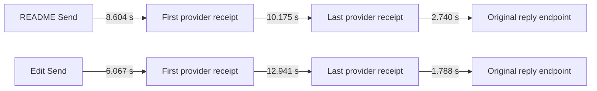
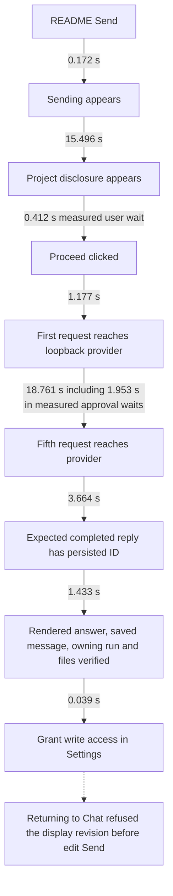
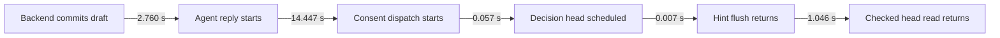
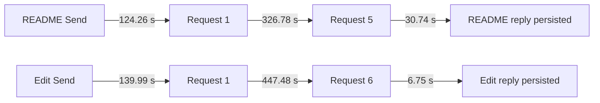
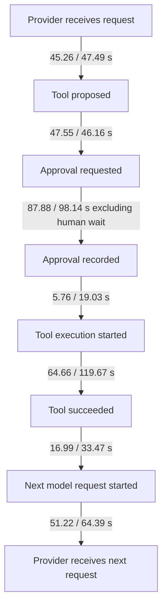
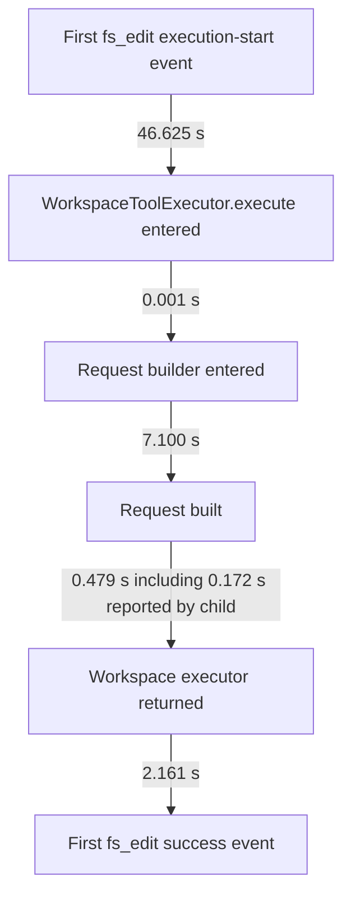
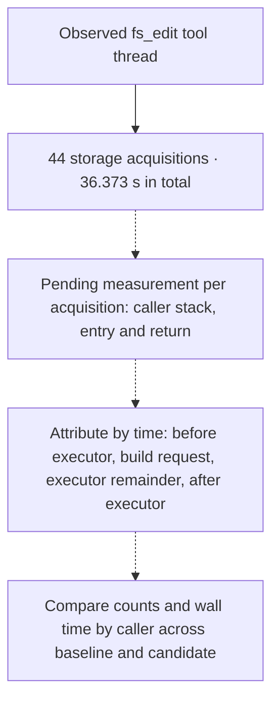
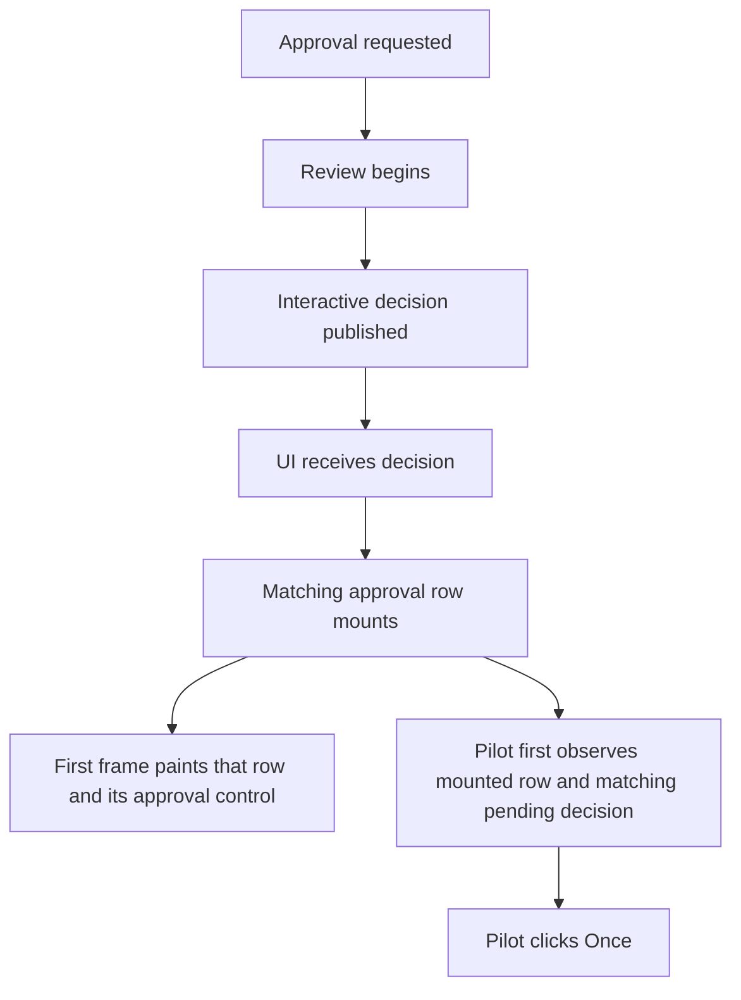
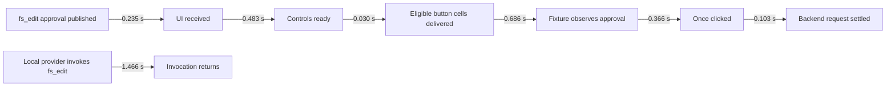

# Windows journey timing tracker

TASK-40608 measures from Send to the persisted reply, subtracting only the original measured disclosure and approval waits. Each of three sequential baseline/candidate pairs must preserve all original journey assertions. Every candidate README and approved edit must finish in under 5 seconds, with at least a 30% median reduction for each journey. The measurements below come from Windows 10 and the scripted loopback provider. [Task and benchmark contract](../../../backlog/tasks/task-40608%20-%20Investigate-slow-Windows-Console-workspace-chat-and-edits.md) · [Original timing observer](original-journey/task40608_trace.py)

The latest three sequential Windows 10 pairs used the original local baseline and the opt-in process candidate at `5fd0c8cd5e`. Median README time fell **254.99 → 18.59 s (92.71%)**. Median approved edit time fell **361.64 → 20.80 s (94.25%)**. All twelve turns and shutdown checks passed. **0 of 6** candidate turns finished under five seconds. Regular startup selected the local backend at that revision. [Verified results and original receipt hashes](original-journey/qd-windows10-results.json)

### First completed diagnostic with the default Windows runtime and shared writer

Both original journeys passed on `498cba77b6`, including two README approvals, three edit approvals, all eleven loopback requests and shutdown. The additional writer guard recorded two elected writers serving and retiring, with zero blocked destinations. The original timer reported **27.5362 s for README** and **34.7203 s for approved edit** after subtracting the recorded human waits. The run was a single diagnostic while other development tests were active. The earlier matched results above refer to a different candidate.

README took 14.4103 s from Send to first HTTP, including 0.6645 s of measured disclosure wait. Edit took 9.1038 s to first HTTP. Provider response handling totaled 0.0326 s and 0.0132 s respectively. The database held eleven normalized trace calls and eleven response links after verification. The frozen source manifest was `a1e034270127cdae3da2801d8d3dd0fd2fc2a8d1fb169624b45579a63d2997c8`. [Runtime and writer ownership](../../../backlog/decisions/126-complete-local-backup-and-recovery.md#task-40608-external-console-runtime-and-profile-writer)

### Matched run of the default external runtime

Batch `qe` uses baseline `b6b53f084a63058ca4b4dac99e074cff42192f7e` and
candidate `854bac202165793abbf9ebcfe6b683f7224d4aa2`. Its candidate manifest
SHA-256 is `41329ce77c0d1243cd5df6d6978400df6f92f415c269018ad1da545a8e012abd`
and its pair configuration SHA-256 is `40142a06d0f05cf349e506890cb474f05d942059e1945d202d3cacd5ef567269`.
The original driver orders the arms B1/C1, C2/B2 and B3/C3. The first
baseline started on November 19. The later config, display and Notes
changes on the draft PR require their own candidate measurement.

## Remaining time on the latest fully paired candidate

Pair 3 took **21.5187 s** for README and **20.7955 s** for approved edit. Each arrow covers a different part of the same original turn.

| Candidate turn | Send → first receipt | First → last receipt | Last receipt → original reply | Adjusted total |
|---|---:|---:|---:|---:|
| README C1 | 8.5456 s | 8.1075 s | 1.5059 s | 18.1591 s |
| README C2 | 8.6046 s | 8.6086 s | 1.3737 s | 18.5869 s |
| README C3 | 8.6036 s | 10.1754 s | 2.7398 s | 21.5187 s |
| Edit C1 | 5.3038 s | 13.0672 s | 2.4525 s | 20.8235 s |
| Edit C2 | 5.5517 s | 12.5610 s | 1.7897 s | 19.9024 s |
| Edit C3 | 6.0668 s | 12.9409 s | 1.7878 s | 20.7955 s |

Only the original observed human disclosure and approval waits are deducted. In pair 3 the loopback handlers used 0.0187 s for all five README requests and 0.0087 s for all six edit requests. The candidate used the original `reply_seen` fallback and passed the subsequent persisted reply, painted UI, file and shutdown assertions. [Verified results and original receipt hashes](original-journey/qd-windows10-results.json)

In pair 3, edit's three approved rounds together took **9.787 s** after human waits. The following boundaries use the fixture's loopback clock and actual approval observations. The intervals cover dispatch, rendering, persistence and file work.

| Edit tool | Provider receipt → approval observed | Once click → next provider receipt |
|---|---:|---:|
| `fs_read` | 1.282 s | 1.516 s |
| `fs_edit` | 1.438 s | 2.017 s |
| `git_diff` | 1.804 s | 1.729 s |

[Earlier paired candidate and original phase measurements](original-journey/qc-windows10-results.json)

### Ranked foreground changes to investigate

1. **Reduce repeated work between provider requests, especially on edit.** In the earlier QC pair 3, the edit rounds containing `fs_read`, `fs_edit` and `git_diff` took **3.791, 3.629 and 4.326 s**. Together those rounds used **11.746 s**. README's `fs_list` and `fs_read` rounds used **4.002 and 3.516 s**. These are request-to-request envelopes. They include approval presentation, tool dispatch, process work, step commits and the next model request. The earlier instrumented `g47d` assigned 9.153 s to approvals, 5.991 s to tools and 5.154 s to the union of step writes and run-log appends across both turns. It left 8.544 s of inter-model time unassigned. Target the calls between `AgentService._run_one`, the scoped permission store, `WorkspaceToolExecutor.execute` and the next `ConsoleProviderGateway._stream_generic_chat`. Group adjacent verified reads only within a single admitted operation. Keep every Once decision, fresh kill-switch and path check, before/after file proof, commit-before-callback and physical worker exit. [Earlier foreground breakdown](#a-replacement-design)
2. **Shorten foreground preparation before request one on both paths.** That stretch alone exceeded five seconds in all six samples. In `g47d`, provider composition included **1.939 / 1.451 s** awaiting `prepare_project_index_for_composition`. Complete configuration capture took **1.429 / 1.305 s**. The durable commit and its parent acknowledgement took **1.227 / 0.530 s**. The edit's then-observed nested permission-process startup has since been removed. The current whole-turn comparison has no exclusive per-caller times. A fixed preparation owner can batch source reads for one selected binding and hand one result back after physical retirement. Retain the original source, registry, membership and archive checks, cancellation and ordered adoption. Starting optional index creation before an earlier prerequisite could fail would change observable state. [Preparation and ownership evidence](#cost-evidence)
3. **Publish a committed terminal row from its backend owner.** In the earlier QC pair 3 the entire tail was **2.090 / 2.522 s**. In `g62reads1` the explicit terminal full-display read took **0.912 / 0.951 s**. A scoped terminal row could be displayed as soon as the accepted turn and native resources have positively retired. The original full reconciliation, acknowledgement and same-visit validation still have to run. The tail includes other work, and these two measurements used different runs. [Display measurements](#periodic-display-work-during-send)

The paired receipts assign elapsed time to the arrows and tool rounds. They do not divide that time among Python execution, lock waits, the Windows scheduler, native calls or independent display work. In particular, the `g62` passive-display overlap spans **9.402 / 10.260 s** during a turn that can make foreground progress concurrently. Counting that overlap as recoverable latency would double-count time. The 2,000-row index test and the faster warm-lease component test measure separate workloads. [History query](#source-checks-during-both-completed-windows-turns)

### Matched Windows scheduling experiment

On November 18, `g69d` and `g69t` ran sequentially on Windows 10 build 19045. Both used the same `b334c52d7e` product, original QA, loopback provider and fresh profiles. The treatment changed only the backend's Windows wait resolution and CPython switch interval to 1 ms. All four turns passed the original assertions and shutdown, including five/six requests and two/three ordered Once decisions. Both backends restored their settings. [Matched numeric results and source hashes](original-journey/g69-windows10-scheduling.json) · [Reproduction method](original-journey/DIAGNOSTICS.md#g69-backend-scheduling-experiment-recovery)

| Arm and journey | Send → first receipt | First → last receipt | Last receipt → persisted reply | Adjusted total | Parent admissions / reuse hits |
|---|---:|---:|---:|---:|---:|
| Stock README | 8.937 s | 9.230 s | 1.589 s | **19.757 s** | 91 / 91 |
| 1 ms README | 8.868 s | 8.607 s | 2.210 s | **19.684 s** | 91 / 91 |
| Stock edit | 5.588 s | 12.901 s | 1.681 s | **20.170 s** | 33 / 33 |
| 1 ms edit | 6.184 s | 13.532 s | 1.888 s | **21.604 s** | 47 / 47 |

README improved by 0.073 s (0.37%) and edit regressed by 1.434 s (7.11%). The large synthetic warm-lease gain did not carry over to the original turns. Keep the stock settings. One matched diagnostic does not establish a scheduling effect across hosts. Parent admission counts exclude the backend. [Windows timer resolution and power trade-off](https://learn.microsoft.com/en-us/windows/win32/api/timeapi/nf-timeapi-timebeginperiod)

The recorded interpreter setting is the outer backend setting. Both arms still executed the product's existing shorter-interval scopes during bounded reads.

Later runs `g62`, `g63` and `g66` are individual diagnostics. Their clocks and application revisions are separate from the three paired candidates in the diagram.

### What the backend admission observer actually covered

On `g66warm1` (`b334c52d7e`), the original fixture passed both turns and shutdown. README took 25.5269 s (11.8570 / 10.9154 / 2.7545 s over the three adjusted intervals above). Edit took 26.1026 s (8.0841 / 15.0171 / 3.0014 s). The parent reported 96 and 50 storage admissions, all with reusable evidence. Five and six provider requests and all two and three Once approvals arrived in order. Original receipt SHA-256: `5499176db2b4c0653249c5816441e3baa49fe92554ad17f8b16e758f962f326b`.

The separate backend observer stopped 11.299 s after README Send, 0.928 s before the first HTTP receipt. Its exact-code guard encountered a second nested function with the same qualified name. Four calls were unfinished. Across 189 completed admissions in the covered prefix, taking the union of overlapping intervals gives 4.041 s in input checks, including 2.507 s in metadata. Forty-two pairs of inputs overlapped. None had a second client already waiting when the first began. This trace supports investigating how concurrent checks interact with Windows scheduling. It provides neither an edit profile nor measured savings from sharing an in-flight check. Numeric stream SHA-256: `866430551dd6bac93cb920f2856a4d22a9f9d1dfe2fde21d34d98622e5a8740f`.

The corrected observer on `g66warm2` had no source refusal and one unfinished observation. The original UI timed out waiting 1,800 seconds for the project-disclosure button, with zero HTTP requests. The backend guard finished and the UI guard did not. The trace captured no underlying application exception. This run failed before either journey supplied a timing.

### CPU use on the current product revision

The guard-only process build at `4c2860349a` passed both original Windows 10 journeys in `g70c`. README took **20.3563 s** (8.7877 / 9.5933 / 1.9753 s across the adjusted intervals). Edit took **24.3292 s** (6.3657 / 16.2899 / 1.6736 s). The parent recorded 98 and 48 admissions, all reuse hits. The independent guards, five/six requests, two/three ordered Once decisions and shutdown passed. The original receipt SHA-256 is `6f9e93605fd96a3f7c2ae4649b05e4ac9e1e03ec617b4ca2cf35a2bd40047d34`. The same revision passed 632 hosted Windows tests and 22 subtests, with two skips. Ubuntu passed all 82 configuration, index, migration and recovery tests. [Hosted results](https://github.com/rmusser01/tldw_chatbook/actions/runs/44359551011)

An external sampler measured actual UI and backend process CPU counters against the guard's original timestamps. Edit's first-to-last provider interval was **18.260 s raw**. The UI used **13.875–14.219 CPU-s**, including 0.781 kernel CPU-s. The backend used **16.109–16.484 CPU-s**, including 5.891–6.000 kernel CPU-s. The ranges enclose samples that straddled each boundary. These processes ran concurrently. Adding their CPU time would overstate elapsed time. The sample began after README Send and has no full-phase upper bound for that first interval.

The sampler itself used **14.891 CPU-s over 70.751 s**. That load limits comparisons with unobserved runs. Use these counters to locate work in both processes and keep the original sequential pairs as the acceptance evidence. Raw numeric counter SHA-256: `4a487abc8f9abe4cd9aa99a58b71ef51f3ba070e84f8113a4ec8c3897cb5e78c`.

### Where the two processes spent CPU

A separate Windows 10 run on `4c2860349a` passed the original README and approved edit in **21.2700 s** and **21.0923 s**. Both guards retired. The original five/six requests and two/three Once approvals completed. An optional sampler read each observed thread's Windows CPU counter and associated the interval with its ending Python stack. The table sums only whole intervals inside Send → first HTTP or first HTTP → persisted reply. Those windows include the original human waits.

| Sampled endpoint across both turns | Backend CPU-s | UI CPU-s |
|---|---:|---:|
| Application | 24.750 | 2.344 |
| Textual or Rich | 0 | 7.234 |
| Python standard library | 17.266 | 15.578 |
| Fixture or other dependencies | 0.250 | 0 |
| Unqualified endpoint | 0.453 | 3.969 |

Backend samples repeatedly ended in Windows handle opening, handle information and security-descriptor reads. They occurred during character metadata reads, trace persistence, recovery history and hook permission checks. The UI often sampled inside the Windows event loop after it had processed messages. Interval CPU can accrue before the sampled frame starts, so these figures cannot identify recoverable CPU in a single method. The two processes run concurrently.

The observer threads used 0.594 CPU-s in the UI and 0.078 CPU-s in the backend. No sampling cap, missed thread counter or handle-close failure was reported. The original receipt SHA-256 is `711face30206fe0f42c4c53f0faf858d4b271c1ee2f482880405e5dfbf20e35d`. The source-qualified numeric readout SHA-256 is `9b6060356565281f002fc41fae519294048525c7a16bf08ce98755407d161371`. This diagnostic supplies no new baseline/candidate comparison.

### What scales with the number of widgets

One activity update reconciles the headers of all retained activities. The previous renderer called Textual's layout-requesting `Static.update` twice per header. With eight mounted activities, a final status change and an externally restyled first label produced 16 updates. Comparing each freshly derived label/status with the installed styled content reduced that to **two updates**. The original class, focus, layout and timer checks still ran. All 67 activity-widget tests passed on Windows.

The original test also does work proportional to **mounted widgets × polling rounds**. Each `Pilot.pause(0.05)` calls Textual's screen barrier, which queues one callback per mounted widget. In the older `g60` README interval, nine of 14 sampled UI dispatch lookups were idle-handler lookups. That sampling does not establish how much time the barrier adds. Both measurements below keep the original fixture and its barrier intact.

| Guard-only Windows 10 run | README adjusted | Approved edit adjusted |
|---|---:|---:|
| Preceding product `4c2860349a` | 20.3278 s | 22.5537 s |
| Header change `5fd0c8cd5e` | 21.4514 s | 23.9275 s |

The one sequential comparison recorded **5.53% and 6.09% longer** turns. All four turns passed their original checks, including the two/three Once approvals and shutdown. The eight-header fixture establishes fewer redundant layout requests. This timed comparison supplies no journey speedup and cannot attribute the difference to layout alone. The earlier three-pair comparison still supplies the acceptance figures. [Both original-receipt hashes, phase splits and parent admission counts](original-journey/g72-windows10-activity-headers.json)

On the same candidate, a separate instrumented run counted the cycles and callbacks in the unchanged Textual test barrier. Both original journeys and both process guards passed. Every observed barrier returned successfully.

| Send to original reply | README | Approved edit |
|---|---:|---:|
| Adjusted journey duration | 25.0793 s | 28.9114 s |
| Original Pilot screen waits | 211 | 203 |
| Successfully queued callbacks | 109,533 | 124,249 |
| Wall time overlapping those waits | 11.5934 s | 16.2164 s |
| Header sync calls | 21 | 39 |
| Total time inside those header calls | 0.0094 s | 0.0119 s |

Sampled README screen trees contained 502–575 mounted objects, of which 360–401 were hidden. Edit samples contained 572–641 mounted objects, with 393–425 hidden. The right rail accounted for 90 hidden objects. Pilot waits for callbacks while the app continues running. Only the original human waits were deducted from journey duration. Header rendering occupied milliseconds, and the barrier's overlap does not measure the speedup obtainable from reducing the mounted tree. [Phase counts, guard results, original hashes and verification instructions](original-journey/pilot/README.md)

### Current three-pair run on Windows 10

Batch `qd` started on November 18 at 18:38 UTC. It compares the original local baseline `b6b53f084a` with the clean process candidate `5fd0c8cd5e` in B1/C1, C2/B2, B3/C3 order. Configuration SHA-256 is `0628029152ad522fa7328e44d76b520e0d051ed1e71661084e6034dbcfdd0479`. The candidate manifest SHA-256 is `a6808c9521e068d2d4587ac4d3eb9067651d8de0e50cae684b09132547204f62`. The driver records each original run and can retain completed pairs after interruption. [Driver and verification contract](original-journey/README.md)

| Completed pair | README baseline → candidate | Edit baseline → candidate |
|---|---:|---:|
| 1 | 306.1657 → 18.1591 s | 430.4508 → 20.8235 s |
| 2 | 241.9415 → 18.5869 s | 341.3939 → 19.9024 s |
| 3 | 254.9937 → 21.5187 s | 361.6412 → 20.7955 s |

All three pairs completed in order. README candidate times ranged from 18.16–21.52 s and edit from 19.90–20.82 s. Both median reductions exceed 30%. All six candidates exceeded five seconds. [Verified results and original receipt hashes](original-journey/qd-windows10-results.json)

## Where the time goes

On the separate Windows 10 diagnostic `g57s` (`5a8b730cfa`), README
verified 24.094 s after Send. About 2.17 s after edit Send, the backend
reported that the sixth preparation read failed its retirement check. Six
reads and zero ordinary-turn trees had been registered. The terminal receipt
failed, later display admissions refused, and the edit made no HTTP request.
The sink identifies the read ordinal. Its exact native resource is still
unknown. The first 9,502 bytes of the diagnostic sink had SHA-256
`851718f6dc47c3afef508a63995a57e50edb4f86bd070ac47fe4e3795a447839`.
This diagnostic began after the separate `qa1c3` Send had already failed.
That fixture was still polling during `g57s`. Neither failed edit supplies
a qualifying time.

On the same frozen product, `g58r` recorded the failing resource inside
the final configuration read. The original callback and worker had both
finished. Of two enrolled SQLite connections, the last was still open when
the original retirement check ran. The edit received its Applied acknowledgement
and its terminal failure, with `Retired=false`. This identifies the callback
on `g58r`; read ordinals vary across runs. The process exited with code 1 and
the guard did not certify shutdown. The original `qa1c3` and `g57s` waits
were still polling during this separate diagnostic. The retirement receipt
has SHA-256 `3e86ea5b5d702c5bc5d57685f5c7ef12a104c52725fb791d8a09cc0f48d979e2`.

The next diagnostic, `g59f` on `db67b4ccea`, isolated final configuration
capture on a fresh worker. README verified after five provider requests.
Send to persisted reply took 26.2488 s raw and 23.9844 s after the original
wait deductions. First HTTP arrived at 11.0856 s. The next four requests
arrived 1.7149, 1.5249, 5.4101 and 4.5661 s apart. The loopback server
spent 0.0155 s servicing the five requests.

Edit reached Applied and failed before its first HTTP request. The sixth
registered read observed one still-open connection and zero new storage
acquisitions. Its callback and handoff had finished. The diagnostic could
identify the controller, but its callback was outside the pinned source list.
A focused saved-chat test with the original workspace Library binding
reproduced the same sixth-read refusal during the Library policy lookup.
Both application processes exited. The guard did not certify shutdown.
The receipt has SHA-256
`48db0b9fd48bd3803b67474e0df23ef8b8347eaf8ad8dfb0fd3d94df7d7ce73f`.
The earlier failed `g57s` fixture was still polling during this diagnostic.

`g57s` subsequently exited at 14:07:21 UTC with pytest code 1. Both
application processes exited. The original guard did not certify shutdown.
The next diagnostic, `g60f` on `41a4d02006`, started its application at
14:08:30 UTC. README reached its persisted reply in 24.8424 s raw. The
first HTTP request arrived after 11.07 s. The intervals between consecutive
requests were 2.69, 1.81, 3.86 and 3.86 s, followed by 1.52 s to the reply.

The source-verified backend checkpoint covered 237 sampling ticks after
the first request. Windows file operations appeared on 147 ticks. Preparing
the periodic or requested full display accounted for 66 distinct ticks with
native work. These included 29 ticks in readiness, 11 in workspace counts
and 26 in the physical display phases. The agent thread itself spent 67
ticks waiting in the provider bridge, 41 in approval rounds and 29 joining
the tool worker. Worker stacks and waits can overlap. These counts locate
competing work and cannot be added as time savings. The source-validation
checkpoint itself took 7.37 s in the backend and 15.87 s in the UI after
README verification, which can affect the Settings visit and the edit.
[Diagnostic source and method](original-journey/DIAGNOSTICS.md#windows-stack-sampling)

The original adjusted README time was **23.0002 s**. The fixture then
timed out waiting for the actionable workspace row in Settings. The
stored UI exception came from the README Send's final display refresh,
which found the original attachment visit had changed across navigation.
Edit never reached Send. The backend guard finished with exit code 0.
The UI exited 1 without a completed guard, and both processes exited.
The original receipt SHA-256 is
`d9dd2c2478edff56f270d8159194262d2d701fdeaeec03590cd06f450d1319bc`.

The latest completed candidate in batch `qa`, `qa1c2` on frozen `e4fa0ea67d`, provides these raw intervals on the original Send clock. Each arrow subtracts its two adjacent recorded timestamps; intervals containing approvals include those waits. The application-time gate uses the fixture’s separately recorded disclosure and approval waits. Exact `fs_edit` invocation and approval stages from the instrumented run are [below](#completed-instrumented-windows-journeys-g47d).

```mermaid
flowchart LR
    RS["README Send"] -->|"0.136 s"| RF["Sending painted"]
    RF -->|"11.543 s"| RD["Project disclosure painted"]
    RD -->|"0.381 s measured wait"| RC["Proceed clicked"]
    RC -->|"1.246 s"| RH["First HTTP"]
    RH -->|"15.466 s, two approvals"| RL["Fifth HTTP"]
    RL -->|"1.318 s"| RR["README persisted"]
    RR -->|"0.700 s"| RV["Verified"]
    ES["Edit Send"] -->|"6.361 s"| EF["Sending painted"]
    EF -->|"2.059 s"| EH["First HTTP"]
    EH -->|"18.074 s, includes read approval"| EA["fs_edit approval observed"]
    EA -->|"0.665 s measured wait"| EC["Once clicked"]
    EC -->|"3.511 s"| EN["Fifth HTTP"]
    EN -->|"5.466 s, includes diff approval"| EL["Sixth HTTP"]
    EL -->|"2.728 s"| ER["Edit reply persisted"]
    ER -->|"0.935 s"| EV["Verified"]
```

The arrows sum to 30.0909 s raw for README and 38.8634 s raw for edit, before the separate verification arrows. Both journeys passed their original assertions and shutdown. The source is `original-journey-e4fa0eclean/replay-runs/qa1c2/progress.jsonl`, SHA-256 `69a9b8d97d8134ee912f9de6189719a313a5029406beab2d31a7445c4d472089`, verified against the pair driver’s artifact ledger. Arrow labels are rounded independently. These intervals locate elapsed time; they do not attribute it all to the operation named at the next node.

On `g29` (`50e868df9f`), the README journey passed every original assertion. The arrows use adjacent timestamps on the original journey clock. The last two events happen after the timed reply.

The four `g29` intervals between provider requests took **1.933, 2.051, 6.540 and 6.284 s** after the measured approval waits, totaling **16.808 s**. Over the same boundaries the completed baseline took **319.329 s**, and the earlier `g27` diagnostic took **12.051 s** (1.760, 1.610, 3.520 and 5.161 s). The `g27` run failed its final row assertion. The two diagnostic runs have different instrumentation and supply no paired estimate.

On the earlier `g25` run, Send to first request took **14.267 s**. The interval from Send to painted disclosure took **12.633 s**. A separate UI observer recorded **3.328 s** from entering Send capture to the draft commit returning. It first sampled the modal present **9.219 s** after that return. These same-observer deltas locate a large gap after the draft commit. Sampling cannot distinguish backend preparation, notification delivery, UI scheduling and paint within the gap.

## What changed between replays

| Windows run | Change being exercised | Send to painted disclosure | Measured disclosure wait | Click to first request | Send to first request | Furthest verified event |
|---|---|---:|---:|---:|---:|---|
| `g21` | Dedicated display worker | 14.609 s | 0.179 s | 1.796 s | 16.584 s | First response. A later passive display read failed when modal visibility changed. |
| `g22p` | Instrumented agent preparation | 14.728 s | 0.160 s | 1.067 s | 15.955 s | Three provider requests. The approval message encoder refused the tool effect. |
| `g23` | Shared modal and display visibility checkpoint | 15.167 s | 0.217 s | 2.409 s | 17.792 s | Tool approval clicked and fourth provider request received. |
| `g24` | Isolated filesystem worker launch | — | — | — | — | Stopped during workspace setup, before Send. |
| `g25` | Isolated worker with dependency roots in its regression test | 12.633 s | 0.311 s | 1.323 s | 14.267 s | First provider response. A decision refresh failed. Neither reply completed. |
| `g26` | Modal dismissal waits for restored visibility, with backend disclosure instrumentation | — | — | — | — | The backend issued the disclosure. A passive readiness read refused a change in the active agent selection before the pilot observed the modal. |
| `g27` | Same-turn retry after a retired readiness read on `f08b23a708` | 12.407 s | 0.733 s | 1.291 s | 14.431 s | Five provider requests and two approval clicks. The fixture found the expected completed assistant message with a persisted message ID at Send +30.132 s (28.352 s after measured waits). The final assistant row lookup then timed out during evidence verification. The edit did not run. |
| `g28` | Checked first-persistence marker refresh on `0be0ccab9e` | 13.754 s | 0.935 s | 1.338 s | 16.026 s | Expected persisted reply at +33.867 s (32.023 s adjusted). All 12 observations during the final row wait found the reply in both the published snapshot and the transcript widget's message list. The reply belonged to the visible window, yet its row was absent. The 300 s assertion expired. |
| `g29` | Mount the original transcript rows on `50e868df9f` | 15.667 s | 0.412 s | 1.177 s | 17.256 s | README passed its original checks, including paint, persisted answer, run ownership and unchanged files. The reply took 39.681 s raw and 37.316 s adjusted. The Settings round-trip for write access failed before edit Send. |
| `g30` | Refresh the resumed Chat through the checked read, and use the existing permission owner for the virtual CLI kill-switch lookup on `aab319544e` | — | — | — | — | Workspace setup stopped before Send. The configuration cache changed identity during the readiness read. The original source check refused the new identity. This run provides no timing for either fix. |
| `g31` | Same product, with parent and backend configuration writers observed on `f9c9e964cc` | 10.938 s | 0.461 s | 1.324 s | 12.723 s | README passed at 30.589 s raw and 28.367 s adjusted. The manual unread reminder read the store before the resumed Chat received its current display. The edit did not reach Send. |
| `g32f` | Foreground and corrected approval v3 observers on frozen `997b3339ff` | 10.530 s | — | — | — | Project disclosure painted; no click or provider request. ReadProjection failed at application in `require_retired_context_change:861`. No completed journey or tool-approval measurement. |
| `g33p` | Separate readiness predicate diagnostic on the same `997b3339ff` product | 11.847 s | 0.420 s | 1.397 s | 13.663 s | README passed all original checks at 30.786 s raw and 29.241 s adjusted. Returning from Settings failed at `_require_selected_publication:75`, before edit Send. The readiness verifier failure from `g32f` did not recur. |
| `g34f` | Separately reviewed foreground/approval v3 candidate on `46ff4b9ed8` | — | — | — | — | Workspace setup stopped before Send. ApplySourceRevision was refused at admission in `_require_rail_publication:294`; neither journey started. |
| `g36f` | Retained display owner on `f0709ee4c0` | — | — | — | — | Workspace creation and New Chat completed. After README Send, Sending painted in 0.0824 s. The received turn failed before disclosure or the first HTTP request. Neither journey produced a completion time. |

The 2.318 s difference in time to first request between `g21` and `g25` is an observation across two diagnostic runs. Several code and instrumentation changes separate them.

The `g26` observer recorded the backend's path on `55d99ac500`. From its committed-draft checkpoint, memory preflight started at +2.060 s and took 0.195 s with one storage admission. Agent reply started at +2.760 s. Startup instruction lookup took 0.018 s. The last observed binding lookup before dispatch returned at +4.277 s. Another **12.930 s** elapsed before consent dispatch began. This interval crosses work outside the observed binding functions. Its cause is still open.

All six events above use the same backend clock. The observer recorded 18 source-pinned targets, zero errors or refusals, and zero unfinished calls. It supplies no parent modal-paint or provider-receipt time for this run. The source receipt is `g26/artifacts/lab-observer/agent-prefix-3032.jsonl` in the disposable Windows profile.

## Cost evidence

| Measurement | Scope | What it establishes |
|---|---|---|
| 1.568 s to first yield in agent preparation | `g22p`, nested measurement | Progress, roster and pending-note reads took 0.193, 0.184 and 0.165 s, with two storage admissions apiece. These times are included in the enclosing work. |
| 4.831 s and 49 inclusive storage admissions | `g25`, backend agent-reply invocation | The model call took 1.388 s within this invocation. This covers work around the first provider call and supplies no exclusive cost for the pre-disclosure gap. |
| 623 README / 620 edit admissions before first HTTP | `q2`, first baseline | Whole turns incurred 2,042 / 2,561 storage admissions. These counts describe the baseline. |
| 22 of 79 stack samples between committed draft and consent | `g29`, backend sampler | The virtual CLI provider's live kill-switch read was waiting for `PermissionProcess._start` to receive the nested permission process's startup response. The whole interval lasted 10.965 s. Sample counts identify the waiting caller and do not give an exact duration. |

## Where the 400-plus seconds went on the completed baseline

Both original journeys finished on `q21b1`. The arrows below partition raw elapsed time at the first and last requests **received** by the loopback server. They include the human waits shown separately in the table. This baseline and the shorter, partial candidate traces above have different endpoints.

| Original Windows baseline | Raw Send to reply | Measured human waits | Application time | Total inside loopback handlers |
|---|---:|---:|---:|---:|
| README | 481.77 s | 3.80 s disclosure + 7.45 s approvals | 470.52 s | 0.197 s |
| Approved edit | 594.22 s | 19.14 s approvals | 575.08 s | 0.020 s |

After removing the measured waits, the interval **between the first and last provider requests alone** accounts for 319.33 s on README and 428.34 s on edit. That interval includes tool review, execution, persistence, display, and preparation for subsequent requests. For scale, the edit's `fs_edit` took 56.37 s from the first tool-start event to success. The workspace executor took 7.58 s inside that interval, and its worker reported 0.172 s. The trace locates substantial application time outside the worker without assigning it all to one cause. Source receipts are `original-journey-win10-before-guarded/replay-runs/q21b1/{progress.jsonl,timings.json}` under `test-snapshots`.

### Between consecutive provider requests

Each arrow adds up the same interval across all four README rounds or all five edit rounds. Arrow labels give **README / approved edit**, in seconds. The requested-to-approved interval excludes the original measured time from observing an approval to clicking it.

The first arrow includes 0.030 / 0.018 s in the loopback handler, 14.026 / 15.142 s from sending its response to the application's first model-complete event, and 31.205 / 32.325 s from that event to the tool proposal. Of the 87.88 / 98.14 s between requesting and recording approval, **69.278 / 73.104 s** elapsed between requesting an interactive approval and the pilot first observing it. The remainder includes the other approval decisions and the interval after a click. The trace records when the pilot observed each prompt. Its exact first paint in those rounds is unknown.

| Journey and request interval | Tool | Proposal → execution start, s¹ | Execution → success, s | Provider receipt → proposal + success → next receipt, s | Total application time, s | Storage acquisitions² |
|---|---|---:|---:|---:|---:|---:|
| README 1→2 | `find_tools` | 22.02 | 0.75 | 23.12 | 45.89 | 210 |
| README 2→3 | `load_tools` | 16.73 | 0.87 | 34.93 | 52.54 | 216 |
| README 3→4 | `fs_list` | 43.06 | 30.32 | 31.74 | 105.13 | 481 |
| README 4→5 | `fs_read` | 59.38 | 32.72 | 23.68 | 115.78 | 455 |
| Edit 1→2 | `find_tools` | 18.73 | 3.85 | 24.31 | 46.89 | 202 |
| Edit 2→3 | `load_tools` | 20.38 | 2.92 | 17.72 | 41.02 | 193 |
| Edit 3→4 | `fs_read` | 48.69 | 34.10 | 31.98 | 114.77 | 494 |
| Edit 4→5 | `fs_edit` | 44.08 | 56.37 | 38.26 | 138.70 | 550 |
| Edit 5→6 | `git_diff` | 31.44 | 22.44 | 33.08 | 86.96 | 463 |
| **README total** | | **141.19** | **64.66** | **113.47** | **319.33** | **1,362** |
| **Edit total** | | **163.33** | **119.67** | **145.34** | **428.34** | **1,902** |

¹ Application time excludes the original measured human wait. Columns are rounded independently. Each round is bounded by two successive requests received by the server. Within it, repeated copies of the same agent step use the first matching event for that tool call.

² Counts use differences between cumulative `_acquire_storage` observations at consecutive HTTP **sends**. They include concurrent activity. The 550 acquisitions on the `fs_edit` round span two provider requests. The narrower tool-execution interval below has its own counts.

### Inside the 56.366-second edit

The main gap is the **46.625 s before workspace executor entry**. The entire executor took 7.580 s. The interval after request construction includes child launch, communication, and return handling. Subtracting the child's reported 0.172 s leaves approximately **0.307 s** in that interval and **56.194 s** outside the reported child time across the whole edit.

A second receipt measured **44 calls to `_acquire_storage` on the `tool-fs_edit` thread, totaling 36.373 s** under the execution-start phase. Its longest call took 6.425 s. Across all 18 threads with acquisitions in that phase, 187 calls accumulated 248.868 thread-seconds. These calls overlap the wall-clock arrows above. The receipt aggregates by entry phase, function and thread, so it cannot place individual acquisitions before or inside the executor. The phase costs come from `native-7aec54d3/costs.json` alongside the `q21b1` progress receipt.

For this edit, 29.599 s elapsed from requesting approval to the pilot detecting the mounted approval row, 7.078 s from detection to button press, and 0.768 s from press to the first recorded approval. The trace captured no paint event for that prompt and no edit stack sample within the 46.625 s before executor entry.

For the baseline/candidate comparison, track the outer approval interval, the 46.625 s from tool start to executor entry, and the 7.100 s request-build interval separately. Match admission start/finish to the same tool call and thread to measure the part on the critical path. Preserve the original authorization, storage checks and positive completion checks.

### Trace ownership of each storage acquisition

The baseline receipt contains no per-acquisition stacks. In the diagnostic run, correlate `_acquire_storage` entry and return with the specific `fs_edit` call, thread, and executor/build boundaries. Split time at any crossed boundary. Group by code location and retain count, total, and longest call. Check that grouped calls reconcile to that run's count. If the count changes from 44, show both runs. Keep background threads and nested intervals separate from the foreground wall time.

### Trace each interactive approval from request to paint

The arrows identify observation points for the next diagnostic. Paint and pilot observation have independent timestamps. Measure both against the same request, including any time between publication and UI delivery. Record the synchronous policy-check interval, queue wait and event-loop delay separately where the trace supports it. Keep any missing paint or boundary visible. Compare the same tool, call and visit on the candidate.

| Baseline journey | Approval | Request → first pilot observation | First pilot observation → click | Request → first paint |
|---|---|---:|---:|---|
| README | `fs_list` | 35.927 s | 3.633 s | Unmeasured |
| README | `fs_read` | 33.351 s | 3.820 s | Unmeasured |
| Approved edit | `fs_read` | 23.901 s | 6.382 s | Unmeasured |
| Approved edit | `fs_edit` | 29.599 s | 7.078 s | Unmeasured |
| Approved edit | `git_diff` | 19.604 s | 5.677 s | Unmeasured |

Use the original `q21b1` progress and costs receipts for these historical values. Keep fresh instrumented runs separate from the frozen qualifying pairs.

## Qualifying pairs

The earlier local implementation completed three sequential pairs with the original checks. Its median README time fell 64.33% and its median edit time fell 42.56%. Every candidate exceeded five seconds. The replacement process has its own qualification record below.

The clean Windows 10 batch `qb` started at 14:21:18 UTC on November 18.
It pins the original baseline `b6b53f084a` and candidate
`41a4d020069ae569a50226b010065a88fc1ef744`. Configuration SHA-256 is
`1a734e32b4f0d2fe8c22d30c6f293ebdce8bc9155d107756b5996683186e20c4`.
The order is B1/C1, C2/B2, B3/C3. It uses the unchanged README and approved
edit fixtures. Each side must finish both journeys and pass shutdown to count.

| Clean pair on `41a4d02006` | README baseline / candidate | Approved edit baseline / candidate | Original assertions and shutdown |
|---|---:|---:|---|
| 1 | 341.4389 s / 28.5447 s | 461.5773 s / 28.0529 s | Both sides passed. Candidate first HTTP arrived at 14.5345 s and 9.2941 s. |
| 2 | 340.8681 s / 33.2691 s | 486.3288 s / 40.9775 s | Both sides passed. Candidate first HTTP arrived at 13.4365 s and 10.1955 s. |
| 3 | 309.5547 s / 24.9988 s | 381.9837 s / 24.5348 s | Both sides passed. Candidate first HTTP arrived at 11.8796 s and 7.0852 s. |
| Median | **340.8681 s / 28.5447 s** | **461.5773 s / 28.0529 s** | Elapsed time fell **91.63%** and **93.92%** respectively. All six candidate turns exceeded five seconds. |

The driver completed all six runs in the designated order on one Windows 10
host. Each README made five provider requests and required two approval
clicks. Each edit made six requests and required three clicks. The following
counts come from the original parent-process observer. The candidate moved
storage work into the opt-in backend, whose admission counts were unobserved
in this batch. These figures therefore describe only the parent. Regular
Windows startup still selects the local route.

| Pair | Parent README admissions, baseline / candidate | Parent edit admissions, baseline / candidate |
|---|---:|---:|
| 1 | 2,288 / 100 | 2,485 / 54 |
| 2 | 2,286 / 101 | 2,587 / 71 |
| 3 | 2,228 / 95 | 2,413 / 50 |

Every counted candidate parent admission reused checked evidence. The baseline
recorded zero reuse hits. Even in the fastest pair, adjusted time before
the first HTTP request was 11.535 s for README and 7.085 s for edit. The
remaining application time after that request was 13.464 s and 17.450 s.
Together, the loopback handlers consumed 0.016 s and 0.010 s respectively.
Both sides of the first request need improvement to reach five seconds.
The archived report revalidates all six original receipts and input hashes.
[Numeric report and source pins](original-journey/qb-windows10-results.json)

The original receipt SHA-256 values for pair 1 are
`37cd15b0121e8547b5345e68f471d22f039fdf73daa3fc7bdf8abff4ca2feb21`
(baseline) and
`d903b709c5bb92b4a9a911d1c1c612e0c78ce92039a95e9dde1b7d1381f0ea2e`
(candidate). Both candidate turns exceeded five seconds.
The pair 2 receipt SHA-256 values are
`1db0f406bc3d37008b81c4b496d85bc7c090c722bba2bfc7d5326ee956373f08`
(candidate) and `202134845ed03df558c2e65bcad680506c00dc6dbd310f11c5a9a59354c52c00`
(baseline).
The pair 3 receipt SHA-256 values are
`43d781691d5c0a3b4acc6811719f334c2def7374eb2edf41e1cd609002c183d6`
(baseline) and `4eee5909be99626d916e7861eca0276521320eb38a2c1432e25143d6ee916b38`
(candidate).

The separate `g61w` run tested `495b3249e9`, which includes the subsequent
SQLite batching, metadata and navigation changes. Both original journeys and
shutdown passed. README took 24.9333 s adjusted (26.6694 s raw), with the
first request at 12.4530 s. Edit took 22.1499 s adjusted (24.7043 s raw),
with the first request at 6.2313 s. Its original receipt SHA-256 is
`e63b819c49d30a419c7637f68cfea1c3bb9d30d764702e4f862e3f0d913386e8`.
The separate paired batch `qc` pins this revision. The hosted Windows
controls on the same product revision passed 531 tests with two skips,
including the original bounded Enter test and the Settings navigation cases.
[Hosted Windows control results](https://github.com/rmusser01/tldw_chatbook/actions/runs/44332076725/job/134898850941)

| Clean pair on `495b3249e9` (`qc`) | README baseline / candidate | Approved edit baseline / candidate | Original assertions and shutdown |
|---|---:|---:|---|
| 1 | 326.2255 s / 24.1755 s | 459.1983 s / 24.5370 s | Both sides passed. Candidate first HTTP arrived at 9.7183 s and 7.4541 s. |
| 2 | 291.5947 s / 24.3015 s | 515.7448 s / 22.1905 s | Both sides passed. Candidate first HTTP arrived at 12.3709 s and 5.8483 s. |
| 3 | 303.0308 s / 22.1459 s | 409.9467 s / 23.9084 s | Both sides passed. Candidate first HTTP arrived at 9.8419 s and 6.6822 s. |
| **Median** | **303.0308 s / 24.1755 s** | **459.1983 s / 23.9084 s** | **92.02% and 94.79% median reductions. All six candidate turns exceeded five seconds.** |

In pair order, the parent process recorded 2,322 / 102, 2,175 / 99 and
2,277 / 98 baseline / candidate admissions for README. The corresponding
edit counts were 2,575 / 49, 2,621 / 47 and 2,428 / 50. Every counted
candidate parent admission reused checked evidence. The candidate also ran
a backend process, so these counts alone cannot measure total application
work. All twelve turns completed with their expected five or six loopback
requests, ordered approvals and original file checks.
[Numeric report, source pins and work counts](original-journey/qc-windows10-results.json)

### Periodic display work during Send

The separate `g62reads1` Windows 10 run on the same frozen product passed
both original journeys and shutdown. The client issued 14 full-display reads
starting during README and 15 during edit. Each request had its own waiter.
Each turn retried one passive read after expiry. The two new attempts spent
0.106 s and 0.696 s, respectively, inside the locked read.

| Full-display read, clipped to the original Send and reply marks | README | Approved edit |
|---|---:|---:|
| Passive reads overlapping Send → first HTTP | 5.014 s | 2.914 s |
| Passive reads overlapping first HTTP → reply | 4.388 s | 7.346 s |
| Explicit read before acknowledging the draft | 0.303 s | 0.272 s |
| Explicit read at turn completion | 0.912 s | 0.951 s |

The original Send-to-first-HTTP intervals were 10.155 s and 6.076 s.
The enclosing Send-to-reply intervals were 23.706 s and 25.144 s before
human-wait deductions. The table uses the union of client read intervals,
including time spent waiting on the backend. It includes the overlap of
reads already in flight at Send. A foreground turn can run during a
passive read. Only the explicit pre-acknowledgement and terminal rows
directly measure those Send waits. The original receipt SHA-256 is
`9a655432c6d70d59a504c4f8a4e2d9cedea2545e32bc2bbc2f9b6ff826f2644e`;
the numeric interval stream has SHA-256
`b43578acdc630f4a8cd33e64c46e096b67f08be6a4b88bb7846d7991d75c1bbe`.

The subsequent clean, separately run `g63shared1` on `b334c52d7e`
includes the shared display decoder and lexical parent reuse. Both original
journeys and shutdown passed. README took 28.0708 s adjusted and edit took
23.2481 s, with first HTTP at 12.9851 s and 6.3035 s. The original receipt
SHA-256 is `baceaa64604db17c98219ceb4a464edf7c69ae63d8d0c5aa70f414fe25c7781c`.

On the same Windows 10 host, three separate mounted regression tests on
`9e0ee52112` passed in 193.38 s. They covered Home to Chat, Enter through
the provider and durable terminal reply, and the saved-chat archive
reservation and generation checks. This run exercised the displaced-visit
publication fix. Its pytest duration includes all three setups and teardowns.

A separate scheduling experiment timed complete warm storage leases with
and without a competing Python arithmetic thread. Two samples per cell in
mirrored order yielded quiet medians of 11.546 ms at CPython's default
switch interval and 11.381 ms at 1 ms. Under synthetic load the same
medians were 11.185 s and 11.171 s. All borrowers and the final native
owner retired, and the original interval was restored. Changing the
interpreter interval alone gave little relief in this experiment. The
competing thread does different work from a Console turn. The completed
numeric receipt has SHA-256
`4bb0595f5c6f213e960c4a69515bff2a334d8d09d1d4b83f975e4cca61da9745`.

With the interpreter interval fixed at 1 ms, a second mirrored comparison on
Windows 10 build 19045 changed only the test process's Windows timer
resolution. Under the same arithmetic load, stock-resolution samples were
7.175 and 11.232 s. With a 1 ms Windows timer request they were 1.165 and
1.356 s. Quiet samples were 19.06 and 11.86 ms at stock resolution and
11.65 and 12.24 ms with the request. All eight timed acquisitions retained
their independent checks. The timer request ended, the interpreter setting
was restored and the native owner retired. The result motivates the matched
original-journey experiment above. Its numeric receipt has SHA-256
`3a2e2f24eeb4db9b42adf0b767419e779aa64d5e9edde8b17c2b37b185fac297`.

The subsequent local-parent change on `cae5d57fea` was measured separately
on Windows Server 2022. Each arm used two warmups and 21 timed complete warm
lease acquisitions and closes in a fresh interpreter. The six alternating
baseline / candidate medians in milliseconds were 9.6109 / 9.1920,
9.5522 / 9.0898, 9.6072 / 9.0797, 9.4681 / 9.0776, 9.5498 / 9.1422 and
9.5168 / 9.1685. Across those six medians the saving was 0.4350 ms per
lease (4.55%). The Windows 10 journey batch above pins the earlier revision.
[Hosted component samples and driver](https://github.com/rmusser01/tldw_chatbook/actions/runs/44339331162/job/134924638726)

The same hosted revision passed the new drive-root control, Enter and the
three Settings transfer controls. The Home-to-Chat test surfaced a
`WorkerFailed` with an attachment-visit change at test shutdown. The job
reported 531 passed, one failed and two skipped. Its outer traceback omitted
the original worker's source location. The task's mounted test now preserves
that location on a recurrence. [Hosted mount test](https://github.com/rmusser01/tldw_chatbook/actions/runs/44339331162/job/134924638495)

Batch `q5` started its first clean baseline on Windows 10 at 07:59 UTC on November 18. The driver pinned candidate `a3bf91340319ad7ad60177a37a537ca46364c2e3` and configuration SHA-256 `6af37c73d99d05badc21dc5b570104a3b513414cd213af8cc9464df362f62f93`. Its order is B1/C1, C2/B2, B3/C3. The earlier q4 plan never launched. A separate native component test accepted the corrected rail Apply, then the mounted-writer test failed in its subsequent visible read. Those tests contribute no journey times.

| Earlier local pair | README baseline → candidate | Edit baseline → candidate |
|---|---:|---:|
| 1 | 286.9434 → 112.0680 s | 340.5827 → 168.3232 s |
| 2 | 236.8475 → 84.4768 s | 282.0649 → 162.0053 s |
| 3 | 188.2872 → 80.3125 s | 270.9438 → 112.4925 s |

| Batch | Pair | README baseline / candidate | Approved edit baseline / candidate | State |
|---|---|---|---|---|
| `qa` | 1 | 351.8018 s / 29.5092 s | 407.0190 s / 29.6705 s | Both sides passed the original assertions and shutdown. Candidate first HTTP arrived at 12.3762 s and 7.5064 s. Both journeys exceeded five seconds. |
| `qa` | 2 | 310.5606 s / 28.5109 s | 440.1165 s / 35.9651 s | Candidate `qa1c2` followed by baseline `qa1b2`. Both passed the original assertions and shutdown. |
| `qa` | 3 | 327.1632 s / 27.1404 s raw to persisted reply only | 418.4522 s / — | Baseline `qa1b3` passed and shut down. Candidate `qa1c3` verified README, then edit Send failed before Sending painted or a provider request. The original fixture exited 1 at its reply deadline. The driver rejected the pair. Frozen candidate `e4fa0ea67d`, configuration SHA-256 `334f106cb818be84841ad9e17bbc869d5efa4b8771b69197966942f3fcc31a6a`. |
| `q9` | 1 | 294.9706 s / 23.2802 s | 416.4471 s / 30.0985 s | Both sides passed every original check and shutdown. Candidate first HTTP arrived at 10.4910 s and 7.9268 s (baseline 89.0301 s and 110.7063 s). Both miss five seconds. |
| `q9` | 2, first attempt | — / 27.0388 s to persisted reply | — / — | Candidate `q91c2` painted the README answer. Verification of completed run history raised `ConsoleReadinessExpired` after the database returned the rows. The driver stopped before edit Send or the second baseline. |
| `q9` | 2, resumed | — / — | — / — | On the identical frozen candidate, `q92c2` waited 300 s for the workspace name field. Textual reported an uncaught `ConsoleDisplayExpired` from the deferred rail resize callback. Neither Send ran. The ledger retained pair 1 and pairs 2–3 remain incomplete. |
| `q9` | 3 | Pending | Pending | Frozen candidate `72f36054ea`, configuration SHA-256 `9ee7d9a18ab6bdec4083d192d47a41d7eb2bd2006882f6fc5e2ba4be2e6a84bd`. |
| `q8` | 1 | 295.3187 s / 25.4222 s | 405.5752 s / 36.0400 s to persisted reply only | Baseline passed. The candidate verified README, then timed out painting the edit reply after all six edit requests. Zero eligible pairs. |
| `q8` | 2–3 | — / — | — / — | The driver stopped. Frozen candidate `33470fe57d`, configuration SHA-256 `176e09ef967e1c4bbd5d74f2ccf5af15c36f7d40282d9184d9596eef5cde8b35`. |
| `q7` | 1 | 259.5920 s / 24.0326 s | 386.9812 s / — | Baseline `q71b1` passed both original journeys. On `e761c372a4`, candidate `q71c1` passed the README assertions, then returned from Settings with source revision 2 while the visible projection still held revision 1. The controller getter refused it. The edit never reached Send. |
| `q7` | 2–3 | — / — | — / — | The driver stopped at the first failed candidate. No complete pair or median. Configuration SHA-256 `ecf4fbe02dff4a8615d550a34d57650e2161c552bd664036bc5379682f5e4d96`. The preceding q6 configuration was prepared before the edit-worker fix and never launched. |
| `q5` | 1 | 284.7760 s / — | 374.3431 s / — | Baseline `q51b1` passed both journeys. Candidate `q51c1` timed out after 300 s waiting for the workspace name field. Shutdown also failed to confirm retirement. Neither Send ran. Batch stopped with no completed pair. |
| `q2` | 1 | 470.518 s / — | 575.079 s / — | Baseline passed. Candidate timed out at disclosure. Batch stopped. |
| `q3` | 1 | 312.621 s / — | 392.728 s / — | Baseline `q31b1` passed. On `997b3339ff`, candidate `q31c1` reached the persisted README reply at 30.027 s adjusted and found its mounted row. The original painted-code check timed out at 300 s, and a ReadProjection command failed at application. The edit did not start. |
| `q3` | 2–3 | — / — | — / — | The driver stopped at the failed first pair. |

Times in the pair table use the benchmark's original adjusted duration. A dash means there is no measurement for that cell. With each new Windows result, append its run ID and commit, retain failed rows and update the diagram to the latest measured path. For a performance claim, record the comparable before/after boundary, wall-time delta, available work count and source receipt. Publish qualifying pair rows separately from instrumented replays.

Batch `qa` currently has two completed pairs, so no three-pair median is reported. During `qa1b3` README, separate source-only staging for `g57` created 10,120 hardlinks over 20.640 s (12:27:43.614–12:28:04.254 UTC). This was no additional application workload, but filesystem contention could affect that baseline interval. Keep the measured duration unchanged and retain this caveat when reporting pair 3; the overlap does not provide a measured correction to subtract.

The third baseline’s original receipt SHA-256 is `76812e87f3933d2e54d23f521f11d4f3eab2eb63518c25f0074ab74111f4663a`. The candidate's failed receipt SHA-256 is `84748ff7479fc1f0963985282f515fc6ca385551f66cfd249ca21259d16e36ab`. It verified README at Send +27.5626 s. The edit reached Send at 12:39:23 UTC. The first parent failure at 12:39:24 UTC was `ConsoleChannelLost` from the terminal or positive-retirement check in `dispatch_send`. Repeated full-display failures followed at 12:39:27 UTC. The original wait expired and the runner exited at 13:38:03 UTC. The two recorded process IDs had exited and the loopback port had no listener. The guard recorded no completed shutdown. The clean source emitted no backend resource identity. The driver retained pairs 1 and 2 and rejected pair 3.

On q91c2 the original history reader requested a full display projection for its database rows. The frame had 93 ms of display readiness left at capture. By the time the parent tried to adopt it the deadline had passed by 16 ms. The first README HTTP request arrived at 12.8151 s and the answer persisted at 28.5004 s. The receipt SHA-256 is `b633501f1d5e89b05cbe9dd55ee6f8d31c61b84db60c26821cc73c3561698e11`. Pair 1 remains the only completed pair in this attempt.

The q92c2 original receipt SHA-256 is `7027813f75d3b7cdab7842af85a8b6fd4ebbb9c17dd5cf08dad3de36c67f98b7`. Its source hashes matched and the failed fixture took 381.031 s. That duration is setup and failure handling. It yields no journey latency.

The original Windows receipts for `qa` pair 1 have SHA-256 `177456a85ea9d863a4e29ec7895e69f685b07aeba29762b4dd7591685a27211c` (`qa1b1`) and `6c851a3679d0ace09be35ca4af31c123ebcd59896bcf64a4b948cdc89d0a798e` (`qa1c1`). On the candidate, README and edit reached the persisted reply at 32.0439 and 32.0209 s raw. Verification finished at 32.4755 and 32.4198 s.

On `qa1c2`, README and edit reached the first HTTP request at 13.3068 and 8.4202 s and the persisted reply at 30.0909 and 38.8634 s raw. The receipt SHA-256 is `421ecc6de93cd49dff8cf0fb1bb4dff66d49c749eff130372eed85f50dbff3fe`. The matching baseline receipt SHA-256 is `8956738f175f5bc4375aa5b70065130689c2760041c9ca12962625c09e8564fe`.

Time *after the first request alone*, with the original approval waits subtracted, was 17.9282 s for README and 22.1641 s for edit on `qa1c1`. The corresponding intervals on `qa1c2` were 15.5851 and 27.5449 s. Even instantaneous preparation would leave all four measurements above five seconds. On `qa1c1` the five README and six edit loopback handlers totaled just 0.0262 and 0.0080 s respectively. The recurring work to investigate is the sequence of application checks, commits, approvals, tool operations and display updates between those requests and the persisted reply.

On `737e2a1ba8`, a separate clean candidate screening run (`g55h`) passed both original journeys and shutdown using the independent run-history query. First HTTP, persisted reply, adjusted application time and final verification came at **10.7742 / 30.9795 / 28.4291 / 31.3856 s** for README and **8.4414 / 31.6519 / 29.2931 / 32.0084 s** for edit. The receipt SHA-256 is `5acc413f61f80e6d1ca3ce125e2b56c6f510f2e1d212dacbd699f0840059ea21`. This run had no matched baseline and does not contribute to the three-pair median.

The width-band fix passed 31 targeted Windows checks in `g56resize`. Those include rederiving the latest resize after expiry, five partial-mount layouts, hidden-checkpoint retirement and a decision read while a full display read is busy.

The local Windows verification directory stores the diagnostic receipts under `test-snapshots/original-journey-<snapshot>/replay-runs/<run>/`. The tables use `progress.jsonl` and `timings.json`. The `g25` subspans use `send-state-25000.jsonl` and `lab-observer/agent-prefix-12312.jsonl`. Batch order and eligibility come from the batch's `order.jsonl`.

## Completed local foreground diagnostic: `foreground-b1-20261117`

This is a new **nonqualifying** baseline run, separate from `q21b1` and the three-pair acceptance test. It used the original local product `b6b53f084a63058ca4b4dac99e074cff42192f7e`, unchanged original QA hash `448015c99604ce96754436c7dc4f784daed6241bed99062cb8d6ab6e66cbe850`, exhaustive guarded verification, foreground observation and approval probe v2. The runner exited **0**, original receipt says **passed/complete**, and pytest reports **1 passed**. Same-run original total was **884.859 s**; the full pytest process reported 895.37 s. These are different boundaries.

| Original journey | Reply completed | Original adjusted | Common adjusted reply seen | Acquisitions at reply completed | Latest acquisitions / scope checks |
|---|---:|---:|---:|---:|---:|
| README | 316.0359 s | 304.7464 s | 305.6975 s | 1,944 | 2,273 / 4,544 |
| Approved edit | 432.0026 s | 416.9249 s | 417.8033 s | 2,457 | 2,498 / 5,000 |

The latest counters include work after the completion endpoint. Setup adds 745 acquisitions: **5,516** across setup and both journey phases. Reuse hits were zero. The original storage-cost rows reconcile to these counts; their summed thread times overlap and are not additional wall time. The loopback handler consumed 0.0245 s for five README requests and 0.0213 s for six edit requests.

### Each filesystem/Git call on its actual worker

Each row uses the exact original fixture call, actual monitored invocation and worker thread. Storage intervals are clipped to the displayed boundary; no nearest-thread or cross-process association is used. Eight admissions before the worker's handover obtains its call context are associated through that same retained invocation and its observed exit context. The table does not assign unrelated UI/background acquisitions to the tool.

| Journey / call | Execution start → executor | Worker acquisitions / time within that interval | Request build | Acquisitions / time within build | Entire executor | Child-reported work |
|---|---:|---:|---:|---:|---:|---:|
| README `fs_list` | 20.0526 s | 32 / 14.4951 s | 1.9992 s | 4 / 1.7660 s | 2.6854 s | 109 ms |
| README `fs_read` | 22.1167 s | 34 / 14.4050 s | 3.5967 s | 4 / 2.4768 s | 3.9163 s | 92 ms |
| Edit `fs_read` | 22.9191 s | 34 / 16.5324 s | 2.6869 s | 4 / 1.7981 s | 3.0783 s | 109 ms |
| Edit `fs_edit` | 26.8765 s | 36 / 18.7999 s | 2.2704 s | 4 / 1.5517 s | 2.6951 s | 156 ms |
| Edit `git_diff` | 25.8684 s | 32 / 18.7578 s | 1.3703 s | 4 / 1.1647 s | 1.9868 s | 296 ms |

The additional observer surrounds the original instrumented wrappers, so its executor interval need not equal the original Trace interval exactly (README `fs_list`: 2.6854 versus 2.6708 s). The unchanged original Trace remains the journey timing authority. `find_tools` and `load_tools` have no workspace-executor invocation; their original tool durations are 0.8687/0.5392 s for README and 0.6195/1.5619 s for edit.

The `fs_edit` worker entered at observer time 734.9950, entered the admitted callable at 739.7369, entered the executor at 760.6706, returned from it at 763.3657, and returned from its worker at 765.0442. Its complete 30.0491 s worker invocation used 4.4688 thread CPU seconds; elapsed time includes blocking, scheduling and other unseparated costs. These observations localize the cost without identifying individual Windows syscalls.

| `fs_edit` admission caller in the frozen original source | Boundary | Count | Observed acquisition time |
|---|---|---:|---:|
| `Agents/agent_service.py:2357`, worker handover before admitted call | Before executor | 8 | 3.5562 s |
| `Agents/local_tool_dispatch.py:104`, `_kill_switch_engaged()` | Before executor | 12 | 5.6822 s |
| `Agents/local_tool_provider.py:3156`, `_effective_local_state()` in `_verdict_for` | Before executor | 12 | 7.3930 s |
| `Tools/local_tool_impls.py:233,246` → `Utils/sensitive_paths.py:743`, CAS target resolution | Before executor | 4 | 2.1684 s |
| `Tools/workspace_tool_executor.py:252,256`, `_call_context()` | Request build | 4 | 1.5517 s |
| `Tools/local_tool_impls.py:233,246`, post-executor target resolution | After executor | 4 | 1.3987 s |
| **Actual worker total** | | **44** | **21.7504 s** |

The independent original costs receipt reports the same **44** `tool-fs_edit` acquisitions, **21.749282 s**, maximum **1.774029 s**. The 0.0011 s sum difference is between nested observation boundaries. This reconciles the count instead of mistaking the 36 pre-executor acquisitions for the complete call. The largest two named groups alone consume 13.0752 s before executor entry. Their checks remain required; this identifies a place to remove repeated admission work while retaining the checks.

### Approval stages and the v2 paint limitation

All values below come from one approval observer clock and exact fixture call. Policy is the synchronous `pending_gate_for` entry→return, **before** `request_mcp_approvals`. Published means original pending publication returned; UI means original `_set_console_pending_decision` entry; card means original `set_batch` returned; ready means the original deferred callback observed the same card generation with information ready. No missing marshal callback is fabricated.

| Approval | Policy | Request → published | Published → UI | UI → card | Card → ready | Ready → click | Click → request returned |
|---|---:|---:|---:|---:|---:|---:|---:|
| README `fs_list` | 8.6959 s | 1.5671 s | 0.3554 s | 0.0349 s | 1.0029 s | 4.5491 s | 0.4216 s |
| README `fs_read` | 6.6477 s | 1.4717 s | 0.8546 s | 0.0239 s | 0.6467 s | 2.3947 s | 0.5061 s |
| Edit `fs_read` | 9.4170 s | 1.7190 s | 1.5638 s | 0.0250 s | 0.9295 s | 4.3951 s | 0.3320 s |
| Edit `fs_edit` | 10.5598 s | 1.6191 s | 0.4215 s | 0.0365 s | 0.7152 s | 3.0375 s | 0.9642 s |
| Edit `git_diff` | 7.0617 s | 1.8826 s | 0.8769 s | 0.0250 s | 0.4437 s | 2.7181 s | 0.8669 s |

The original outer approval-request→click values were 22.3223, 18.8538, 30.3026, 24.2924 and 24.0081 s respectively. These begin earlier than `request_mcp_approvals`, which follows policy work. The pilot's first `approval_observed` mark precedes the new card batch in four of five calls; it therefore cannot be substituted for that card's ready or painted time. `approval_request_return` and `local_review_return` occur **after** the click, not before initial presentation.

There were **50 observed compositor-return frames, zero original `painted_approval` events, zero original-label probes, and zero strengthened qualified frames**. Review found a diagnostic false-negative: v2 looked for `__dict__['_parent']`, while pinned Textual keeps its `MessagePump.__parent` weakref in the name-mangled `__dict__['_MessagePump__parent']`. Both ancestry flags were consequently false for every frame. At all five clicks, other captured facts reported a mounted, enabled, ready button, full clip containment and prior region cells. These independent facts do **not** retrospectively prove matching-label paint. The measured policy/publication/ready/click timings remain usable; **request→qualified paint remains unmeasured**. The corrected v3 probe is a separate revision, never a rewrite of this result; its later partial candidate run is recorded below.

The existing v2 records do locate an earlier, weaker observation: the first update intersecting the recorded button rectangle after controls were ready, with its other active/enabled/full-clip flags true. The readiness→region-cell intervals were **0.0409, 0.0424, 0.0640, 0.0567 and 0.0309 s** in the table's order (card generations 20, 22, 29, 31 and 33). All were before the recorded click. These are actual recorded region-cell updates, not reconstructed ancestry or exact-label paint; v2's false ancestry flags remain unchanged.

Both observer summaries closed with zero errors, source refusals, unfinished invocations/admissions and truncation; 535 selected foreground admissions were observed. These summaries prove observer bookkeeping completion, not native resource retirement. The original fixture reached shutdown then complete, preserved its answer/file/diff/Git/permission/network assertions, and the guarded runner recorded process exit 0. This local baseline has no selected-process `Retired` frames or per-resource retirement certificate; none is inferred from Python returns or an empty observer registry.

Receipts: snapshot `original-journey-win10-before-foreground-20261117-a1`, run `foreground-b1-20261117`, `timings.json`, `progress.jsonl`, `native-9e45221f/{receipt,costs}.json`, and both `lab-observer/tool-{foreground,approval}-ui-17720.jsonl` streams. The tracked [numeric analysis](original-journey/analyze_diagnostics.py) reproduces the per-call stacks and boundary splits from these originals; its local `diagnostic-numeric-v3.json` output is an analysis revision over **probe v2**. No full per-tool candidate diagnostic has completed. Observation overhead, different host conditions and the paint-probe defect prevent treating this diagnostic as a new qualifying pair or a measured candidate speedup.

## Partial candidate diagnostics on `997b3339ff`

`g32f` and `g33p` use the frozen product `997b3339ffd37fab54dc28054ed4987fb933e478`
and unchanged original QA hash
`448015c99604ce96754436c7dc4f784daed6241bed99062cb8d6ab6e66cbe850`.
Both are nonqualifying diagnostic runs, distinct from clean pair candidate
`q31c1`. Different stopping points must not be combined into a completed pair.

| Run | Original total | README endpoint | Last named failure | Edit |
|---|---:|---|---|---|
| `g32f` | 85.625 s, failed | Disclosure observed at +9.5917 s and painted at +10.5304 s; no click or HTTP request | Original backend `RuntimeError` at `console_backend_readiness.require_retired_context_change:861`, reported as ReadProjection `command_failed (applied)` | Not started |
| `g33p` | 120.968 s, failed | Reply seen at +30.7859 s; 29.2408 s adjusted; original evidence checks passed at +31.2873 s | Settings return reached `_require_selected_publication:75` through the decision timer, attach reconcile and progress timer | Not started |

In `g33p`, the original five provider requests and two approval clicks completed.
Measured waits were 0.4196 s for disclosure and 1.1255 s for approvals; the
loopback handlers totaled 0.0211 s. The latest README parent counters recorded
104 acquisitions and 104 reuse hits. `g32f` recorded 12 and 12. These are parent
counts from the original trace, **not total backend storage work**.

`g32f` is the first partial native execution of the corrected approval **v3**
probe. UI and backend streams report revision 3; all four foreground/approval
summaries closed with zero errors, source refusals, unfinished work and
truncation. The backend foreground observer saw two step-write invocations and
two storage admissions. Neither process recorded an interactive approval stage,
and no filesystem executor call occurred. Consequently this run tests observer
installation but does not verify the repaired ancestry proof, emitted approval
region cells, fixed-label paint or per-tool costs. The original project-modal
paint event is a different measurement. V3 baseline execution subsequently
completed as recorded below; a complete candidate per-tool trace remains outstanding.

`g33p` used a separate predicate observer, not the foreground/approval v3 probe.
It recorded 5,780 `require_sources`, 5,780 `selection_is_current` and 10
`require_retired_context_change` calls with zero predicate failures and no
truncation. Its observed backend `ConsoleBackendReadinessChanged` was the typed
display-context change, not `g32f`'s generic verifier refusal. This does not
identify the failed predicate in `g32f`. The clean `q31c1` meanwhile found the
final assistant row but timed out on its original painted-code assertion; its
concurrent applied ReadProjection failure has no precise backend cause in that
clean receipt. Those three boundaries remain distinct.

Source receipts are `original-journey-997b33fg/replay-runs/g32f` and
`original-journey-997b33pred/replay-runs/g33p`: original `timings.json`,
`progress.jsonl`, `native-d5808301/receipt.json` and
`native-2d64c291/receipt.json`, body-free `first-exception-*.jsonl`, and
`lab-observer/{backend-failure,source-predicates}-*.jsonl`. `g32f` additionally
has four `tool-{foreground,approval}-{ui,backend}-*.jsonl` streams. Both runners
exited 1. A failed original receipt or a clean observer summary does not establish
positive native retirement. Neither run meets the five-second acceptance target.

## Completed corrected-probe baseline: `fgv3b1`

The separately prepared original LOCAL baseline ran with foreground observation
and approval **v3**, unchanged product `b6b53f084a63058ca4b4dac99e074cff42192f7e`
and the same original QA hash above. The exhaustive guarded runner exited **0**;
the original receipt is **passed/complete**, with zero model errors or blocked
destinations. Both original journeys, file/diff/Git/permission evidence and
shutdown completed. Original total was **880.094 s**; pytest reported 890.04 s.
This is an additional nonqualifying diagnostic, not a fourth acceptance pair.

| Journey | Persisted reply completed | Original adjusted | Common adjusted reply seen | Acquisitions at completion | Latest acquisitions / scope checks |
|---|---:|---:|---:|---:|---:|
| README | 313.2911 s | 303.0486 s | 303.7695 s | 1,956 | 2,300 / 4,600 |
| Approved edit | 427.3703 s | 412.4056 s | 413.2279 s | 2,396 | 2,423 / 4,848 |

Setup contributed 778 acquisitions: **5,501** across setup and both phases;
reuse hits were zero. These original counters include later evidence work at
their latest boundary. Loopback handlers totaled 0.0309 s for five README
requests and 0.0231 s for six edit requests. The earlier v2 result is preserved,
not replaced or used to infer an optimization from different observer runs.

### Foreground tool boundaries

Values below use the same exact-call/worker association and clipped admission
intervals as the earlier diagnostic. The request-build interval is inside the
executor interval. Inclusive observer/storage time must not be added to wall time.

| Call | Execution start → executor | Worker acquisitions / time in that interval | Request build | Acquisitions / time in build | Entire executor | Child work |
|---|---:|---:|---:|---:|---:|---:|
| README `fs_list` | 22.0198 s | 32 / 15.2005 s | 2.0217 s | 4 / 1.5829 s | 2.7022 s | 156 ms |
| README `fs_read` | 26.7114 s | 34 / 18.0435 s | 2.5983 s | 4 / 0.8778 s | 2.9714 s | 125 ms |
| Edit `fs_read` | 24.5602 s | 34 / 17.3150 s | 1.3170 s | 4 / 1.1800 s | 1.7099 s | 109 ms |
| Edit `fs_edit` | 24.0306 s | 36 / 17.4580 s | 3.0881 s | 4 / 2.3579 s | 3.5507 s | 155 ms |
| Edit `git_diff` | 20.7770 s | 32 / 15.1347 s | 1.6873 s | 4 / 1.4912 s | 2.3264 s | 264 ms |

The original Trace surrounds slightly different wrappers (`fs_list` executor
2.6871 s, Git executor 2.3106 s); it remains the journey timing authority.
`fs_edit` additionally spent 3.2724 s after executor return before worker return,
with four acquisitions totaling 2.6420 s. Its complete worker invocation was
29.5795 s with 4.6094 thread CPU seconds; its execution-start mark precedes that
worker entry, so the boundaries differ.

| `fs_edit` source owner in the original baseline | Boundary | Count | Acquisition time |
|---|---|---:|---:|
| `Agents/agent_service.py:2357`, worker handover | Before executor | 8 | 5.2560 s |
| `Agents/local_tool_dispatch.py:104`, kill-switch check | Before executor | 12 | 5.2802 s |
| `Agents/local_tool_provider.py:3156`, verdict effective-local-state check | Before executor | 12 | 4.6189 s |
| `Tools/local_tool_impls.py:233,246`, CAS target resolution | Before executor | 4 | 2.3029 s |
| `Tools/workspace_tool_executor.py:252,256`, call context | Request build | 4 | 2.3579 s |
| `Tools/local_tool_impls.py:233,246`, post-executor target resolution | After executor | 4 | 2.6420 s |
| **Actual worker total** | | **44** | **22.4580 s** |

The original costs receipt independently reports 44 `tool-fs_edit` acquisitions,
22.440042 s total and 1.647205 s maximum. The 0.0179 s difference is between nested
observation boundaries. Both runs locate repeated admission around the same
required checks; neither measurement authorizes removing a check.

### Corrected approval-region evidence

All five approvals now have a positive **actual button-region delivery** record:
the original compositor wrapper returned an update intersecting the eligible
button, with exact live ancestry, matching visit/card generation, full clip and
viewport containment, and no covering foreground widget. There were 47 observed
frames and five such qualifying deliveries. This is stronger than v2's broken
ancestry record, but still **not an exact-label paint measurement**: original
`painted_approval`, original-label probes and qualified fixed-label frames all
remain zero.

| Approval | Policy before request | Request → published | Published → UI | UI → card | Card → ready | Ready → delivered cells | Cells → click | Click → request returned |
|---|---:|---:|---:|---:|---:|---:|---:|---:|
| README `fs_list` | 6.7771 s | 1.4065 s | 0.7062 s | 0.0357 s | 0.2310 s | 0.0350 s | 2.9384 s | 0.3373 s |
| README `fs_read` | 5.4763 s | 1.6429 s | 1.5587 s | 0.0240 s | 0.5683 s | 0.2102 s | 4.0917 s | 0.7223 s |
| Edit `fs_read` | 6.9776 s | 1.9140 s | 1.3035 s | 0.0238 s | 0.4622 s | 0.0329 s | 4.4227 s | 0.8706 s |
| Edit `fs_edit` | 5.8028 s | 1.7701 s | 1.5887 s | 0.0267 s | 0.2965 s | 0.0423 s | 3.8479 s | 0.4061 s |
| Edit `git_diff` | 7.1277 s | 1.9258 s | 0.3376 s | 0.0238 s | 0.2899 s | 0.0368 s | 2.3919 s | 0.2735 s |

The matching card generations were 20, 22, 29, 31 and 33, all under original
local attachment generation 1. Every click retained the same-generation prior
qualified region evidence. Request→cells was 2.4144, 4.0042, 3.7364, 3.7243 and
2.6139 s respectively. The synchronous policy interval precedes those request
boundaries. In four calls, the original pilot observed the pending approval
before the new card batch; that mark still cannot stand in for its frame.
Measured human waits and the original timing formula remain unchanged.

Both observer summaries completed with zero errors, source refusals, unfinished
work and truncation; 535 foreground acquisitions were observed. Bookkeeping
completion and process exit are not per-resource retirement certificates; this
LOCAL baseline has no selected-process `Retired` frames. No candidate speedup or
five-second qualification follows from this baseline alone.

Receipts: `original-journey-win10-before-foreground-v3-20261118-a1/replay-runs/fgv3b1`,
original `timings.json`, `progress.jsonl`, `native-f601942b/{receipt,costs}.json`,
and `lab-observer/tool-{foreground,approval}-ui-15408.jsonl`. The tracked numeric
helper produces `fgv3b1-diagnostic-numeric.json` locally; source-only arithmetic
tests distinguish region delivery from fixed-label paint and refuse intervals
across changed card/visit scope. The portable v3 archive and its checksum remain
unchanged by this execution.

## Incomplete candidate diagnostic: `g34f`

The separately pinned `46ff4b9ed88d71d0e9390fb57fd8406d220bd702` candidate
failed during Workspace setup after 66.984 s of original fixture time (runner
exit 1; pytest 78.60 s). Neither README nor edit reached Send. The first backend
failure was `RuntimeError` at `console_execution_backend._require_rail_publication:294`
during **ApplySourceRevision admission**, where the captured requested rail
change is compared with the reloaded configuration. Later parent callbacks
reported `ConsoleChannelLost`; they are not evidence of a second tool failure.

UI foreground and approval observers closed without errors, source refusals,
unfinished work or truncation, but recorded zero approvals and zero tool
executions. The two backend streams have registration records and **no closing
summary**. Their observation completeness and resource retirement are therefore
unproven. There is no candidate per-tool cost or approval interval to compare
with completed baseline `fgv3b1`.

The optional source-predicate observer rejected changed bytecode before the run
and was omitted. The executed variant kept foreground/approval v3 and first-error
observation; original QA and product source checks remained enabled. Source
receipts are `original-journey-46ff4bfg/replay-runs/g34f/{timings,run-metadata}.json`,
`progress.jsonl`, `first-exception-*.jsonl` and
`lab-observer/backend-failure-3860.jsonl` plus its four tool-observer streams.
This is an incomplete nonqualifying diagnostic, not a measured speedup or a
five-second result.

The subsequent `g36f` replay took 72.609 s through fixture failure. The backend spent 0.8031 s in `run_received_intent` across five yields before it unwound. The observer saw no skill, consent, tool or provider span. The later backend failure receipt names `finish` awaiting the work receipt. It does not identify the original raise site. No candidate approval or file-worker interval can be compared with `fgv3b1` from this run. The original journey source digest matched the candidate copy. [Observer source bundle](original-journey/windows-preconsent-foreground-approval-v3-f0709e.zip) · [SHA-256](original-journey/windows-preconsent-foreground-approval-v3-f0709e.sha256)

## Later failed candidate diagnostics: `g37e`, `g39f`, `g40`

All three retained the original QA digest `448015c99604ce96754436c7dc4f784daed6241bed99062cb8d6ab6e66cbe850`
and report `source_verified=true`. They are failed diagnostics, not completed
pairs or five-second qualifications. `g37e` used `f0709ee4c01b0875fb9d932256043f62610e6658`;
`g39f` and the separately instrumented `g40` both used
`70cd5c798fea382e52bdb24b93161d4a3d9704b5`.

| Run | Original fixture duration | README first POST | README reply / verified | Original adjusted README | Edit endpoint |
|---|---:|---:|---:|---:|---|
| `g37e` | 104.750 s | Not observed | Not observed | — | Not started |
| `g39f` | 143.891 s | 16.4053 s | 33.9764 / 35.2395 s | 31.4954 s | Providers and two approvals; no verified reply |
| `g40` | 115.078 s | 10.9382 s | 27.2767 / 28.1471 s | 25.7908 s | Send failed before its second durable commit or provider call |

`g37e` reached painted Sending, then failed in project-instructions. Its first
parent exception is a reconciliation worker's `ReadProjection`
`command_refused/admission`; this receipt alone does not identify the backend
raise. `g39f` verified README and entered the edit: its first POST was 10.0791 s
after edit Send. The final receipt contains two file-worker failure model errors.
Its first-chance Textual files are empty. The separately observed benign typed
readiness invalidations are not evidence that they caused the edit failure.
Neither run measures a successful candidate `fs_edit` execution interval.

For `g40`, the edit's actual wire delivered `ReceiveTurn` terminal `turn_failed`.
The retained state has Received and Applied complete, **Retired=false**, zero
plans and `draft_committed=false`, while UpdateInputs retirement is true and
the channel-failed flag is false. The backend's original `run_received_intent`
unwound after 1.6126 s, before a second durable commit. The first uncaught parent
exception is the original `dispatch_send:247` guard for an unproven turn outcome
or retirement. Later ReadProjection admission refusals and Drain failure do
not establish the initial cause. This variant had no backend failure-location
observer, so the underlying raise is unobserved; no cleanup success is inferred.

### `g40` pre-consent boundaries

These are paired boundaries on the same backend clock. Nested intervals are
explicitly identified and must not be added together. Active thread CPU excludes
other workers and time suspended at awaits.

| Original boundary | Elapsed | Active thread CPU | Observed admissions | Interpretation |
|---|---:|---:|---:|---|
| Send selection | 0.0755 s | 0.0156 s | 0 | Fresh selected Send capture |
| Durable commit | 0.2851 s | 0 s | — | Separate original persistence boundary |
| Memory preflight body | 0.0913 s | 0.0938 s | 1 | Completed original preflight |
| Provider composition | 2.3721 s | 0.2500 s | 5 | Includes project-index preparation below |
| Project-index preparation | 1.9005 s | 0 s | 0 on observed thread | Awaits its original checked worker; worker cost is not split here |
| Virtual CLI composition | 0.1468 s | 0.1406 s | 2 | Separate composition boundary |
| Native preparation, entry → first yield | 1.2179 s active wall | 1.0156 s | — | Includes plugin, plan and skill construction below |
| Plugin construction | 0.1671 s | 0.1562 s | 2 | Nested native preparation |
| First-request planning | 0.3576 s | 0.2969 s | 7 | Nested native preparation |
| Skill-trust construction | 0.3879 s | 0.2969 s | 7 | Nested native preparation |
| Agent entry → consent request | 0.3721 s | 0.2031 s | 7 | Stops before user consent wait |
| Consent request/settlement | 0.6285 s | 0.0312 s | — | Includes waiting; not pure application preparation |

The two observed skill keyring resolutions total approximately 0.0011 s; the
secure probes are below 0.0002 s combined. Setup-end/owner-exit and trace
maintenance waits are each below 0.0002 s. These observations do not support
keyring or setup teardown as a multi-second optimization target. Native
preparation's full 17.9223 s generator lifetime includes the agent/provider
execution after its first yield and is not a preparation cost.

The largest finite measured pre-consent candidate is the 1.9005 s project-index
await inside `console_provider_composition._compose_agent_request_providers`'s preparation
path. `console_project_index_preparation.prepare_project_index_for_composition`
runs the original callback with physical read observers; its worker obtains the
actual index owner, enters the registry scope and checks each admitted binding
before accepting a compatible status. The existing span does not distinguish
executor scheduling, cold service construction or those reads. It identifies a
target for a narrower source-backed optimization, **not** a proven removable
1.9005 s or permission to skip a currentness/status check. No product change was
made from these aggregate timings.

### `g40` completed README tools and approval display

All five model calls crossed the same Windows performance-counter clock as the
loopback server. The intervals start at the original model-call entry, split at
server receipt and response, and end when the call returns to the agent.

| README model call | Before server receipt | Inside handler | After response |
|---|---:|---:|---:|
| 1 | 0.9170 s | 0.0038 s | 0.2707 s |
| 2 | 0.5507 s | 0.0037 s | 0.3099 s |
| 3 | 0.8762 s | 0.0041 s | 0.3600 s |
| 4 | 0.4688 s | 0.0050 s | 0.1772 s |
| 5 | 0.5427 s | 0.0026 s | 0.2435 s |
| **Total** | **3.3554 s** | **0.0192 s** | **1.3613 s** |

The HTTP worker executes on the event loop’s thread pool. The agent thread’s
CPU and admission counters cannot identify how much time that worker spent
in scheduling, recovery checks, HTTP setup or cleanup.

The two completed filesystem calls are correlated original README `fs_list`
and `fs_read`. Acquisition durations below are clipped to their exact worker
boundaries, excluding other display/agent threads. Request construction is
inside the executor interval.

| Call | Worker → executor | Admissions / time there | Request construction | Admissions / time there | Whole executor |
|---|---:|---:|---:|---:|---:|
| README `fs_list` | 0.3707 s | 2 / 0.0406 s | 0.2565 s | 4 / 0.1346 s | 0.6387 s |
| README `fs_read` | 0.3807 s | 4 / 0.0828 s | 0.2209 s | 4 / 0.1460 s | 0.5473 s |

The corresponding LOCAL `fgv3b1` pre-executor intervals were 22.0198 and
26.7114 s, with 32 and 34 admissions. This identifies a materially different
observed boundary, but the two nonqualifying executions are not a clean paired
speedup measurement. The 28 call-correlated README step writes in `g40` total
0.8538 s versus 14.909 s for the same count in that LOCAL diagnostic; nested
trace wrappers must not be added to either total. **No candidate paired
`fs_edit` interval exists**: `g39f` failed the file worker and `g40` never reached
an edit tool. The LOCAL 24.0306 s pre-executor / 3.5507 s executor `fs_edit`
figures above remain baseline-only.

Backend approval request→publication took 0.0056 s and 0.0008 s. In the UI
process, delivery→card took 0.0287 / 0.0220 s, card→ready 0.2870 / 0.2131 s,
and ready→qualified delivered button-region cells 0.0216 / 0.0265 s. Those cells
preceded the click by 1.0696 / 1.5154 s, with matching visit and card generations
21 and 24. This is v3 region-delivery evidence, not exact-label paint. Backend
publication and UI delivery clocks were not subtracted from one another.
Original painted disclosure remained 9.3608 s after Send, with 0.4115 s of
observed disclosure wait; original observed approval waits totaled 1.0744 s.

Both UI observers closed with zero errors, source refusals, unfinished work or
truncation. **Neither backend observer has a closing summary.** Completed paired
spans remain usable bounded observations, but full backend coverage, final cap
status and resource retirement cannot be certified from them. Instrumentation
overhead is not subtracted; the difference between `g39f` and `g40` is not
attributed to an optimization on their identical product revision.

Receipts are under `original-journey-f0709eerr/replay-runs/g37e`,
`original-journey-70cd5cf/replay-runs/g39f`, and
`original-journey-70cd5cprof/replay-runs/g40`: original `timings.json`,
`native-*/receipt.json`, first-exception and Send-state records. `g40` additionally
has `tool-{foreground,approval}-backend-10264.jsonl` and the matching UI-1692
streams. The existing numeric analyzer generated the local
`g40-diagnostic-numeric.json`; no fixture, native workload, new tracked archive
or qualifying release was changed for this analysis.

### Edit approvals and the Settings return on `e761c372a4`

In the clean `q71c1` failure, navigation had transferred the stack to Chat.
The unread acknowledgement worker then entered the strict store getter before
Chat's resume message published revision 2. The original fixture independently
reached the same refusal in the controller getter.

Diagnostic `g43e` on the same revision passed the original README checks at
31.1341 s adjusted. The edit reached six provider requests and the original
Once decisions on `fs_read`, `fs_edit` and `git_diff`. The three measured
approval waits were 0.7468, 0.6504 and 0.7915 s. An error applying a display
read interrupted verification. The run has no completed edit time. The
following intervals use the original edit clock.

Click to next provider request includes tool execution, persistence and
subsequent model dispatch. This observer did not time the candidate's
`fs_edit` worker itself. Receipt directory:
`original-journey-e761c3fast/replay-runs/g43e`.

### Both original journeys completed on `33470fe57d`

Diagnostic `g45f` completed the original README and edit journeys and shut
down successfully on Windows. The README verification code, read-only tree,
explicit Settings write grant, ordered Once decisions, sole expected
`main.py` diff and negative, ordinary and over-cap cases passed. Its extra
failure-location observer excludes it from the three clean pairs.

| Journey | Send → first HTTP | Send → completed reply | Measured user waits | Adjusted | Send → verified | Parent admissions |
|---|---:|---:|---:|---:|---:|---:|
| README | 12.9510 s | 30.1438 s | 0.6088 s disclosure + 1.3375 s approvals | **28.1975 s** | 30.8106 s | 114 |
| Approved edit | 10.7735 s | 37.7805 s | 2.2500 s approvals | **35.5305 s** | 38.0844 s | 68 |

Both the worker fix and the return-to-Chat fix were present. During this run
one display read detected an obsolete readiness context. Its normal recovery
completed. The observer recorded no uncaught UI exception. Original receipts
are in `original-journey-33470fsink/replay-runs/g45f`.

In diagnostic `g44`, the five README model calls took 4.096 s. The five HTTP
request methods took 0.106 s combined and the loopback handlers 0.0206 s.
The loop's checked preparation and settlement used 20 storage admissions.
The provider workers used 15. These are nested costs inside the model calls.
The original test reached the fifth response and then failed in a display
read before verifying the reply. Its README and edit have no completion times.

### How the work scales

The original project has three files. A slow run on that fixture does not
establish a repository-size bottleneck. The baseline `fs_edit` trace instead
places 17.4580 s in 36 storage admissions before executor entry, on the same
tool thread. Each event can revisit the same Windows profile paths. The
lexical part of admission also revisited every ancestor for every supplied
path, even when the input already contained all those ancestors. On a single
chain of depth `d`, that loop visited roughly `d(d+1)/2` prefixes. The
follow-up on `c99b4a9889` stops at the first previously checked full spelling
and builds the native traversal's set of nodes the same way. Each distinct
prefix is inserted once per observation. Full component validation, native
opens, access checks and bottom-up identity verification still run.
In particular, validating the complete spelling of every distinct node on one
deep chain still visits a quadratic number of components. The change removes
the extra ancestor enumeration during planning. It supplies no linear-time
bound on the complete admission.

Project-index status has a separate cost that depends on the number of
entries in the *index cache*. The original `binding_bytes` walks cache
directories, checks each entry and caps traversal at 4,096 entries. No
measurement here attributes the journey's total time to that walk. In the
successful run the optional index database was 106,496 bytes; creating and
opening that database is distinct from scanning the user's source files.

## Clean Windows pair attempt q8

The driver stopped after the first baseline and candidate on `33470fe57d`.
Its ledger records zero eligible pairs. The original edit assertion waited
600 seconds for the expected transcript row. The reply had already persisted.

| Side | Journey | First HTTP | Send to persisted reply | Measured disclosure and approvals | Adjusted | Verified |
|---|---|---:|---:|---:|---:|---|
| Baseline | README | 94.8256 s | 302.7484 s | 7.4297 s | 295.3187 s | Yes |
| Baseline | Edit | 94.1889 s | 419.6515 s | 14.0763 s | 405.5752 s | Yes |
| Candidate | README | 11.4368 s | 26.8948 s | 1.4726 s | 25.4222 s | Yes |
| Candidate | Edit | 12.2075 s | 38.0666 s | 2.0266 s | 36.0400 s | No, painted row timed out |

The candidate reached five README and six edit requests. The three edit Once
approvals were for `fs_read`, `fs_edit` and `git_diff`. The UI worker raised
`command_failed (applied)` on a background projection read. The original
traceback shows its physical retirement succeeded. The first workspace tray
duplicate-widget error followed 29 seconds later and recurred during the wait.
The edit's 777 parent storage admissions include this wait and cannot be
assigned to the 38.0666-second interval.

The original Windows receipts are in `q81b1` and `q81c1`. Their SHA-256
digests are `290567b597776e6d89970cc1b5c8617dc4f4f73613eacefec3041f26f1173bf2`
and `c4fb2aaf95dc6bf201f04898b8ece884fc99de04ce4971b5485f00cdbf32948f`.

## Completed instrumented Windows journeys g47d

On the same frozen candidate, both actual journeys passed the original
assertions and shutdown. README took 30.7793 s adjusted and edit took
33.1092 s adjusted. First HTTP arrived at 15.2031 s and 10.9445 s.
Call-site verification itself consumed 2.531 s in the parent and 2.753 s
in the backend across the run. These observations do not qualify a pair.

The edit invocation included a 0.259 s checked precondition, 0.748 s in the
workspace executor and a 0.158 s post-worker path check. Request construction
took 0.286 s inside the executor. The approval round lasted 1.903 s before
invocation. The diagram shows the measured display stages within that round.
Only the original fixture's measured approval waits were subtracted from
the benchmark. Its total edit wait was 1.6148 s across three approvals.

The eleven model calls totaled 11.830 s across both journeys, including
0.313 s in HTTP requests. All five approvals delivered button-region cells
before the click. The region observer cannot verify the exact painted label.
Receipts are in `original-journey-33470fmodelg47b/replay-runs/g47d`.

### A replacement design

The measured workload has two different scaling costs. The mounted test queues one callback per widget per poll. Even the three-file fixture queued over 100,000 callbacks per turn. The backend also performs fresh storage observations at separate points within each provider/tool round. On the cleaned-up `5fd0c8cd5e` edit, the two discovery rounds before the first file approval took 2.063 and 1.500 seconds between HTTP receipts. A faster query over historical rows cannot eliminate those rounds in a new chat. [Original UI callback counts](original-journey/pilot/README.md) · [Current clean journey](original-journey/g72-windows10-activity-headers.json)

For the UI, keep editable state and approval ownership in the model and mount expensive controls when they become interactive. Bringing an existing editor back must restore its contents, selection, focus and pending decision. Several hidden selectors currently serve live callers. The right rail's 90 hidden widgets give a concrete fixture for a prototype that opens the rail during a pending decision and verifies the same controls and state. Measure both ordinary repaint cost and the original journeys.

Give the Console backend sole ownership of its run, permission and persistence
state. At the end of each finite command, it can publish immutable results for
the parts of the Console that actually changed. A committed transcript row,
for example, carries its source, session incarnation, message revision and
marker revision. Rendering that row should require neither a character database
read nor a fresh provider-readiness projection. The existing decision-head
reader already delivers a scoped result independently of those reads.

One constraint on a replacement is that other features write the same databases. Settings writes agent definitions in AgentRuns, and Notes and Chatbook import write ChaChaNotes. Backup and recovery can replace files after active owners have drained. An exclusive database transaction held through an approval would block those writers. A prototype can isolate one durable step commit and verify that another writer can commit between steps, observers see committed data, and a new recovery intent still refuses the next write. Giving one service exclusive ownership of these stores would also require migrating those other writers and defining how restore and other application instances coordinate. [AgentRuns transaction](../../../tldw_chatbook/DB/AgentRuns_DB.py) · [Settings writer](../../../tldw_chatbook/Widgets/settings_agents_panel.py) · [Import writer](../../../tldw_chatbook/Chatbooks/chatbook_importer.py) · [Cross-process recovery checks](../../../Tests/Backup_Recovery/test_admission_evidence_reuse.py)

Publish a terminal row only after the original accepted turn proves physical
retirement. Keep policy and filesystem checks at Send, approval, access changes
and tool execution. External edits still require bounded reconciliation for
config, character, workspace and file state. A closed view or a newer source
cannot receive an earlier publication. Existing readers of durable state retain
their ordered commit boundaries.

The owner can publish a generation for each store it writes. A separate
process with sufficient rights can still change a file or its permissions.
Windows directory notifications omit changes to the watched directory itself
and may discard events on overflow. Directory oplock breaks for child changes
can be advisory. Either mechanism can signal that a derived view needs
refreshing. Replacing fresh checks would require an enforceable ownership
contract covering every external writer. [Directory notifications](https://learn.microsoft.com/en-us/windows/win32/api/winbase/nf-winbase-readdirectorychangesw) · [Directory oplocks](https://learn.microsoft.com/en-us/windows/win32/api/winioctl/ni-winioctl-fsctl_request_oplock) · [Windows file access rights](https://learn.microsoft.com/en-us/windows/win32/fileio/file-security-and-access-rights)

The g47d model-to-model intervals totaled 28.842 s across both journeys.
Of that time, 9.153 s was in approval rounds, 5.991 s in local tool calls
and 5.154 s in the union of foreground step writes and run-log appends.
The remaining 8.544 s has no assignment in this breakdown. This spread makes
a rewrite of the HTTP client a poor fit. A replacement should demonstrate both
fewer native display reads per completed row and fewer admissions per durable
operation, then meet the original end-to-end gate.

An independent terminal-row command could paint the row while an earlier
full display read is busy. The terminal full read still owes settings,
attachments, acknowledgements and reconciliation. Adding the command would
leave that work in place. A smaller alternative is to share an already queued
full read whose dispatch has yet to start. Compatible callers can observe
one freshly checked result while the terminal caller still runs its complete
presentation and the original native resource retires. A read dispatched
before the turn finishes cannot stand in for that terminal read.

Within the backend's timed receive operation, every one of the 546 observed
storage admissions had a matching completion on its original thread. The
following durations use the union of those intervals, so overlapping work
would be counted only once. These observers cover selected backend callers.
Other workers, parent-process storage and approval waits are outside their
coverage. The timings include observation overhead.

| Backend receive operation | Total | Observed admissions | Time inside them | Time outside them |
|---|---:|---:|---:|---:|
| README | 31.837 s | 248 | 10.550 s | 21.287 s |
| Edit | 32.348 s | 298 | 9.384 s | 22.964 s |

Each of 106 durable step writes already used one admitted transaction. On
success its commit precedes the UI or tool-activity callback. Grouping
successive writes across those callbacks would change what readers see when
a later step fails. The 29 run-log appends each checked a directory and a
segment. Counts alone cannot justify removing either check.

## Source checks during both completed Windows turns

There is a separate history-size cost. With 2,000 synthetic primary runs in
one conversation, the stock newest-primary query used the conversation index
and a temporary B-tree for its sort, even with `LIMIT 1`. SQLite executed
76,045 virtual-machine instructions to choose the newest row. On the same
in-memory database, a trial index on `(conversation_id, agent_kind,
created_at DESC, id DESC)` restricted to non-superseded runs produced the
same row in 55 instructions. That index would require an AgentRuns and
recovery-schema migration. The original README starts in a new conversation,
so this history scan cannot explain its eleven seconds to first HTTP.

The schema 32 implementation indexes only non-superseded primary rows on
`(conversation_id, created_at DESC, id DESC)`. On the same 2,000-row
fixture, the parameterized newest-primary list went from 76,053 to 57 VM
instructions. The full, metadata-only and bounded-list readers retained
their existing SQL. Seventeen Windows cases passed, including live and
staged upgrades, ordering ties, index membership after writes, restricted
migration, cancellation and refusal of changed or missing index definitions.
The original end-to-end qualification still pins schema 31.

Each model dispatch can also search stored trace request headers. When 64
headers have identical scalar fields and only the last has matching
components, the original repository issued 67 SELECTs. One ordered left
join and the final checked header read reduced this to three SELECTs in
the same in-memory SQLite fixture. The reader still validates each visited
candidate's complete component list, recognizes empty headers, and chooses
the same first exact match. Its time still depends on the number of rows it
must inspect. The two fresh project journeys have many fewer headers.

The native metadata collector also performed a linear membership search for
each parent and child handle, then another search on close. In a Windows 10
fixture with 32 sibling directories and one file per directory, the original
collector compared 11,834 unrelated birth records. Its operation-local
identity index reduces that count to zero while it still opens the names,
reads their descriptors, checks their identities and closes their handles.
This count concerns wide metadata observations. The three-file journey still
requires its own wall-clock measurement.

On `737e2a1ba8`, diagnostic `g56s` passed the original assertions and shutdown at 28.6737 s adjusted for README and 32.6502 s for edit. Both the UI and backend remained confined to the loopback fixture. The profiling run is separate from batch `qa`. The receipt SHA-256 is `9f00609574a0e7de069fe5da4ed3d545a07de34165dfce33e17839e5e84ec82e`. [Reproducible observer sources and method](original-journey/DIAGNOSTICS.md)

| From Send to the original reply | README | Approved edit |
|---|---:|---:|
| Raw elapsed | 29.939 s | 34.776 s |
| UI checks of reader definitions | 7,927 calls / 0.804 s | 10,278 calls / 1.120 s |
| Backend checks of presentation definitions | 7,556 calls | 7,566 calls |
| Time inside any timed source check in either process, counting overlaps once | 3.423 s | 3.753 s |

Before first HTTP, Windows named opens appeared in 126 of 214 backend sampling ticks on README and 76 of 157 on edit. A sample can include the open, its enclosing storage admission and its caller. These counts locate the work and cannot be summed or converted to precise saved time. Reader checks repeatedly inspect the same small set of Python classes even on the three-file project. Tightening those lookups can save part of the source-check time. It leaves the larger cost of freshly admitting many separate operations.
