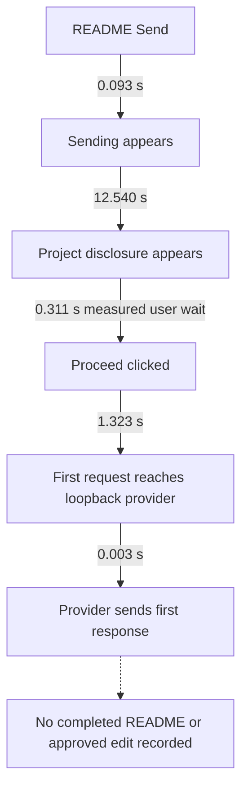
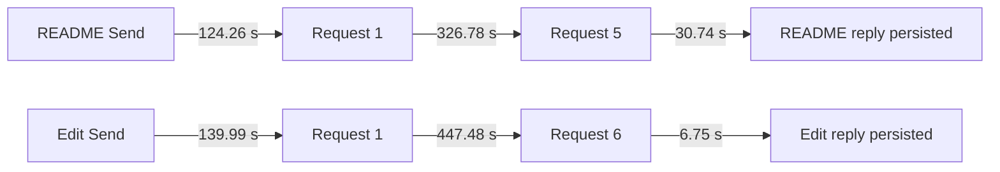

# Windows journey timing tracker

TASK-40608 measures from Send to the persisted reply, subtracting only the original measured disclosure and approval waits. Each of three sequential baseline/candidate pairs must preserve all original journey assertions. Every candidate README and approved edit must finish in under 5 seconds, with at least a 30% median reduction for each journey. The measurements below come from Windows 10 and the scripted loopback provider. [Task and benchmark contract](../../../backlog/tasks/task-40608%20-%20Investigate-slow-Windows-Console-workspace-chat-and-edits.md) · [Original timing observer](original-journey/task40608_trace.py)

## Where the time goes

The latest diagnostic shown here is `g25` on `5d4739b317`. Each arrow gives elapsed wall time since the previous event, taken from the same original journey clock. The diagram ends where the evidence ends.

Send to first request took **14.267 s**. The interval from Send to painted disclosure took **12.633 s**. A separate UI observer in this run recorded **3.328 s** from entering Send capture to the draft commit returning. It first sampled the modal present **9.219 s** after that return. These same-observer deltas locate a large gap after the draft commit. Sampling cannot distinguish backend preparation, notification delivery, UI scheduling and paint within the gap. These intervals overlap the diagram and use a different clock origin.

## What changed between replays

| Windows run | Change being exercised | Send to painted disclosure | Measured disclosure wait | Click to first request | Send to first request | Furthest verified event |
|---|---|---:|---:|---:|---:|---|
| `g21` | Dedicated display worker | 14.609 s | 0.179 s | 1.796 s | 16.584 s | First response. A later passive display read failed when modal visibility changed. |
| `g22p` | Instrumented agent preparation | 14.728 s | 0.160 s | 1.067 s | 15.955 s | Three provider requests. The approval message encoder refused the tool effect. |
| `g23` | Shared modal and display visibility checkpoint | 15.167 s | 0.217 s | 2.409 s | 17.792 s | Tool approval clicked and fourth provider request received. |
| `g24` | Isolated filesystem worker launch | — | — | — | — | Stopped during workspace setup, before Send. |
| `g25` | Isolated worker with dependency roots in its regression test | 12.633 s | 0.311 s | 1.323 s | 14.267 s | First provider response. A decision refresh failed. Neither reply completed. |

The 2.318 s difference in time to first request between `g21` and `g25` is an observation across two diagnostic runs. Several code and instrumentation changes separate them.

## Cost evidence

| Measurement | Scope | What it establishes |
|---|---|---|
| 1.568 s to first yield in agent preparation | `g22p`, nested measurement | Progress, roster and pending-note reads took 0.193, 0.184 and 0.165 s, with two storage admissions apiece. These times are included in the enclosing work. |
| 4.831 s and 49 inclusive storage admissions | `g25`, backend agent-reply invocation | The model call took 1.388 s within this invocation. This covers work around the first provider call and supplies no exclusive cost for the pre-disclosure gap. |
| 623 README / 620 edit admissions before first HTTP | `q2`, first baseline | Whole turns incurred 2,042 / 2,561 storage admissions. These counts describe the baseline. |

## Where the 400-plus seconds went on the completed baseline

Both original journeys finished on `q21b1`. The arrows below partition raw elapsed time at the first and last requests **received** by the loopback server. They include the human waits shown separately in the table. This baseline and the shorter, partial candidate traces above have different endpoints.

| Original Windows baseline | Raw Send to reply | Measured human waits | Application time | Total inside loopback handlers |
|---|---:|---:|---:|---:|
| README | 481.77 s | 3.80 s disclosure + 7.45 s approvals | 470.52 s | 0.197 s |
| Approved edit | 594.22 s | 19.14 s approvals | 575.08 s | 0.020 s |

After removing the measured waits, the interval **between the first and last provider requests alone** accounts for 319.33 s on README and 428.34 s on edit. That interval includes tool review, execution, persistence, display, and preparation for subsequent requests. For scale, the edit's `fs_edit` took 56.37 s from the first tool-start event to success. The workspace executor took 7.58 s inside that interval, and its worker reported 0.172 s. The trace locates substantial application time outside the worker without assigning it all to one cause. Source receipts are `original-journey-win10-before-guarded/replay-runs/q21b1/{progress.jsonl,timings.json}` under `test-snapshots`.

## Qualifying pairs

| Batch | Pair | README baseline / candidate | Approved edit baseline / candidate | State |
|---|---|---|---|---|
| `q2` | 1 | 470.518 s / — | 575.079 s / — | Baseline passed. Candidate timed out at disclosure. Batch stopped. |
| `q3` | 1–3 | — / — | — / — | A configuration was prepared on `5d4739b317`. No pair start was recorded when this tracker was initialized. |

Times in the pair table use the benchmark's original adjusted duration. A dash means there is no measurement for that cell. With each new Windows result, append its run ID and commit, retain failed rows and update the diagram to the latest measured path. For a performance claim, record the comparable before/after boundary, wall-time delta, available work count and source receipt. Publish qualifying pair rows separately from instrumented replays.

The local Windows verification directory stores the diagnostic receipts under `test-snapshots/original-journey-<snapshot>/replay-runs/<run>/`. The tables use `progress.jsonl` and `timings.json`. The `g25` subspans use `send-state-25000.jsonl` and `lab-observer/agent-prefix-12312.jsonl`. Batch order and eligibility come from the batch's `order.jsonl`.
