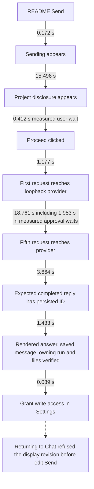
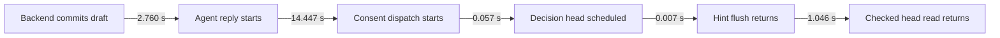
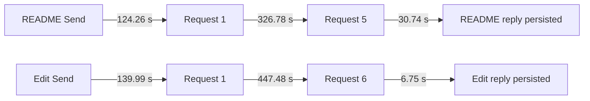
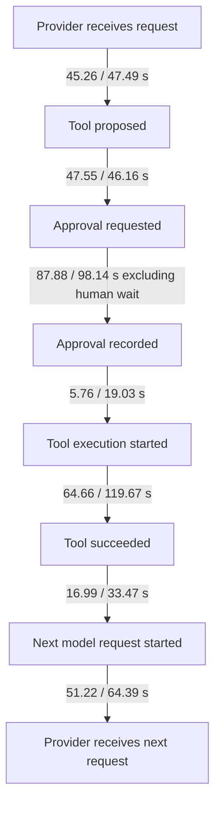
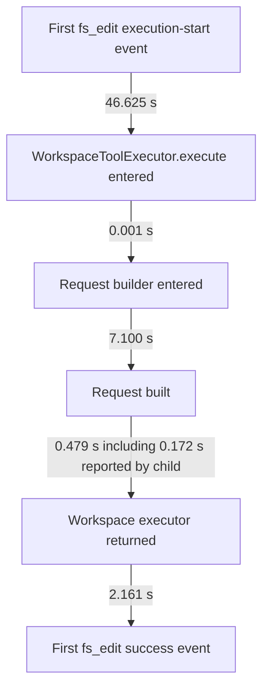
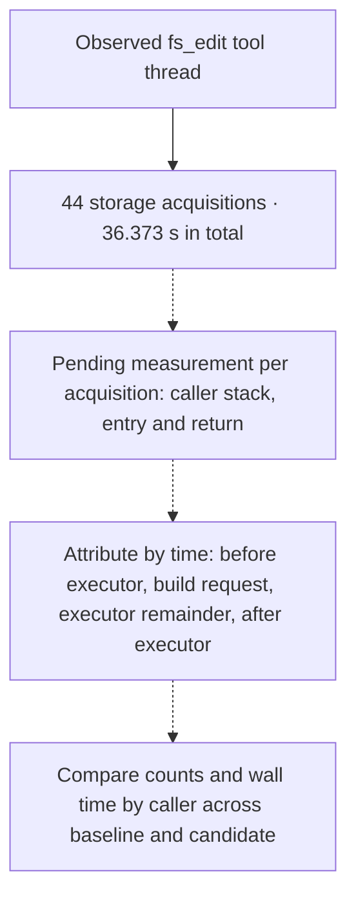
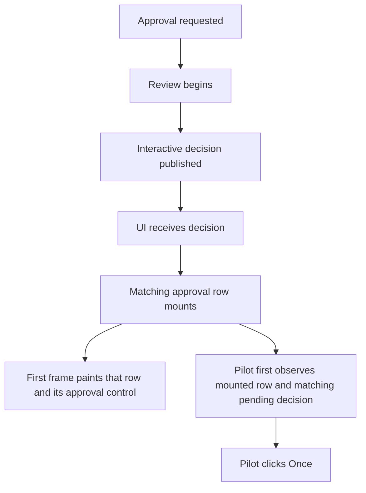

# Windows journey timing tracker

TASK-40608 measures from Send to the persisted reply, subtracting only the original measured disclosure and approval waits. Each of three sequential baseline/candidate pairs must preserve all original journey assertions. Every candidate README and approved edit must finish in under 5 seconds, with at least a 30% median reduction for each journey. The measurements below come from Windows 10 and the scripted loopback provider. [Task and benchmark contract](../../../backlog/tasks/task-40608%20-%20Investigate-slow-Windows-Console-workspace-chat-and-edits.md) · [Original timing observer](original-journey/task40608_trace.py)

## Where the time goes

On `g29` (`50e868df9f`), the README journey passed every original assertion. The arrows use adjacent timestamps on the original journey clock. The last two events happen after the timed reply.

The four `g29` intervals between provider requests took **1.933, 2.051, 6.540 and 6.284 s** after the measured approval waits, totaling **16.808 s**. Over the same boundaries the completed baseline took **319.329 s**, and the earlier `g27` diagnostic took **12.051 s** (1.760, 1.610, 3.520 and 5.161 s). The `g27` run failed its final row assertion. The two diagnostic runs have different instrumentation and supply no paired estimate.

On the earlier `g25` run, Send to first request took **14.267 s**. The interval from Send to painted disclosure took **12.633 s**. A separate UI observer recorded **3.328 s** from entering Send capture to the draft commit returning. It first sampled the modal present **9.219 s** after that return. These same-observer deltas locate a large gap after the draft commit. Sampling cannot distinguish backend preparation, notification delivery, UI scheduling and paint within the gap.

## What changed between replays

| Windows run | Change being exercised | Send to painted disclosure | Measured disclosure wait | Click to first request | Send to first request | Furthest verified event |
|---|---|---:|---:|---:|---:|---|
| `g21` | Dedicated display worker | 14.609 s | 0.179 s | 1.796 s | 16.584 s | First response. A later passive display read failed when modal visibility changed. |
| `g22p` | Instrumented agent preparation | 14.728 s | 0.160 s | 1.067 s | 15.955 s | Three provider requests. The approval message encoder refused the tool effect. |
| `g23` | Shared modal and display visibility checkpoint | 15.167 s | 0.217 s | 2.409 s | 17.792 s | Tool approval clicked and fourth provider request received. |
| `g24` | Isolated filesystem worker launch | — | — | — | — | Stopped during workspace setup, before Send. |
| `g25` | Isolated worker with dependency roots in its regression test | 12.633 s | 0.311 s | 1.323 s | 14.267 s | First provider response. A decision refresh failed. Neither reply completed. |
| `g26` | Modal dismissal waits for restored visibility, with backend disclosure instrumentation | — | — | — | — | The backend issued the disclosure. A passive readiness read refused a change in the active agent selection before the pilot observed the modal. |
| `g27` | Same-turn retry after a retired readiness read on `f08b23a708` | 12.407 s | 0.733 s | 1.291 s | 14.431 s | Five provider requests and two approval clicks. The fixture found the expected completed assistant message with a persisted message ID at Send +30.132 s (28.352 s after measured waits). The final assistant row lookup then timed out during evidence verification. The edit did not run. |
| `g28` | Checked first-persistence marker refresh on `0be0ccab9e` | 13.754 s | 0.935 s | 1.338 s | 16.026 s | Expected persisted reply at +33.867 s (32.023 s adjusted). All 12 observations during the final row wait found the reply in both the published snapshot and the transcript widget's message list. The reply belonged to the visible window, yet its row was absent. The 300 s assertion expired. |
| `g29` | Mount the original transcript rows on `50e868df9f` | 15.667 s | 0.412 s | 1.177 s | 17.256 s | README passed its original checks, including paint, persisted answer, run ownership and unchanged files. The reply took 39.681 s raw and 37.316 s adjusted. The Settings round-trip for write access failed before edit Send. |
| `g30` | Refresh the resumed Chat through the checked read, and use the existing permission owner for the virtual CLI kill-switch lookup on `aab319544e` | — | — | — | — | Workspace setup stopped before Send. The configuration cache changed identity during the readiness read. The original source check refused the new identity. This run provides no timing for either fix. |
| `g31` | Same product, with parent and backend configuration writers observed on `f9c9e964cc` | 10.938 s | 0.461 s | 1.324 s | 12.723 s | README passed at 30.589 s raw and 28.367 s adjusted. The manual unread reminder read the store before the resumed Chat received its current display. The edit did not reach Send. |

The 2.318 s difference in time to first request between `g21` and `g25` is an observation across two diagnostic runs. Several code and instrumentation changes separate them.

The `g26` observer recorded the backend's path on `55d99ac500`. From its committed-draft checkpoint, memory preflight started at +2.060 s and took 0.195 s with one storage admission. Agent reply started at +2.760 s. Startup instruction lookup took 0.018 s. The last observed binding lookup before dispatch returned at +4.277 s. Another **12.930 s** elapsed before consent dispatch began. This interval crosses work outside the observed binding functions. Its cause is still open.

All six events above use the same backend clock. The observer recorded 18 source-pinned targets, zero errors or refusals, and zero unfinished calls. It supplies no parent modal-paint or provider-receipt time for this run. The source receipt is `g26/artifacts/lab-observer/agent-prefix-3032.jsonl` in the disposable Windows profile.

## Cost evidence

| Measurement | Scope | What it establishes |
|---|---|---|
| 1.568 s to first yield in agent preparation | `g22p`, nested measurement | Progress, roster and pending-note reads took 0.193, 0.184 and 0.165 s, with two storage admissions apiece. These times are included in the enclosing work. |
| 4.831 s and 49 inclusive storage admissions | `g25`, backend agent-reply invocation | The model call took 1.388 s within this invocation. This covers work around the first provider call and supplies no exclusive cost for the pre-disclosure gap. |
| 623 README / 620 edit admissions before first HTTP | `q2`, first baseline | Whole turns incurred 2,042 / 2,561 storage admissions. These counts describe the baseline. |
| 22 of 79 stack samples between committed draft and consent | `g29`, backend sampler | The virtual CLI provider's live kill-switch read was waiting for `PermissionProcess._start` to receive the nested permission process's startup response. The whole interval lasted 10.965 s. Sample counts identify the waiting caller and do not give an exact duration. |

## Where the 400-plus seconds went on the completed baseline

Both original journeys finished on `q21b1`. The arrows below partition raw elapsed time at the first and last requests **received** by the loopback server. They include the human waits shown separately in the table. This baseline and the shorter, partial candidate traces above have different endpoints.

| Original Windows baseline | Raw Send to reply | Measured human waits | Application time | Total inside loopback handlers |
|---|---:|---:|---:|---:|
| README | 481.77 s | 3.80 s disclosure + 7.45 s approvals | 470.52 s | 0.197 s |
| Approved edit | 594.22 s | 19.14 s approvals | 575.08 s | 0.020 s |

After removing the measured waits, the interval **between the first and last provider requests alone** accounts for 319.33 s on README and 428.34 s on edit. That interval includes tool review, execution, persistence, display, and preparation for subsequent requests. For scale, the edit's `fs_edit` took 56.37 s from the first tool-start event to success. The workspace executor took 7.58 s inside that interval, and its worker reported 0.172 s. The trace locates substantial application time outside the worker without assigning it all to one cause. Source receipts are `original-journey-win10-before-guarded/replay-runs/q21b1/{progress.jsonl,timings.json}` under `test-snapshots`.

### Between consecutive provider requests

Each arrow adds up the same interval across all four README rounds or all five edit rounds. Arrow labels give **README / approved edit**, in seconds. The requested-to-approved interval excludes the original measured time from observing an approval to clicking it.

The first arrow includes 0.030 / 0.018 s in the loopback handler, 14.026 / 15.142 s from sending its response to the application's first model-complete event, and 31.205 / 32.325 s from that event to the tool proposal. Of the 87.88 / 98.14 s between requesting and recording approval, **69.278 / 73.104 s** elapsed between requesting an interactive approval and the pilot first observing it. The remainder includes the other approval decisions and the interval after a click. The trace records when the pilot observed each prompt. Its exact first paint in those rounds is unknown.

| Journey and request interval | Tool | Proposal → execution start, s¹ | Execution → success, s | Provider receipt → proposal + success → next receipt, s | Total application time, s | Storage acquisitions² |
|---|---|---:|---:|---:|---:|---:|
| README 1→2 | `find_tools` | 22.02 | 0.75 | 23.12 | 45.89 | 210 |
| README 2→3 | `load_tools` | 16.73 | 0.87 | 34.93 | 52.54 | 216 |
| README 3→4 | `fs_list` | 43.06 | 30.32 | 31.74 | 105.13 | 481 |
| README 4→5 | `fs_read` | 59.38 | 32.72 | 23.68 | 115.78 | 455 |
| Edit 1→2 | `find_tools` | 18.73 | 3.85 | 24.31 | 46.89 | 202 |
| Edit 2→3 | `load_tools` | 20.38 | 2.92 | 17.72 | 41.02 | 193 |
| Edit 3→4 | `fs_read` | 48.69 | 34.10 | 31.98 | 114.77 | 494 |
| Edit 4→5 | `fs_edit` | 44.08 | 56.37 | 38.26 | 138.70 | 550 |
| Edit 5→6 | `git_diff` | 31.44 | 22.44 | 33.08 | 86.96 | 463 |
| **README total** | | **141.19** | **64.66** | **113.47** | **319.33** | **1,362** |
| **Edit total** | | **163.33** | **119.67** | **145.34** | **428.34** | **1,902** |

¹ Application time excludes the original measured human wait. Columns are rounded independently. Each round is bounded by two successive requests received by the server. Within it, repeated copies of the same agent step use the first matching event for that tool call.

² Counts use differences between cumulative `_acquire_storage` observations at consecutive HTTP **sends**. They include concurrent activity. The 550 acquisitions on the `fs_edit` round span two provider requests. The narrower tool-execution interval below has its own counts.

### Inside the 56.366-second edit

The main gap is the **46.625 s before workspace executor entry**. The entire executor took 7.580 s. The interval after request construction includes child launch, communication, and return handling. Subtracting the child's reported 0.172 s leaves approximately **0.307 s** in that interval and **56.194 s** outside the reported child time across the whole edit.

A second receipt measured **44 calls to `_acquire_storage` on the `tool-fs_edit` thread, totaling 36.373 s** under the execution-start phase. Its longest call took 6.425 s. Across all 18 threads with acquisitions in that phase, 187 calls accumulated 248.868 thread-seconds. These calls overlap the wall-clock arrows above. The receipt aggregates by entry phase, function and thread, so it cannot place individual acquisitions before or inside the executor. The phase costs come from `native-7aec54d3/costs.json` alongside the `q21b1` progress receipt.

For this edit, 29.599 s elapsed from requesting approval to the pilot detecting the mounted approval row, 7.078 s from detection to button press, and 0.768 s from press to the first recorded approval. The trace captured no paint event for that prompt and no edit stack sample within the 46.625 s before executor entry.

For the baseline/candidate comparison, track the outer approval interval, the 46.625 s from tool start to executor entry, and the 7.100 s request-build interval separately. Match admission start/finish to the same tool call and thread to measure the part on the critical path. Preserve the original authorization, storage checks and positive completion checks.

### Trace ownership of each storage acquisition

The baseline receipt contains no per-acquisition stacks. In the diagnostic run, correlate `_acquire_storage` entry and return with the specific `fs_edit` call, thread, and executor/build boundaries. Split time at any crossed boundary. Group by code location and retain count, total, and longest call. Check that grouped calls reconcile to that run's count. If the count changes from 44, show both runs. Keep background threads and nested intervals separate from the foreground wall time.

### Trace each interactive approval from request to paint

The arrows identify observation points for the next diagnostic. Paint and pilot observation have independent timestamps. Measure both against the same request, including any time between publication and UI delivery. Record the synchronous policy-check interval, queue wait and event-loop delay separately where the trace supports it. Keep any missing paint or boundary visible. Compare the same tool, call and visit on the candidate.

| Baseline journey | Approval | Request → first pilot observation | First pilot observation → click | Request → first paint |
|---|---|---:|---:|---|
| README | `fs_list` | 35.927 s | 3.633 s | Unmeasured |
| README | `fs_read` | 33.351 s | 3.820 s | Unmeasured |
| Approved edit | `fs_read` | 23.901 s | 6.382 s | Unmeasured |
| Approved edit | `fs_edit` | 29.599 s | 7.078 s | Unmeasured |
| Approved edit | `git_diff` | 19.604 s | 5.677 s | Unmeasured |

Use the original `q21b1` progress and costs receipts for these historical values. Keep fresh instrumented runs separate from the frozen qualifying pairs.

## Qualifying pairs

The earlier local implementation completed three sequential pairs with the original checks. Its median README time fell 64.33% and its median edit time fell 42.56%. Every candidate exceeded five seconds. The replacement process has its own qualification record below.

| Earlier local pair | README baseline → candidate | Edit baseline → candidate |
|---|---:|---:|
| 1 | 286.9434 → 112.0680 s | 340.5827 → 168.3232 s |
| 2 | 236.8475 → 84.4768 s | 282.0649 → 162.0053 s |
| 3 | 188.2872 → 80.3125 s | 270.9438 → 112.4925 s |

| Batch | Pair | README baseline / candidate | Approved edit baseline / candidate | State |
|---|---|---|---|---|
| `q2` | 1 | 470.518 s / — | 575.079 s / — | Baseline passed. Candidate timed out at disclosure. Batch stopped. |
| `q3` | 1–3 | — / — | — / — | The first baseline, `q31b1`, started with candidate `997b3339ff` pinned. The candidate includes the explicit-return fix and the batched AgentRuns log metadata reads. |

Times in the pair table use the benchmark's original adjusted duration. A dash means there is no measurement for that cell. With each new Windows result, append its run ID and commit, retain failed rows and update the diagram to the latest measured path. For a performance claim, record the comparable before/after boundary, wall-time delta, available work count and source receipt. Publish qualifying pair rows separately from instrumented replays.

The local Windows verification directory stores the diagnostic receipts under `test-snapshots/original-journey-<snapshot>/replay-runs/<run>/`. The tables use `progress.jsonl` and `timings.json`. The `g25` subspans use `send-state-25000.jsonl` and `lab-observer/agent-prefix-12312.jsonl`. Batch order and eligibility come from the batch's `order.jsonl`.

## Completed local foreground diagnostic: `foreground-b1-20261117`

This is a new **nonqualifying** baseline run, separate from `q21b1` and the three-pair acceptance test. It used the original local product `b6b53f084a63058ca4b4dac99e074cff42192f7e`, unchanged original QA hash `448015c99604ce96754436c7dc4f784daed6241bed99062cb8d6ab6e66cbe850`, exhaustive guarded verification, foreground observation and approval probe v2. The runner exited **0**, original receipt says **passed/complete**, and pytest reports **1 passed**. Same-run original total was **884.859 s**; the full pytest process reported 895.37 s. These are different boundaries.

| Original journey | Reply completed | Original adjusted | Common adjusted reply seen | Acquisitions at reply completed | Latest acquisitions / scope checks |
|---|---:|---:|---:|---:|---:|
| README | 316.0359 s | 304.7464 s | 305.6975 s | 1,944 | 2,273 / 4,544 |
| Approved edit | 432.0026 s | 416.9249 s | 417.8033 s | 2,457 | 2,498 / 5,000 |

The latest counters include work after the completion endpoint. Setup adds 745 acquisitions: **5,516** across setup and both journey phases. Reuse hits were zero. The original storage-cost rows reconcile to these counts; their summed thread times overlap and are not additional wall time. The loopback handler consumed 0.0245 s for five README requests and 0.0213 s for six edit requests.

### Each filesystem/Git call on its actual worker

Each row uses the exact original fixture call, actual monitored invocation and worker thread. Storage intervals are clipped to the displayed boundary; no nearest-thread or cross-process association is used. Eight admissions before the worker's handover obtains its call context are associated through that same retained invocation and its observed exit context. The table does not assign unrelated UI/background acquisitions to the tool.

| Journey / call | Execution start → executor | Worker acquisitions / time within that interval | Request build | Acquisitions / time within build | Entire executor | Child-reported work |
|---|---:|---:|---:|---:|---:|---:|
| README `fs_list` | 20.0526 s | 32 / 14.4951 s | 1.9992 s | 4 / 1.7660 s | 2.6854 s | 109 ms |
| README `fs_read` | 22.1167 s | 34 / 14.4050 s | 3.5967 s | 4 / 2.4768 s | 3.9163 s | 92 ms |
| Edit `fs_read` | 22.9191 s | 34 / 16.5324 s | 2.6869 s | 4 / 1.7981 s | 3.0783 s | 109 ms |
| Edit `fs_edit` | 26.8765 s | 36 / 18.7999 s | 2.2704 s | 4 / 1.5517 s | 2.6951 s | 156 ms |
| Edit `git_diff` | 25.8684 s | 32 / 18.7578 s | 1.3703 s | 4 / 1.1647 s | 1.9868 s | 296 ms |

The additional observer surrounds the original instrumented wrappers, so its executor interval need not equal the original Trace interval exactly (README `fs_list`: 2.6854 versus 2.6708 s). The unchanged original Trace remains the journey timing authority. `find_tools` and `load_tools` have no workspace-executor invocation; their original tool durations are 0.8687/0.5392 s for README and 0.6195/1.5619 s for edit.

The `fs_edit` worker entered at observer time 734.9950, entered the admitted callable at 739.7369, entered the executor at 760.6706, returned from it at 763.3657, and returned from its worker at 765.0442. Its complete 30.0491 s worker invocation used 4.4688 thread CPU seconds; elapsed time includes blocking, scheduling and other unseparated costs. These observations localize the cost without identifying individual Windows syscalls.

| `fs_edit` admission caller in the frozen original source | Boundary | Count | Observed acquisition time |
|---|---|---:|---:|
| `Agents/agent_service.py:2357`, worker handover before admitted call | Before executor | 8 | 3.5562 s |
| `Agents/local_tool_dispatch.py:104`, `_kill_switch_engaged()` | Before executor | 12 | 5.6822 s |
| `Agents/local_tool_provider.py:3156`, `_effective_local_state()` in `_verdict_for` | Before executor | 12 | 7.3930 s |
| `Tools/local_tool_impls.py:233,246` → `Utils/sensitive_paths.py:743`, CAS target resolution | Before executor | 4 | 2.1684 s |
| `Tools/workspace_tool_executor.py:252,256`, `_call_context()` | Request build | 4 | 1.5517 s |
| `Tools/local_tool_impls.py:233,246`, post-executor target resolution | After executor | 4 | 1.3987 s |
| **Actual worker total** | | **44** | **21.7504 s** |

The independent original costs receipt reports the same **44** `tool-fs_edit` acquisitions, **21.749282 s**, maximum **1.774029 s**. The 0.0011 s sum difference is between nested observation boundaries. This reconciles the count instead of mistaking the 36 pre-executor acquisitions for the complete call. The largest two named groups alone consume 13.0752 s before executor entry. Their checks remain required; this identifies a place to remove repeated admission work while retaining the checks.

### Approval stages and the v2 paint limitation

All values below come from one approval observer clock and exact fixture call. Policy is the synchronous `pending_gate_for` entry→return, **before** `request_mcp_approvals`. Published means original pending publication returned; UI means original `_set_console_pending_decision` entry; card means original `set_batch` returned; ready means the original deferred callback observed the same card generation with information ready. No missing marshal callback is fabricated.

| Approval | Policy | Request → published | Published → UI | UI → card | Card → ready | Ready → click | Click → request returned |
|---|---:|---:|---:|---:|---:|---:|---:|
| README `fs_list` | 8.6959 s | 1.5671 s | 0.3554 s | 0.0349 s | 1.0029 s | 4.5491 s | 0.4216 s |
| README `fs_read` | 6.6477 s | 1.4717 s | 0.8546 s | 0.0239 s | 0.6467 s | 2.3947 s | 0.5061 s |
| Edit `fs_read` | 9.4170 s | 1.7190 s | 1.5638 s | 0.0250 s | 0.9295 s | 4.3951 s | 0.3320 s |
| Edit `fs_edit` | 10.5598 s | 1.6191 s | 0.4215 s | 0.0365 s | 0.7152 s | 3.0375 s | 0.9642 s |
| Edit `git_diff` | 7.0617 s | 1.8826 s | 0.8769 s | 0.0250 s | 0.4437 s | 2.7181 s | 0.8669 s |

The original outer approval-request→click values were 22.3223, 18.8538, 30.3026, 24.2924 and 24.0081 s respectively. These begin earlier than `request_mcp_approvals`, which follows policy work. The pilot's first `approval_observed` mark precedes the new card batch in four of five calls; it therefore cannot be substituted for that card's ready or painted time. `approval_request_return` and `local_review_return` occur **after** the click, not before initial presentation.

There were **50 observed compositor-return frames, zero original `painted_approval` events, zero original-label probes, and zero strengthened qualified frames**. Review found a diagnostic false-negative: v2 looked for `__dict__['_parent']`, while pinned Textual keeps its `MessagePump.__parent` weakref in the name-mangled `__dict__['_MessagePump__parent']`. Both ancestry flags were consequently false for every frame. At all five clicks, other captured facts reported a mounted, enabled, ready button, full clip containment and prior region cells. These independent facts do **not** retrospectively prove matching-label paint. The measured policy/publication/ready/click timings remain usable; **request→qualified paint remains unmeasured**. A corrected probe is a separate unrun revision, never a rewrite of this result.

The existing v2 records do locate an earlier, weaker observation: the first update intersecting the recorded button rectangle after controls were ready, with its other active/enabled/full-clip flags true. The readiness→region-cell intervals were **0.0409, 0.0424, 0.0640, 0.0567 and 0.0309 s** in the table's order (card generations 20, 22, 29, 31 and 33). All were before the recorded click. These are actual recorded region-cell updates, not reconstructed ancestry or exact-label paint; v2's false ancestry flags remain unchanged.

Both observer summaries closed with zero errors, source refusals, unfinished invocations/admissions and truncation; 535 selected foreground admissions were observed. These summaries prove observer bookkeeping completion, not native resource retirement. The original fixture reached shutdown then complete, preserved its answer/file/diff/Git/permission/network assertions, and the guarded runner recorded process exit 0. This local baseline has no selected-process `Retired` frames or per-resource retirement certificate; none is inferred from Python returns or an empty observer registry.

Receipts: snapshot `original-journey-win10-before-foreground-20261117-a1`, run `foreground-b1-20261117`, `timings.json`, `progress.jsonl`, `native-9e45221f/{receipt,costs}.json`, and both `lab-observer/tool-{foreground,approval}-ui-17720.jsonl` streams. The tracked [numeric analysis](original-journey/analyze_diagnostics.py) reproduces the per-call stacks and boundary splits from these originals; its local `diagnostic-numeric-v3.json` output is an analysis revision over **probe v2**. No full per-tool candidate diagnostic has run yet. Observation overhead, different host conditions and the paint-probe defect prevent treating this diagnostic as a new qualifying pair or a measured candidate speedup.
