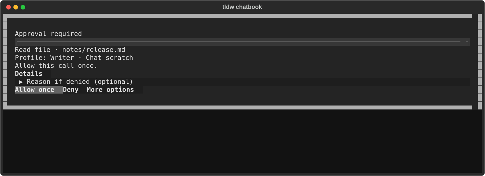

# Agent runs & tools — what happens when a reply uses tools, skills, and sub-agents

## Running the Watchlists workflow from Console

You can ask the Console agent to create feeds, group them into a Watchlist, check the sources, generate a briefing, save a recurrence, and read a completed briefing. The agent discovers and loads the required local tools, while each approval remains explicit and auditable.

A useful first request is:

> Create a Watchlist from these RSS feeds, check every source, generate a briefing, schedule it every 24 hours, then open the completed briefing and summarize it for me.

Long-running checks and briefings return receipt IDs. The agent should follow each exact receipt until it reaches a terminal state instead of treating “accepted” as “finished.” Keep the receipts when you need an audit trail or want to ask for status later.

The agent can list and open completed briefings on your behalf. Full briefing and item bodies remain Console-local; an external MCP client receives only the limited metadata and receipt surface described in the MCP guide.

“Use the existing model” means the collection's saved briefing provider/model
preset first. Without one, Chatbook reads the saved `chat_defaults` provider and
model at briefing run time; if that model is empty, it uses the saved model for
that same provider. It never means “silently copy the model selected for this
Console conversation.”

## What this page covers

When a Console reply needs more than plain text — running a tool, spawning a
sub-agent, executing a skill, or calling an MCP server — it becomes an *agent
run*. This page covers what you see while a run is in flight, how tool-call
approvals work, how background runs in other tabs surface, and how skills and
MCP tools plug in. For the Console screen itself see [Console](../console.md).

## What plain chat offers — the light tool surface

Out of the box, Console's assistant gets a **light, safe tool set**: date
and time (`get_current_datetime`), `calculator`, and ask-you-a-question
(`ask_user`, which follows its own `[tools] ask_user_enabled` switch). A
plain message such as "Reply with just: hi" is answered directly; there are
no sub-agents, skills, web search, Watchlists, workspace, character,
Canvas, chat-fork or run-log tools, and none of chatbook's own MCP tools,
until you turn them on. The system prompt is your session prompt, or "You
are a helpful assistant." when it is off — not the agent operating prompt.

To turn more on:

- **Full agent tools** — **Settings ▸ Tools & MCP ▸ Servers ▸ built-in row ▸
  Tool gates**, or
  setup's Tools step (`[tools] full_agent_tools_enabled`). It brings back
  everything this page describes: sub-agents and the fleet, skills, the
  local workspace, web and Watchlists tools, character tools, Canvas, chat
  forks, the run-log tools and chatbook's own MCP tools.
- **One tool at a time** — an individual gate in the same pane (Read file,
  Create note, Expand document, `web_deep_search`, …) is offered in plain
  chat on the next send, without the rest of the agent surface. So are
  tools from an MCP server you added, and Library tools once a conversation
  allows assistant Library access. On a small context window where they no
  longer fit beside the light set, the request keeps the light set and
  leaves them out, so switching one on never leaves you with fewer tools.
- **One turn** — a message that names a skill (`$skill`) gets the full agent
  surface for that turn.

Each send reads these switches fresh, so a change applies on the next send.
The exception is a conversation whose sub-agents are still running, or have
sent reports nobody has read yet: it keeps the full agent surface until that
work is picked up, so switching Full agent tools off mid-run never leaves the
reply that collects the results unable to read or reach its sub-agents.
A [goal run](#goal-runs) is not plain chat either: each iteration gets the
tools its reviewed launch selected — including the trusted skill-script
executor that runs a command-backed check — and the agent operating prompt,
whether or not Full agent tools is on.
A small local model whose context window cannot hold even the light set (a
server the app has not sized yet is planned as 4,096 tokens) gets a plain
request with no tools.
Full agent tools needs a much larger window than the light set. On a model
with about 8,000 tokens (for example a llama.cpp server started with
`-c 8192`) neither its tools nor its full find-tools fallback fit, so a send
carries only a compact fallback: `find_tools` and `load_tools`, which must
look a tool up and load it before the model can call it, and the reader for
sub-agent reports. When even those do not fit, it carries no tools. With the
switch off, the same model gets the light set directly. Leave Full agent
tools off for such a model; the setup Summary says "gets fewer tools, or
none" when it is on.

The tools a send carries count toward the context meter: the status strip's
**Context N%**, the model tab's **Request estimate**, and **Next request** and
**Request overhead** under **Chat settings** (**Ctrl+O**) ▸ **Context and
memory**, which names the tool share — for example "Request overhead 499
tokens (tool schemas 489)". The figure comes from the last request the app
prepared for the conversation, with its tools planned for that request's
model, window and conversation, as the send plans them — a model with a
small window, or a conversation that leaves no room, counts the smaller set
the send gets, or none. With Full agent tools on, the meter learns the local,
MCP and skill tools a conversation composes from its full sends. Until one
has gone out in this conversation, it uses the tools of the most recent full
send in any conversation, or only the built-in tools if there has been none
since the app started; the send itself is sized correctly either way. A send
that compacts older turns first is shown as the request stood before
compacting, tools included; the next send's reading reflects the compacted
conversation and the tools that fit beside it.

## Getting there

Open Console (**Ctrl+2**) and send a message — runs happen wherever you
chat. Tool rows, approvals and sub-agents appear once a reply uses a tool,
which for anything beyond the light set means turning it on first (see
above). The surfaces this page covers: the
transcript's inline tool rows, the **Agent** section in the left "Console
context" rail, the Inspector's status rows, the status chips above the
composer, and the approval and confirm cards that appear above the
transcript.

## Goal runs

Enable **F4 Settings → Console behavior → Goal runs**, save, then open
**Ctrl+P → Console: Goal runs… → New goal**, or type
`/goal <task description>` in the composer and send it. For example,
`/goal Fix the failing tests in this project` opens the same setup form with that
objective filled in. Bare `/goal` opens the form without a supplied objective;
the slash popup also offers `/goal` completion. Review the launch, then choose
**Start** to begin. Cancel or a setup refusal keeps your composer draft, and the
command is never sent as an ordinary chat message. Pasted text keeps the
composer's existing literal-text behavior.

Goal enablement is independent of fleet wakes. The current conversation supplies the provider/model selection;
Start creates a dedicated goal conversation and preserves your ordinary draft.

Enter an objective and success criteria, select a ready local project binding,
optional read-only source bindings, and the allowed tools. The initial surface
supports local file tools, the existing trusted skill-script executor, and
connected local MCP tools with a fixed process/configuration identity. Remote
MCP tools are not selectable in this release. A selection narrows existing
permission; it never grants skill trust, tool approval, or a wider binding.

For a command-backed check, select a previously trusted local skill and its
script path. Arguments and checked input paths are JSON arrays. Pass the project
path explicitly as an argument: the script runs in a temporary working directory.
Keep the verifier outside the editable project. **Review launch** fixes the
objective, criteria, review requirement, provider, bindings, tools, arguments,
verifier hash and input scope before validation waits; **Start** then launches
those same selections. Failed validation restores editable controls. Every
iteration receives the selected target and exact verifier invocation, so you do
not need to duplicate command arguments in the objective. Cancel to revise them. Result review is required
by default. Turning it off requires at least one configured objective check.
A passing model report alone cannot satisfy that check.

The status view shows iterations, charged calls/tokens, reserved or unknown
usage, and the elapsed deadline. Pauses, approvals and waits count toward that
deadline. **Pause** saves a clean checkpoint when the current work settles;
**Stop** signals active work and refuses later increments. **Resume** continues
an eligible saved checkpoint without refilling its allowance. Navigation closes
the view while the runtime owns execution. Shutdown fences new work and drains
execution before closing stores. After restart, clean continuation requires
explicit Resume. An interrupted **Starting** launch instead offers **Retry setup**
with its saved identity, preventing a second conversation.

Choose an iteration to inspect its exact report, artifact fingerprint and saved
check output. **Changes** opens that iteration's native run in its goal
conversation, even when another conversation is foreground. **Review** refreshes
proof; **Accept result** records quality for the captured checkpoint and artifact.
It rechecks freshness and refuses stale or missing proof. **Reject result** keeps
the saved work for revision. A settled review waiting across restart can still be
reviewed without another model call.

Interrupted execution with uncertain effects uses a separate **Close uncertain**
action. Closing preserves unknown accounting; it cannot authorize replay or
remove uncertain evidence. **Remove payloads** is available only for settled
eligible history and removes private goal reports/evidence while retaining
accounting tombstones. It is not a general deletion of existing run logs or files.

Selected additional sources are available through the selected `fs_read` and
`fs_list` tools using absolute paths, under existing tool permissions. Selecting
a source does not automatically select either tool or grant access. Relative
paths, `fs_glob`, `fs_grep`, and file writes stay within the primary binding;
unselected sibling roots remain inaccessible. Source bindings and directory
identity are checked again after waits and before use. Source files are untrusted
data; their `AGENTS.md` files are not automatically activated as instructions.

Trusted scripts retain
the executor's actual authority; a scratch directory is not an operating-system
sandbox for arbitrary script code. The real CLI qualification for this release
covers the POSIX skill path. The finite local Qwen endpoint demonstration did not
successfully use tools and paused safely; it does not certify that model for
successful goal execution. See the [qualification evidence](../../superpowers/qa/native-goals/task5/README.md).

## Layout tour — what you see during a run

Each Console tab runs its own agent, and a run keeps going in the background
while you're on another tab. The first time you open a second tab (**Ctrl+T**),
a one-time banner spells it out:

> Each tab runs its own agent — up to 3 in parallel (change in Settings >
> Console Behavior).

The number is your configured cap (default 3). Sending past the cap is
refused with a message like "2 agents already running (…). Wait for one to
finish or interrupt it." The app-owned Console runtime keeps admitted work alive across Console navigation;
shutdown drains it before stores close.

**In the reply row itself** — while the turn works, the unfinished
`Assistant` row shows a live activity line in place of its (empty) text, so
a long tool call never looks frozen. `Connecting tools… · 4s` marks the
pre-provider setup step. The first send after a launch pays for it once,
assembling the turn's tools and your profile. `⚙ read_file · 4s` names the
tool that is running and how long it has been running, `Thinking… · 6s`
means the tool finished and the model is composing the next round, and
`Generating…` is the wait for the model's first response of the turn. That
setup step is capped at ten seconds: if something it needs — an OS
keychain prompt, for instance — does not answer in time, the send goes
ahead without profile tools rather than waiting. **Stop** (or Ctrl+G) works
during that step too: the reply ends `[stopped]` with the "Response stopped
by user." row before anything reaches the model, pressing Stop again changes
nothing, and your next send goes out normally. Stop works the same way during
a **Retry** of a failed reply; if the retry had not yet cleared the failed
reply, that reply stays as it was, and you can retry it again. Once an
approval, a skill or worktree confirm, or a question is up and waiting on you,
the line reads
`Waiting for your approval · 12s` for an approval, `Waiting for your
answer · 12s` for a question, or `Waiting for your confirmation · 12s` for
a skill/worktree confirm — instead of `Thinking…`, since a decision only
you can make outranks whatever the model's last step happened to be — and
the "Run:" status chip above the composer reads the same kind-aware line.
The Inspector's `Live work` row uses the same waiting copy. Its `Approvals`
count and the pinned authority summary's `Run` fact cover tool-approval rounds
for the viewed conversation, including approvals queued behind another card.
Questions and skill/worktree confirmations do not increase that count. Older
integrations can show an approval without attaching it to a conversation; when
it is the only pending tool decision, the Inspector and Files attention count
it while you decide. The elapsed figure advances while you watch. The line is live-only — it vanishes
the moment the reply's own text arrives, and a conversation you reopen later shows the
completed `Tool` rows below instead. During a fleet turn, while the primary
waits on its children, the line reads `2 sub-agents · ⚙ grep_files · 12s`
(the count of running sub-agents and their longest-running tool) instead of
`Thinking…`; the running sub-agent list itself lives in the **Agents**
section of the Inspect rail (**Alt+I**), and each child's full step list
stays in the left rail's Agent drill-down. Once a tool call has run for
five seconds the line grows a `✕ abandon call` link: clicking it abandons
that one call (the model sees it fail as "tool call cancelled") and the
turn continues, unlike **Stop**, which ends the run. A tool that must
finish once started (a Watchlists mutation, for example) cannot be
abandoned and shows no link.
a long tool call never looks frozen: `⚙ read_file · 4s` names the tool that
is running and how long it has been running, `Thinking… · 6s` means the
tool finished and the model is composing the next round, and `Generating…`
is the wait for the model's first response of the turn. The elapsed figure
advances while you watch. The line is live-only — it vanishes the moment
the reply's own text arrives, and a conversation you reopen later shows the
completed `Tool` rows below instead. A sub-agent's work never appears here;
it belongs to the Inspect rail's **Agents** section.

While a model call is generating or thinking, this line may also show its
current output count. `17 provider output tok` means the provider supplied an
explicit count. `~17 local output tok` is Chatbook's local estimate from the
text received so far. The count belongs only to the current model call: it
resets for the next call and disappears while a tool or approval is waiting and
when the call finishes. Missing usage and an explicit provider count of zero
show no segment. Live counts do not include a price estimate and are separate
from the completed run's budget-token accounting.

**In the transcript** — each complete primary tool call appears inside its
Assistant turn as soon as the model proposes it. The same row changes from
**Queued** to **Awaiting approval** when a decision is actually pending, then
**Running** with elapsed execution time. Completion shows the outcome and a
short result preview immediately, without waiting for the assistant's final
answer. Denied, failed, timed-out, and stopped calls remain visible.

The collapsed preview takes at most three wrapped lines, including an omission
hint when needed. Click the row, or focus it and press **Enter** or **Space**, to
expand **Arguments** and **Result** together. Details stay open as the call
finishes; existing full-output and file-diff actions remain available. **Review
approval** takes you to the existing approval card. Calls with the same tool
name keep separate rows.

Arguments and timing are live-session details; reopened runs show the facts
already retained by the existing capture policy. Output chunks from ordinary
tools are not streamed in this version. Raw shell commands keep their existing
process status and live output details. Expanded shell calls also show the resolved
shell, working directory, elapsed time, exit code, truncation, and cleanup status.
If a run ends before a shell result arrives, its row stops updating and explains
that process cleanup is unknown; any received executor result remains visible.

Other activity rows include:

- `⤷ spawned sub-agent: …` — the agent delegated work to a sub-agent.
- `⚠ …` — an error summary.

**In the left rail** — expand the **Agent** section (collapsed by default):

- Status line: `Agent: idle`, or `Agent: running · step N` while working.
- One `·`-prefixed line per step.
- The drilled-into view of a single sub-agent (`Sub-agent · <status>
  (Back)`) and the **Cancel all agents** button, both reached from the
  Inspect rail's **Agents** section — see below.
- **View full log** opens the "Full run log — <run id>" window: the complete,
  stored record beyond the Console display cap, loaded one page at a time.
  **Next** advances, **Previous** reloads the previous page, and **First**
  returns to the beginning (also after older navigation history is dropped).
  Large records continue across pages; any writer storage truncation is
  identified separately. A scan with no matching records can still offer
  **Next**. If access is lost, the last loaded page stays visible.
  **Close** or **Esc** dismisses the window, including while a page loads.

**In the Inspector** (right rail) — the "Status:" line tracks the run
(`Status: Ready` / `Status: Generating…` / `Status: Needs approval` /
`Status: Source blocked` / `Status: Blocked`), and the "Run recipe" row summarizes provider / model /
sources / tools / approvals for the next send. The **Agents** section near
the top of this rail is the sub-agent list itself. Once the chat is saved
(after its first send) it shows a **Run history** summary with a **View all
runs** button, and it lists sub-agents once a reply spawns them. The rail
shows the same after a send whether it was open during the send or opened
afterwards; see
[The fleet panel](#the-fleet-panel--three-states) below for its three
states (collapsed summary, expanded rows, drilled into one child), how to
cancel a child, and how its token spend shows up. The list used to live in
the left rail's Agent section; only the list moved, and everything about
its rows and actions is unchanged.

**In the status chips** (above the composer) — "Tools: N ready" counts the
tools available to the agent (the chip stays hidden until tools are counted,
which happens after your first send), and
"Approvals: N pending" counts outstanding tool-approval rounds in the viewed
conversation; a round may contain several calls. Chat-creation confirmations
use "Waiting for your confirmation" and do not count as tool approvals.
The Approvals chip is
clickable: it jumps to the visible decision card, preferring an approval when
one is displayed. If approvals are queued behind a skill confirmation, review
reaches that confirmation first. With no decision visible it says
"No approval is pending." A mutation already in **Finishing** is
status, not a pending decision, so it no longer contributes to this count.

## Features & controls

### Planning is not model thinking

Console may show a **Planning** activity while it prepares a run. That is a
safe, session-only application preamble: it is not provider reasoning, is not
saved as model thinking, and is not replayed into later model history. When an
adapter reports an actual Thinking block for the same model round, the Planning
preamble is suppressed so the two are not presented as duplicate evidence.

Model **Thinking** rows have a stricter rule: they exist only for actual
adapter-reported displayable or proprietary evidence. Tool use, a reasoning-
capable model, or a long pause does not create one. Proprietary evidence never
contains private text; its expanded notice is
`Proprietary thinking obfuscated - not available`. This distinction describes
observable provider events and does not promise hidden chain-of-thought.

### Task panel — the agent's task list stays in view

When the agent keeps a task list (the `todo_create` / `todo_update` tools),
a **Tasks** panel sits pinned above the transcript for as long as the list
has entries:

```
▾ Tasks · 3 of 7 done · Writing the migration
[x] Read the schema
[x] Draft the migration plan
[x] Add the version bump
[~] Writing the migration
[ ] Run the DB tests
[ ] Update the docs
[ ] Open the PR
```

- The header always shows how many tasks are done and what the agent is
  working on right now. `[~]` marks the in-progress task, `[x]` a finished
  one, `[ ]` one still waiting.
- The panel updates the instant the agent changes the list. The transcript
  still gets its `☰ Tasks` marker on every change, so the history stays
  intact; the panel is the copy that does not scroll away.
- Click the header to collapse the panel to its one-line summary, and click
  again to expand it. Each tab remembers its own collapsed state.
- Long lists scroll inside the panel rather than pushing the transcript
  down.
- The list belongs to the tab: switching tabs switches the panel, and a tab
  with no tasks shows no panel at all. Like the rest of a run, the list
  lives only while Console stays open.

The panel is read-only — it shows the agent's plan; it is not a place to
edit it.

### Questions from the agent

An agent can stop and ask you up to four multiple-choice questions. The
questions appear on a card above the transcript, in the same slot as
approvals, and the run waits until you answer:

```
The agent has 2 questions for you:
Database   Which database should the migration target?
  ( ) Postgres — managed, relational
  (•) SQLite — embedded
  Other…
Region     Which regions? (pick any)
  [x] eu
  [ ] us
  Other…
                                                    [ Submit ]
```

- Pick an option per question, or type your own answer in **Other…** — it
  is always there, whatever the agent offered. `1`–`4` pick an option in the
  question you are on, `Tab` moves between questions, `Enter` submits.
- You can submit with questions left blank; the agent sees them as
  unanswered and decides what to do.
- You can also just type your answer and send it. While a question card is
  up, a plain message answers the questions you have not picked an option
  for (it becomes their **Other…** text) and is not sent to the agent as a
  new message. Two exceptions: a `/` command runs as usual, and a message
  with a staged attachment or staged Library evidence is sent as a normal
  turn, leaving the question up for you to answer on the card.
- The card never grabs focus from something you are typing. If you need to
  reach it from the keyboard, the inspector's **Review approval** action
  focuses the question card when no approval card is displayed.
- By default the question waits as long as it takes. To make an unanswered
  question expire instead, set `ask_user_timeout_seconds` under `[console]`
  in your config; the card then shows *Auto-continues in m:ss* and the run
  carries on without an answer when it reaches zero. The clock advances only
  while the question can be answered in the visible conversation.
- A question for a tab you are not looking at lights that tab's badge and
  shows a toast; visit the tab to answer it. Stopping the run clears the card.
- Every answered round leaves one line per question in the transcript, so
  the exchange stays in the record.

The tool is on by default. To remove it from every agent, set
`ask_user_enabled = false` under `[tools]`.
### Recovering saved agent work

Confirmed Merge uses your Git user identity. If Git cannot resolve an author or
committer, configure `user.name` and `user.email` for the selected repository
and retry; Chatbook checks this before capturing or merging child work. Apply
continues to leave unstaged changes without creating a parent merge commit.

If worktree creation succeeds but authority changes or its ownership record
cannot be saved, the failed run explains that the checkout is retained for
manual review. It may be absent from the recovery picker when no ownership row
was saved. Chatbook does not delete or adopt an unrecorded checkout automatically.


### Approval controls in small terminals

The common **Allow once**, **Deny** and **More options** actions reflow to
fit the chat column. Request rows and **Details** scroll inside a bounded
review area while committing actions stay outside it. Broader choices appear
under **More options** and require their explicit Apply action. Resizing keeps
staged choices, focus, disclosure state and scroll position.

### Consecutive tool denials

Console agent runs stop after three consecutive authoritative tool denials by
default. Set `[agents] denial_circuit_breaker_limit` to another nonnegative
integer; zero disables this breaker. A nonempty
`TLDW_AGENTS_DENIAL_CIRCUIT_BREAKER_LIMIT` takes precedence over TOML. Invalid
values use the conservative default of three; blank environment values use TOML.

### Run lifecycle webhooks are bounded and best effort

When `[webhooks]` is enabled, Chatbook can admit signed notifications for
subscribed run outcomes without waiting for the network request to finish.
Admission means the notification entered the process-local delivery queue; it
does not mean the endpoint received it. One delivery may be in progress while
up to 32 wait in FIFO order. A newer notification is dropped immediately when
that queue is full, so webhook traffic never blocks run finalization. Delivery
remains best effort: notifications have no retry or durable outbox and may also
be lost when the process exits.

The configured timeout covers both destination lookup and delivery. At most two
native resolver jobs are admitted, so repeated timeouts cannot build an
unbounded resolver backlog. A stuck OS lookup cannot be forcibly cancelled: it
may delay worker retirement and normal process exit. New notifications are
refused while that worker is retiring.

### Approvals — tools ask before they run

When current policy requires approval, the affected run waits and an
**Approval required** card appears above the transcript. Other chats and
navigation remain available.



The card shows the captured action and targets, permission profile and location.
A grouped row covers every captured call sharing that verdict; its count is not
limited to the calls currently visible. **Details** opens complete redacted
captured inputs in read-only pages. **Previous** and **Next** expose the rest,
with an explicit continuation label. It uses the captured data without new file
reads or network calls. Raw shell retains its separate complete-command viewport
and danger warnings.

Identifying fields show line breaks and terminal formatting as visible escapes,
such as `\n`. **Agent stated reason** labels the agent's advisory explanation.
While a round remains pending, revisiting Console preserves your staged choices,
deliberate raw-command review, open disclosures and Details page/scroll position.
Returning to the card requires a fresh decision gesture.

For one call, **Allow once** and **Deny** answer immediately. **More options**
reveals supported broader choices and their scope; the selected broader choice
requires an explicit Apply. The available choices depend on the provider and
current policy:

| Choice | What it covers |
|---|---|
