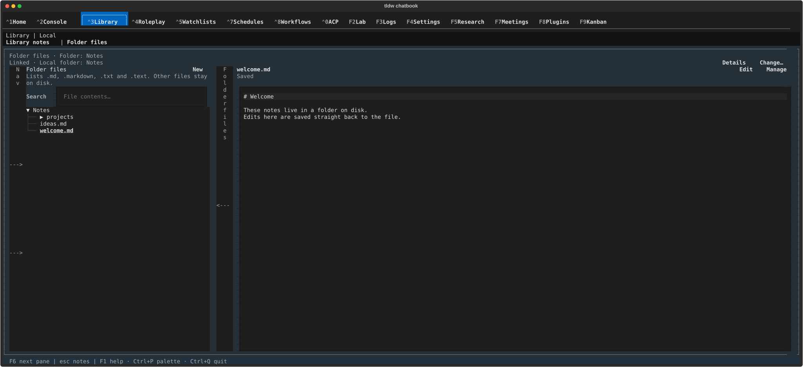

# Folder files — plain notes on disk, edited in place

## What this screen is for

Folder files edits ordinary files that live in a folder you choose on disk —
what you see in the editor is exactly what's in the file, and saves write
straight back to it. It is a separate system from [Library notes](notes.md):
nothing here is stored in the Library's own database, there are no templates or
database mirror, and no "Use in Console" handoff. This is also the key
difference
from Library Notes lasting sync: lasting sync keeps a reviewed relationship
between a managed Library folder and a local folder, while Folder files mode
edits that folder directly with nothing mirrored anywhere. Reach for it
when your notes are a
folder of Markdown files (a wiki, a repo's docs, an Obsidian vault) and you
want to read, edit, search, and — if the folder is a Git repository — stage
and commit this session's edits, then publish that exact Chatbook-created
commit to its existing upstream, without leaving the app.

## Getting there

Open [Library](../library.md) (**Ctrl+3**), pick **Notes** in the rail's
Browse section (on a brand-new profile that section is not there yet — see
"Getting there" in [Library notes](notes.md) for the three routes that are),
then use the source strip at the top of the canvas: it reads
**Library notes** | **Folder files**. Click **Folder files** — while the
workspace loads you'll briefly see "Opening File Notes…". Focus lands in the
**Files** search box, or on **Choose folder…** while no folder is linked; a
later return to Notes from the rail lands there too. At wide sizes,
Library navigation and the Folder files tree have separate slim collapse
grips. Each pane remembers its own choice; collapsing the tree does not also
collapse Library navigation or the Library notes list. On compact
terminals, Library shows the Folder files canvas as the single visible stage so
its controls remain on-screen; **Escape** or **Library notes** returns to the
Library notes view. Escape climbs one step at a time: from inside the file
editor it first returns to the **Files** tree (the footer reads `esc files`),
and the next press leaves Folder files for Library notes (`esc notes`). Either
switch first saves any unsaved edits on the side you're leaving.

The first editable file opened during a wide Notes work session closes Library
navigation automatically once to make room. That temporary close does not
change your saved pane choice. Reopen Library navigation with its grip and it
stays open for the rest of the work session. Opening another file, switching
between Edit and Manage, autosaving, resolving a conflict, or resizing does
not close it again. The automatic close resets only when you close or clear
the open Folder files file, switch between Folder files and Library notes,
change the linked folder, clear the selected Library note, or leave Notes.
Using compact **‹ Files** does not reset it. (Was "**Back to navigator**" —
the Session Git panel and the Folder-files
work pane now use the same "‹ " cue as the Notes editor, naming where it
goes.)

## Layout tour

- **Source strip** (above the workspace) — **Library notes** | **Folder
  files**, with **Folder files** marked as the selected source. At wide sizes
  the strip stays visible while you are in Folder files: it is a mode of
  Notes, not a separate screen, and **Library notes** is the way back. On
  compact terminals the strip collapses to a **‹ Library / Notes** cue
  instead.
- **Library navigation** (left of the workspace) — the same Library rail as
  the rest of the screen, so you can leave for Media, Prompts or Skills
  without going back through Notes first. The rail is there before a folder
  is linked too — the file list and the editor are what wait for a folder,
  not the rail — but its collapse grip arrives with the folder, so before
  linking the rail is simply always open. Once linked, the grip collapses
  it. On compact terminals (under about 120 columns) the rail is collapsed
  whether or not a folder is linked, so the empty state takes the full
  canvas width there.
- **Folder link row** (top) — before setup the status reads "Choose a notes
  folder." with buttons **Details** and **Choose folder…**, and the line
  under it explains the mode: "Folder files edits Markdown files in a folder
  on disk, in place. Nothing is copied into the Library." When a notes
  folder is already configured, a **Use \<folder\>** button offers that
  folder directly. Once linked, the status becomes "Linked · Local folder:
  \<folder\>" (or "Checking · Local folder: …" / "Offline · Local folder: …"
  when the folder can't be verified, or "Warning · Local folder: …" when its
  recovery copy needs attention) and the button relabels to
  **Change…**. On a narrow terminal, down to 40 columns, the state word
  stays whole: "Local folder:" is dropped first, then the middle of the
  folder name (`Linked · Res...tes`), then the name itself; where only one
  state word fits, "Offline" stays and "· Warning" goes. **Details** opens
  the read-only "File Notes folder details"
  dialog. A folder-change reason that is currently owning the row (see
  "While a folder change runs" below) replaces this summary until you try
  again; the linked-folder detail stays available in the row's tooltip and
  in Details throughout.
- **Authority line** (above the folder link row) — "Folder files · Folder:
  \<folder\>", followed by this session's edit count once you have changed a
  file: "· Git · N change(s)" when the folder has been confirmed to be a Git
  repository (a `git rev-parse` check runs once per linked folder, and a
  trusted Session Git repository counts too), and "· N session change(s)"
  otherwise — a plain folder never says "Git" (task-32543). A running or
  failed Git operation, or a folder problem, takes this slot instead. So does
  a background refresh of the folder that fails ("· Refresh failed"), even
  while a narrow navigator hides the work area; it clears on the next refresh
  that succeeds.
- **Folder navigator** (left) — a **New** action, a "File contents…" search
  input, the **Files** tree of everything under the linked folder, and a
  **Search results** tree that appears only while a query is active. Directly
  under the pane's heading it states what it lists — "Lists .md, .markdown,
  .txt and .text. Other files stay on disk." — so a `notes.csv`, a
  `meta.yaml`, a Canvas folder or an attachments folder is explained rather
  than silently absent: this workspace only ever edits note files, and
  everything else in the folder is left exactly as it is. Every
  folder whose name starts with a dot is hidden — `.git`, and Obsidian's own
  `.obsidian` and `.trash` alike (task-32552); Folder files edits the folder
  in place, so those stay exactly as they are on disk, just out of the tree
  and out of search. A file under such a folder that an earlier version had
  indexed is simply forgotten on the next scan, not listed under "Recently
  deleted". Its grip
  collapses or restores this tree independently of Library navigation and the
  Library notes list. Large folders and direct-path
  search fallbacks show 100 rows at a time; activate **Load more** to append
  the next 100 without rebuilding the entire tree.
- **File work area** (right) — a breadcrumb ("No file selected" until you
  open one; "Recently deleted: \<path\>" right after a delete), an
  Idle / Dirty / Saving / Saved / Conflict / Error status, and **Edit** /
  **Manage** modes. Edit gives the file body nearly all available space;
  Manage groups path details, file actions, Session Git, and Danger. With no
  file open there is no save state and no body box: the status line reads
  "No file open." rather than claiming a save, and the editor appears when
  there is a file to put in it. The breadcrumb and the absolute path under
  **File details & path** each stay on one row; a long path is shortened in
  the middle with … so the file's own name stays in view.
- **Narrow terminals (under 80 columns)** — Folder files switches between
  the navigator and the file work area. Opening a file switches to the work
  area, which takes the whole width, and its **‹ Files** returns to the
  navigator with focus in the **Files** tree. A click or key press right after
  a resize keeps the control you chose; the resize's focus restore never takes
  it back. From 60 columns the navigator keeps a narrow work area beside
  the **Files** pane. Below 60 the **Files** pane takes the whole width and
  the work area stays hidden until you open or select a file, so **Tab**
  never lands on a control you cannot see. Reopening Folder files with its
  grip from the work area gives the navigator the whole width too. **New**,
  any open or save that fails or is refused, and a conflict with the file
  on disk also bring the work area forward, with its message and recovery
  (for example "Save failed" and "Next: Save Copy."). Cancelling **New**
  returns to the navigator with **New** focused. While a save failure or a
  conflict stands, a resize below 60 columns keeps the work area in view.
  **‹ Files** still returns to the navigator; opening another file is then
  refused and brings the failure back. While the work area is hidden, the
  navigator's header shows its own **Manage** beside **New**, in the Tab
  order: it opens the work area in Manage, where **Review
  session changes (N)** opens Session Git, with or without a file open.
- **Session Git panel** — **Manage** → **Review session changes (N)** opens
  the staging, commit, and guarded-push panel described below;
  from the row list, **Esc** or **‹ Files** returns to the files.
  In the file editor itself, **Esc** returns to the **Files** tree; a second
  **Esc** leaves Folder files.
  During commit or push, **Esc** follows the phase-specific safe action in the
  keyboard table below.

### Linking a folder without a mouse

Every step has a keyboard route (task-32606):

1. From the notes list, **Shift+Tab** back to the mode strip at the top of the
   screen until **Folder files** carries the focus underline, then **Enter**.
2. With no folder linked, focus is already on **Choose folder…**; press
   **Enter**. Once a folder is linked, focus starts in the **Files** search
   box: **Shift+Tab** back to **Change…** and press **Enter**.
3. The picker opens with the **Folder path** field focused and its value
   selected — type or paste the folder and it replaces what was there.
4. **Enter** browses into the typed folder; **Tab** then **Enter** on
   **Select folder** links it. **Esc** leaves the picker without changing anything.

While the picker is open the bottom row of the terminal shows the picker's own
keys instead of Library's, starting with `esc Cancel` — that row is how you
tell you are inside the dialog. The keys are clickable as well as typable, and
clicking one does what pressing it does: `esc Cancel` closes the picker, and
every other key runs without closing it.

The row is ordered by usefulness and the overflow scrolls off the right edge,
so how much of it you see depends on your terminal's width. At 100 columns it
ends around `f5 Refresh direc`; the keys past that — `^r Show recent
locations` and `^s Select this folder` — appear only on a wide terminal.
`^s Select this folder` is dimmed wherever it does appear: it belongs to the
file-and-folder picker Import once uses, and this dialog's **Select folder**
button does that job instead.

## Features & controls

### Folder link

| Control | What it does |
|---|---|
| **Choose folder…** / **Change…** | Opens the "Choose File Notes Folder" picker; the choice is saved to `[file_notes] root` in config.toml. It opens on the linked folder when there is one, and otherwise on the folder you last picked through it (`[file_notes] browse`) — or your home directory the first time. With nothing remembered yet, it tries the folder `[notes] sync_directory` names before your home directory. The **Folder path** field holds focus from the moment the picker opens, with the folder it opened on selected, so the first thing you type replaces that path rather than going into the file listing (task-32606). Press **Enter** to browse into what you typed, or **Select folder** to use it right away without needing Enter first; an invalid path shows an inline reason and leaves the picker open. The listing opens with folders first in name order (**Sort** still offers discovery order and the rest), each folder saying how many notes sit directly inside it and marking an Obsidian vault as `· vault`. The count reads at most 500 entries of a folder; past that it shows a floor such as "48+ notes". A hint line reads "Enter Open · Select folder to use this folder"; **Ctrl+R** offers the folders you last chose through this door and **Enter** on one uses it without browsing (task-32611, task-32643) |
| **Details** | Opens "File Notes folder details" — a read-only status report; **Close** or **Esc** dismisses it |
| **Review…** | Appears only while a restored backup's pairing for this folder awaits your review — the folder line then reads "Warning · …", and the button's tooltip reads "Review the recovered folder pairing". Opens the pairing review, which compares the folder on disk with its retained recovery copy before you approve it. **Close**, **Esc** or a click outside the review closes it without approving, and focus returns to **Review…** |
| **Cancel** (folder change) | Appears once a folder change has been running about three seconds — the same moment the line stops being a bare "Changing folder…". Press it to stop waiting: the status reads "Folder change cancelled · previous folder kept" and the folder you already had stays linked |
| **Keep waiting** (folder change) | Appears beside **Cancel** once a folder change has been running about three seconds. Grants the change one more full 30-second budget; it can be used once per change, then the control goes away |
| **Choose another** (folder change) | Appears with **Keep waiting**. Abandons the change, keeps the folder you already had, and reopens the folder picker in one step |
| **Use \<folder\>** | Appears only before a folder is linked, and only when a configured folder still exists. It reads `[file_notes] root` — the key **Choose folder…** writes — and falls back to the legacy `[notes] sync_directory`; either must name an existing folder by absolute path in config.toml. Links that folder without opening the picker |

While a folder change runs, the folder line reads `Changing folder…` and the
row holds nothing else. If it is still going after about three seconds it
starts reporting how far the scan has got — `Changing folder… · 1,240
entries so far` (or `· still working` before the first count) — and that is
when **Cancel**, **Keep waiting** and **Choose another** arrive: the way out
appears with the line that admits one is needed. Those three are then the
whole row: **Details** and **Change…** step aside, because **Details**
would only repeat the line you are already reading and **Change…** is
inert until the change ends, which is what **Choose another** is for.
After 30 seconds the change gives up on
its own and the folder line itself reads "Folder change timed out · previous
folder kept. Try again or choose a different folder." That reason stays on
the folder line until you start another folder change or open a file.
Either way the previously linked folder is untouched — unless the change had already
finished saving when you cancelled, in which case the folder line says
"Folder change finished before it could be stopped · now linked to the new
folder." and the new folder is the one in use.

A folder change never drops a draft that is not saved yet. While a save has
failed or conflicts, the change is refused and the folder line reads "Folder
not changed · your draft is not saved yet." until the draft saves, you start
another folder change, or you open a file. Save the draft first (**Retry
save** or **Save Copy**, below), then change the folder.

Abandoning a folder change — by **Cancel**, by **Choose another**, or by
letting it time out — also stops the folder scan itself. Picking a different
folder afterwards works normally; you do not have to restart the app.

Leaving Folder files while a change is running abandons it as well — Esc,
the "‹ Library / Notes" cue and moving to another screen all do. The folder
line goes with the surface you left, so that outcome arrives as a
notification instead: "Folder change cancelled · previous folder kept".

### Edit and Manage

**Edit** is the ordinary writing view. It keeps the file body prominent and
shows only safe actions that become relevant to the current state, such as
Restore, Compare, Resolve conflict, Retry save, Reload from disk, or Save Copy.
Saving is automatic; there is no ordinary Save button.

**Manage** keeps less-frequent controls in clearly named sections:

- **File details & path** shows the exact linked path and save details.
- **File actions** contains Move, Reload, Save copy, and **More file actions**;
  the latter reveals Protect/Unprotect and Refresh when available.
- **Session Git** contains **Review session changes (N)**.
- **Danger** contains Delete, separated from routine file work.

**New**, **Move**, and **Save copy** are named path tasks rather than one
always-visible path field. Start the task, enter its labeled target such as
`ideas/today.md`, and choose its named action: **Create**, **Move**, or **Save
Copy**. Only one path task can be open at a time; starting another replaces it
after any pending save or conflict is handled. **Cancel** or **Escape** closes
the path task and returns focus to the action that opened it. **Restore** is
contextual and restores the recently deleted path without asking for a target.

| Control | What it does |
|---|---|
| **New** | Opens a **New file path** task; **Create** makes an empty file at that absent relative path and opens it — there is no file picker for creating content |
| **Move** | Opens a **Move file to** task; its **Move** action moves the open file to that relative path |
| **Delete** | Two-press: first activation shows "Activate Delete again to confirm.", second deletes ("Deleted. Restore remains available.") |
| **Restore** | Brings back the most recently deleted file |
| **Protect** / **Unprotect** | Toggles protection on the open file ("Protected." / "Unprotected."); every save to a protected file first stores a checkpoint of its previous contents in the local recovery database |
| **Reload** / **Reload from disk** / **Discard draft and reload** | Re-reads the open file from disk. **Reload from disk** becomes immediately visible in Conflict; in Error, the destructive label is shown. The first activation opens a confirmation with **Cancel** focused; only **Discard draft and load disk** replaces the editor contents |
| **Retry save** | Appears only after a save fails (Error). Runs the save again with the editor text unchanged and returns focus to the file body; no typing needed. A Conflict does not offer it: there the choices are **Compare**, **Resolve conflict**, **Reload from disk** and **Save Copy** |
| **Compare** | Appears only for a Conflict and opens a read-only Base / Draft / Disk comparison without resolving the conflict or changing the editor |
| **Resolve conflict** | Appears only for a Conflict and discloses the three bounded choices described below; none overwrites the changed disk file |
| **Save copy** | Opens a **Save copy as** task; **Save Copy** writes the complete editor draft to that absent path. It is available as an ordinary Manage action and as a safe recovery action when relevant |
| **Export exact copy** | Replaces **Save copy** for a large read-only file and opens a named path task that streams the complete current disk bytes, not the visible excerpt, to an absent path |
| **Refresh** | Re-scans the folder and rebuilds the **Files** tree |

Saving is automatic: edit and the status walks Dirty → Saving → Saved. If a
save fails, the status reads "Save failed — your draft remains in the editor.
Next: Save Copy." and **Retry save** tries again. If the linked folder cannot
be reached while a draft is not saved (a failed save or a conflict), the status
ends "Next: Reconnect the folder.": a folder change would drop the draft, and
Save Copy writes into the same folder, so neither works until the folder is
back. Once it is, the next step returns to Save Copy, and **Retry save** writes
the draft. If the
file changes on disk underneath you, the status shows Conflict and keeps the
draft in the editor. **Compare** identifies Base (the body loaded into the
editor or last saved), Draft (the current editor body), and Disk (the latest
readable file body). It shows bounded Base-to-Draft and Base-to-Disk unified
comparisons; oversized sides keep their exact sizes and SHA-256 identities and
report that diff output was omitted or elided. A deleted or unreadable Disk side
is named explicitly. Closing Compare returns to the conflict without resolving
it or changing any side.

Folder files does not use **Ctrl+S** and does not assign a replacement. Keep
typing and autosave writes the file. When the file body has keyboard focus,
only its boundary becomes more prominent; its background and size do not
change. Compact inputs such as a named target path keep their usual filled
focus treatment.

**Resolve conflict** keeps **Compare** available and opens three explicit safe
choices:

- **Keep editing** closes the resolution choices and returns focus to
  **Resolve conflict**. The Base, Draft, Disk, and Conflict state are unchanged.
- **Save draft as new note** opens the named **Save copy as** task. It writes
  the exact draft only when that destination does not already exist, then
  opens the new note after the write succeeds.
- **Discard draft and load disk** opens the same Cancel-first, freshness-checked
  confirmation described below. It is the only resolution choice that can
  replace the editor draft.

There is no overwrite choice. If the proposed new-note destination already
exists, File Notes leaves both that file and the conflict draft unchanged.

**Reload from disk** (Conflict) or **Discard draft and reload** (Error) first
reads the current disk
version and asks for confirmation. **Cancel** or **Escape** preserves the exact
draft and conflict. **Save Copy** stays available while the confirmation is
open, so opening its named path task remains a safe exit and dismisses the
reload decision without changing the original file. Confirming rechecks the
root, file, editing session, and disk version before it replaces the draft. If
any of those changed, reload stops with recovery guidance and leaves the draft
untouched.

### Session Git — stage and commit session edits, then push the exact commit

Open **Manage** and choose **Review session changes (N)**. Consequential Git
states such as checking, pushing, or needing attention also remain visible in
the work header, so you do not have to leave Edit merely to learn that work is
still running.

The panel is headed "Review session changes" with the scope line "Review and
commit only notes changed during this Chatbook session." and the keyboard
guide "Up/Down select · Tab actions · Enter run · Esc back". Before anything
runs it shows "Repository: not checked" / "Status: NOT CHECKED". *(Was
headed "Prepare session for commit", with the scope line "Session paths only
· stages complete file state" and a pipe-separated, title-case keyboard
guide. All three were real once and all three were rewritten by task-15122
on 2026-08-11.)*

**Trust first.** Press **Trust and check status** and a confirmation dialog
titled "Trust repository for session changes?" appears (was "Trust Session
Git repository?"):

> Repository: \<path\>
>
> Trust lasts only for this application process. Git status and staging may
> execute configured Git filters, including arbitrary programs with side
> effects outside Chatbook.
>
> Continue only if you trust this repository and its Git configuration.

**Cancel** is focused first, so Enter alone runs nothing. Confirming with
**Trust and check status** checks the repository and, from then on, a
**Refresh** button takes the trust button's place. Focus lands on the row
list as soon as the first status arrives, so the panel's own line is true
from where it leaves you: **Up/Down** moves between rows, **Tab** steps into
that row's actions, **Enter** runs the focused one. The actions render
directly under the rows — **Stage** / **Unstage**, then bulk actions, then
**Commit staged (N)** — rather than at the floor of the pane.

**Rows.** Each file edited this session gets a row whose second line states
where it stands:

| Row status | Meaning |
|---|---|
| READY TO STAGE · Git: unstaged | Your edit can be staged |
| STAGED · by Chatbook | Already staged from here |
| UPDATE AVAILABLE · newer note edits are not staged | You edited again after staging |
| UPDATE REQUIRED · stage the moved note before unstaging | A move needs restaging first |
| NO ACTION · matches HEAD | The file equals the last commit |
| BLOCKED · already staged outside Chatbook; manage this path in Git, then Refresh | Hands off — you staged it yourself |
| BLOCKED · ignored by Git / Git conflict / Git unavailable | Fix the condition outside Chatbook, then **Refresh** |

On a narrow pane the status line switches to a shorter recovery step and
shortens the reason. When too little room is left for the reason, it is
dropped: an ignored row reads "BLOCKED · fix ignore, then Refresh", a conflict
row "BLOCKED · Conflict: use Git; Refresh", and a Git unavailable row
"BLOCKED · Restore Git first; Refresh".

With no session edits the panel says "No current-session Git changes."

**Staging and committing.** Use **Stage** / **Unstage** on a row, or
**Stage all (N)** / **Unstage all (N)**. **Commit staged (N)** stays disabled
behind the gate "Stage at least one session note to commit" until something
is staged. It then opens the commit form — **Subject** (placeholder
"Required commit subject") and **Body (optional)** — and **Review commit**
runs a pre-check ("Checking commit...") before showing a decision-first
review. **What** contains the exact message as Git will record it. **Where**
names the local repository, branch, and exact parent commit. **Impact**
lists the author/committer, included-note counts and complete staged-file scope,
plus the hook and signing policy. **Recovery** explains when to edit, cancel,
or use **Check again** without retrying an uncertain commit. **Technical
details** is collapsed by default and holds filesystem-identity audit evidence;
**Show included notes (N)** remains a separate disclosure for every file going
in. Finish with **Confirm commit**, or step back with **Edit message** /
**Cancel commit**.

The commit review states the exact scope — for example, "2 session notes will
be committed; unrelated changes untouched", or "1 session note will be
committed" for a single file. A successful commit is still local: Chatbook
never starts a push automatically. Its receipt ("Committed 1 session note as
…; unrelated changes untouched.") appears under the file's save state, above
the Edit or Manage pane.

#### Guarded push

After a successful guarded commit, the panel can expose
**Review push (1 commit)…** for that exact commit. The candidate exists only
in the current app process. It does not include older commits, commits made
outside Chatbook, or later note edits.

1. Press **Review push (1 commit)…**. Chatbook first checks the candidate and
   the existing upstream using local information only; the panel reads
   "Checking push candidate…" and offers **Cancel check**.
2. Before any network or authentication-helper contact, the
   **Authorize configured destination** dialog shows the sanitized endpoint,
   local branch, full destination ref, transport, and process-only
   authorization scope. **Cancel** has initial focus. **Endpoint Details**
   exposes the complete sanitized destination, while **Authorize and check**
   starts the authorized read-only remote preflight; it does not push. That
   exact-destination authorization also covers final revalidation and the
   reviewed push. Existing approved HTTPS credential helpers or the existing
   SSH agent may run after authorization, but terminal prompts remain
   disabled. The panel then reads "Checking remote before push…" and still
   offers **Cancel check**.
3. Read the immutable decision-first review. **What** identifies the exact
   commit, parent transition, and included session-note provenance. **Where**
   shows the local repository and branch, configured destination, full ref,
   sanitized endpoint, exact parent lease, transport, and authentication
   policy. **Endpoint details** remains independently available for the
   selectable endpoint fields. **Impact** states the publication scope, local
   hook bypass, later-local edits, and possible remote hooks, branch policy,
   CI, or mirrors. **Recovery** explains how to leave without pushing and how
   an uncertain result is checked without another push. Collapsed **Technical
   details** contains only duplicate/internal audit evidence.
4. **Back** has initial focus. Choose **Push 1 commit** only after confirming
   the destination. Chatbook freshly re-checks the candidate, configuration,
   authorization, and remote parent before requesting the one reviewed ref
   update.

You may use **Cancel check** before the network push process starts. Once the
panel says "Pushing 1 reviewed commit…", cancellation is unavailable;
**Back to Files — push continues** lets you keep editing while the owned
operation settles. Reopening **Manage** → **Review session changes** reattaches
to that same operation or result without starting another request; the header reports
**Push checking**, **Pushing**, or **Push needs attention** as appropriate.

| Push result | Meaning and next step |
|---|---|
| **Already published** | The destination already points to this commit. Chatbook sent no push. Choose **Back to session**. |
| **Succeeded** | Git accepted the exact update and a final check observed the commit. Choose **Back to session**. |
| **Blocked** | Chatbook refused the check or update before it could prove the exact destination ready. **Review again** starts a fresh proof; follow the displayed recovery copy or use external Git. |
| **Failed with no update currently observed** | Git reported failure, every owned process ended, and a final check still observed the reviewed parent; remote-side work may still occur later. Use **Review again** for a fresh proof, not an automatic retry. |
| **Uncertain** | Chatbook cannot prove whether the destination accepted the update. Do not push again automatically. After all owned processes settle, **Check remote again — no push** queries the original destination without sending another update. |

While owned descendants are settling, **Check remote again — no push** is
disabled with "Owned push descendants are still settling; checking becomes
available after every owned process ends." Once started, recovery reads
"Checking uncertain outcome…" / "This check does not push." and offers
**Back to Files — check continues**.

A query-only check reports **Succeeded** if it observes the candidate, without
claiming what caused the update. Observing the parent leaves the result
**Uncertain** because remote work could still finish. A missing or different
destination ref, or a failed/unprovable query, reports **Needs attention** and
should be inspected with external Git. Changed trust or configuration may
require destination authorization again before a query.

Uncertain-recovery evidence lives only in the current app process. Exiting
Chatbook removes the **Check remote again — no push** attribution; after a
restart, inspect the destination with external Git before taking further
action.

A local refusal, changed destination, deleted or divergent remote branch,
unsupported authentication policy, or lost proof never broadens the push.
Follow the panel's recovery copy and use external Git when the guarded path is
not available.

## Common tasks

1. **Link a notes folder.** Open **Folder files** (source strip), press
   **Choose folder…**, pick the folder in "Choose File Notes Folder". The
   status becomes "Linked · Local folder: \<folder\>" and the **Files** tree
   fills in.
2. **Create a file.** Press **New** above the Folder files tree, enter a path
   such as `ideas/today.md` in the **New file path** task, and choose
   **Create**. The file is created on disk and opened; start typing and it
   saves automatically.
3. **Find text across files.** Type a query into "File contents…" —
   a **Search results** tree appears under the **Files** tree; pick a result
   to open that file. Activate **Load more** when a direct-path result set has
   another 100 rows. Clear the query and the tree disappears.
4. **Resolve a disk conflict.** Use **Compare** to inspect Base, Draft, and
   Disk. Press **Resolve conflict**, then either keep editing, save the exact
   draft to an absent new-note path, or enter the Cancel-first discard
   confirmation. No choice overwrites the changed disk file.
5. **Stage and commit this session's edits, then push the exact commit.** Open
   **Manage** and choose **Review session changes (N)**,
   trust the repository if asked, press **Stage all (N)**, then
   **Commit staged (N)**. Fill in **Subject**, press **Review commit**,
   confirm the exact message and "unrelated changes untouched" scope, then
   press **Confirm commit**. For the resulting local commit, press
   **Review push (1 commit)…**, inspect **Endpoint Details**, choose
   **Authorize and check**, review the exact destination and parent lease, and
   finally choose **Push 1 commit**. If the result is **Uncertain**, use
   **Check remote again — no push** instead of pushing again.
6. **Restore a deleted file.** After a delete the breadcrumb shows
   "Recently deleted: \<path\>" — press **Restore** and the file is back on
   disk and in the tree.

## Keyboard & commands

| Key | Action |
|---|---|
| Ctrl+End / Ctrl+Home (file editor) | Move the caret to the end / start of the file; the footer shows `ctrl+end end of file` while the editor has focus |
| Esc (file editor) | Return to the **Files** tree without leaving Folder files (footer: `esc files`) |
| Esc (Files tree, or anywhere else in Folder files) | Leave Folder files for Library notes (footer: `esc notes`) |
| Esc (named path task) | Cancel New, Move, or Save copy and return to the action that opened it |
| Up / Down (Session Git panel) | Select a row |
| Tab (Session Git panel) | Move into the selected row's actions |
| Enter (Session Git panel) | Run the highlighted action |
| Esc (reload confirmation) | Cancel reload, preserve the draft and conflict, and return focus to the action that opened the confirmation |
| Esc (Session Git panel) | Step back safely: row list → Files; commit form → cancel; commit review → edit message; candidate/remote check → cancel; push review → Back; active push/uncertain recovery check → Files while it continues; push result → session |
| Esc (dialogs) | Close "File Notes folder details" or **Endpoint Details**; cancel the repository-trust or destination-authorization dialog |
| Esc (folder change running) | Leaves Folder files for Library notes, exactly as it does when nothing is running — the folder change is abandoned and the previously linked folder is kept. The same applies to the "‹ Library / Notes" cue, the **Library notes** button, switching rail rows, the command palette and Ctrl+Q: a running folder change never blocks the way out |

Folder files does not register **Ctrl+S** and does not replace it with another
save shortcut. File edits save automatically, and **Ctrl+Q** writes a pending
edit to the file before Chatbook exits. If that write cannot finish (the file
changed on disk, or the write fails), Chatbook asks 'Quit and discard unsaved
changes to "<file>"?' with **Keep editing** selected instead of exiting.

## Related settings & docs

- **config.toml `[file_notes]`** — `root` is the linked folder; written
  whenever you use **Choose folder…** / **Change…**. `browse` is where that
  picker reopens while no folder is linked yet: the folder you last picked
  through it, written on every pick, and ignored in favour of your home
  directory if it no longer exists. **Import once** and **Keep a folder
  synced** keep their own separate keys, see [Library notes](notes.md).
- [Library notes](notes.md) — the Library-stored notes system, with
  templates, reviewed **Add from files…**, lasting root management, and Console
  handoff. Folder files is different — the files *are* the notes.
- [Library](../library.md) — the parent screen; [guide index](../index.md)
  for global keys.
- There is no deeper Docs/Features write-up for File Notes or Session Git —
  this page is the reference.

## Quirks & troubleshooting

- **The "Chunking Lab / Try selected text" pair is not part of this
  canvas.** The two buttons live in the Library rail's **Details ▸ Actions**
  group, under the line "Chunking Lab — compare how text is split for
  search", and open a full-screen developer tool for comparing chunking
  strategies; **Escape** there returns to the Library canvas you came from.
  See [Library overview](../library.md). *(Was "It paints under the header
  on every Library canvas … Escape does not leave it … demoting it is
  tracked as task-32064" — superseded by task-32064, which is Done: the
  strip left the header, the pair moved into Details ▸ Actions, and the Lab
  gained its Escape route.)*

- **YAML frontmatter is hidden from the editor and kept exactly as it is on
  disk.** A file that opens with a `---` block (Obsidian properties, for
  example) shows only the body below it; the block itself is never displayed
  and never edited here. A line above the editor says so — "N lines of YAML
  frontmatter above this body are hidden here and kept exactly as they are on
  disk" — and every save writes those bytes back unchanged, so properties
  survive a Chatbook edit. Edit the block itself in your own editor.
- **Per-file caps: 8 MB and 2,000,000 characters.** Edits that would push a
  file past either limit are refused at save time. A body above 200,000
  characters opens read-only with exact byte and character sizes and a labeled
  first-100,000-character excerpt. Use **Export exact copy** to stream the
  complete current file to a new path; the excerpt is never used as the copy.
- **Staging is session-scoped and whole-file.** Only files touched in this
  session appear in the panel, and staging records each file's complete
  current state — not a partial diff. A path you already staged outside
  Chatbook shows BLOCKED here on purpose: finish it in Git, then **Refresh**.
- **Trust doesn't persist.** The "Trust repository for session changes?"
  dialog returns after every app restart — trust lasts only for the running
  process, by design.
- **Guarded push is deliberately narrow.** It publishes only the exact guarded
  commit created in this app process, to its one existing tracking upstream,
  while that remote branch still points to the reviewed parent. Restarting,
  changing the root/repository, or making a newer guarded commit removes or
  replaces the candidate. Chatbook does not range-push older/ahead commits,
  add or repair remotes/upstreams, create remote branches, browse history or
  remote status, pull, fetch, merge, rebase, manage credentials, or retry
  pushes in the background. Configure and perform those operations with
  external Git.
- **Push requires an admitted secure setup.** Guarded push uses existing
  noninteractive HTTPS or SSH authentication on POSIX. HTTPS can use the
  existing macOS `osxkeychain` helper; SSH requires safe standard
  `known_hosts` trust and an existing SSH agent. It does not read default
  private-key files, follow custom SSH routing, or prompt. Git LFS-managed
  candidate paths, unsupported transport/configuration, missing or unsafe
  trust material, and Windows execution block; use your external Git or
  Git/LFS workflow in those cases.
- **Local remote-tracking state may remain stale after success.** The guarded
  operation updates only the approved remote ref; it does not fetch or update
  the local remote-tracking ref. Refresh that state later with external Git if
  you need it.
- **No Console handoff.** Unlike Library notes, media, and prompts, this
  workspace has no "Use in Console" — copy text out manually if you need it
  in a chat.
- **Structural actions wait during Git work.** While a stage, unstage, commit,
  push check, push, or uncertain recovery owns Session Git, root changes and
  other structural/Git actions remain gated. Ordinary editing and autosave stay
  available. Retry structural work after the operation or recovery settles.
- **Search and Restore need the recovery database.** Both are backed by a
  local index; if it can't be opened you'll see "Recovery unavailable:
  \<error\>", search falls back to a slower direct scan, and **Restore** may
  be unavailable.
