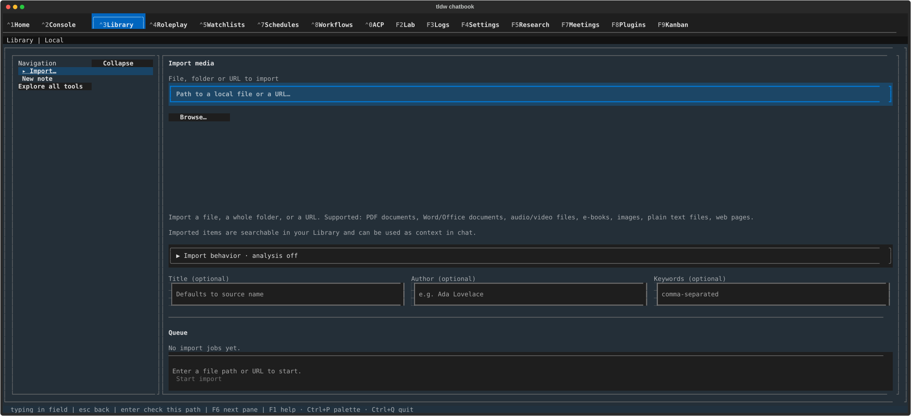

# Library Import & Export — getting content in, packaging it out

## What this screen is for

These are the Library's two doorways. **Import media** turns files, folders,
and URLs into Library media — checked before they run, queued while they
run, and searchable afterwards. **Export bundle (.zip)** packages your local
media, conversations, notes, and Prompts/Recipes into a single portable `.zip`
you can archive or share. Come here when you want the app to know about a
document, a recording, or a web page — or when you want to carry your
content somewhere else.

## Getting there

Press **Ctrl+3** for Library (see [the Library overview](../library.md)),
then either:

- Click **"Import…"** — the primary button at the very top of the
  left rail — to land on Import media directly.
- In the rail's **Import / Export** section, click **"Import…"** or
  **"Export"**.

Scoped exports also arrive here on their own: use **"Export…"** in the Media,
Conversations, or Prompts panels — or **"Export"**, bare, in Notes, which is
the one canvas spelled without the ellipsis — (or the select-mode
**"Export selected"**, spelled **"Export"** in Media). Each opens the same
Export bundle (.zip) form, pre-limited to that content
(see [Media & Conversations](media-and-conversations.md)).

In server mode the **Export** rail row is disabled, with the tooltip
"Export packages local content only."

From another screen, press **Ctrl+P** and choose **Library: Import…** or
**Media & Content: Import New Media** to open the same form.

## Layout tour

**Import media**, top to bottom:

- **Header** — "Import media". When a server is configured, a target line
  follows ("Imports run on this machine." / "Imports run on the server.", or,
  while the Library is local, "Imports run on this machine. Switch the
  Library to server mode to import on the server."), and in server mode a
  switch button ("Import on the server" ↔ "Import on this machine") follows
  the line. With no server configured there is no target line.
- **Path field** — labelled "File, folder or URL to import", with the
  placeholder "Path to a local file or a URL…", "Browse…" and
  (once something is typed) "Clear", which empties the field and leaves
  the caret in it. On a fresh visit, two orientation
  lines sit below: "Import a file, a whole folder, or a URL. Supported:
  PDF documents, Word/Office documents, audio/video files, e-books,
  images, plain text files, web pages." and "Imported items are
  searchable in your Library and can be used as context in chat."
- **Pre-check summary** — as soon as you enter a path the form shows
  "Checking…", then replaces it with a type breakdown ("1 PDF document,
  2 audio/video files"; a URL reads "1 web page"), a size estimate
  ("3 files · 1.2 MB" — omitted for URLs, whose size isn't known ahead of
  time), any "⚠" warnings about missing tooling, and — if some files
  can't be handled — "2 unsupported files will be skipped: …" (importing
  on the server, the same line reads "will fail", because that backend
  records a failure row rather than skipping quietly). A path may start
  with `~` (`~/Documents/paper.pdf` is read as your home folder's
  `Documents/paper.pdf`). A path that cannot be found shows one line under
  the field — "Can't find that path — check it, or use Browse… to pick a
  file or folder." — with a "Choose a file…" button. Enter (and Start
  import) start an import only once the pre-check for what is in the field
  has finished; pressing Enter while "Checking…" is shown starts the import
  when the check lands, and never when the check says the path is wrong.
  When the check has refused what is in the field — it could not find the
  path, or the folder is empty or holds nothing it can import — the footer
  reads "enter check this path": Enter re-runs the check (so a file you
  have just created or added to the folder is picked up) and imports if it
  now passes. Leaving the Import canvas, picking a different file with
  Browse…, or any screen that opens over the Library — F1 help, the Ctrl+P
  palette, any dialog, and the Browse… picker even when you cancel it —
  cancels a waiting Enter: nothing imports until you press again.
  The pre-check does
  **not** contact a URL: it reads the address, not the site, so nothing is
  fetched while you are still typing one. A URL that turns out not to be
  fetchable is reported by the import job itself, where the failure carries
  a real reason. (You can turn a link check back on with `[library]
  ingest_url_preflight_probe = true` in `config.toml`; it then runs only
  when you leave the field, press Enter, pick with Browse…, or press
  "Retry check" — never while you type — and an address it cannot check
  reports one plain "The link could not be checked ahead of time. The
  import will still be attempted." A link that answers but says the page
  does not exist still reports "URL unreachable — the server says this page
  does not exist (HTTP 404)." The check obeys your `[web_security]`
  settings and follows no redirects.) When the import is
  aimed at the server, the missing-tooling block is replaced by a single
  quiet note ("1 local component isn't installed — that affects imports
  on this machine only; this one runs on the server."): those extras
  belong to a machine that is not doing the work, so installing them
  would not change the run.
- **Options** — "Expand all" / "Collapse all", then one fold per detected
  content type. An untouched fold uses only its short type name; after you
  change a setting, its title becomes a concise receipt of those changes.
  A title also leads with a value that needs fixing ("⚠ Chunk size needs
  fixing") and names options a missing package blocks ("Audio & video —
  13 options unavailable — needs faster-whisper installed").
  Word/Office
  documents (.doc/.docx/.odt/.rtf) get their own fold; the Plain text &
  HTML fold's Analyze/Chunk/Encoding options still apply to them as the
  always-present base. Each fold ends with "Reset to defaults", which resets
  only that type's options. Changing a choice, toggling an option or resetting
  one fold preserves the text and selection in your other editors, including
  metadata and the custom analysis prompt. Dependent fields and their reasons
  update in place; long checkbox explanations wrap in compact terminals.
  Option edits also clear any pending Start or "replace form" confirmation.
- **Metadata** — three persistently labeled fields: "Title (optional)",
  "Author (optional)", and "Keywords (optional)". Example/default guidance
  remains in the placeholders while the labels survive entered values.
  These apply to everything in the import.
- **Start** — a forecast line, a quiet gate line ("Enter a file path or
  URL to start.") and the "Start import" button, kept together in a pinned
  review bar so a long pre-check cannot push the decision below the fold.
  Recovery and confirmation text wraps at narrow widths so the full reason
  stays readable above Start. The empty explanation keeps one reserved row.
  After submission the blank review bar hides so Queue activity gets the
  viewport. The forecast is one
  sentence of counts for the staged selection — "2 will import · 1 will
  skip · 4 will fail (3 need tooling, 1 empty)" — and it counts a file
  whose type needs tooling you don't have as a failure, not an import,
  because the pre-check has already warned that the tooling is missing.
  The failure segment names its reasons whenever tooling is one of them,
  so you can tell which part of the number an install would change. The
  line stays on screen while a gate blocks Start (a bad option value, a
  selection with nothing importable), so the numbers you were reasoning
  about don't vanish at the moment you need them — it goes quiet only
  when this runtime has no import path at all (no job queue, no media
  database), where a count would promise something nothing can deliver.
  Two hedges are carried rather than rounded off: when the duplicate
  check hit its candidate cap the match count is a floor and the import
  count is therefore a ceiling, so the line reads "at most 5 will
  import · at least 20 will match"; and when the import is aimed at a
  **server**, the local tooling inventory says nothing about it, so the
  line reads "5 will be sent to the server · server tooling isn't
  checked from here" rather than pretending to know what the server has
  installed. What the forecast *can* know about a server import is which
  files that backend will not take at all — images, and anything with no
  recognised format — and those are counted as failures with the reason
  named: "3 will be sent to the server · 2 will fail (unsupported by the
  server)". "Unsupported by the server" is not "unreadable": an image
  imports fine on this machine, it simply has no place in the server's
  import API, so switching the target back to this machine changes the
  number. An empty (0 B) file is counted as a failure on both targets,
  and on both targets that is this app's own doing: a server import
  refuses a 0-byte file here rather than uploading it ("empty.txt is
  empty; there was nothing to send."), so the count never depends on
  what a server would have made of an empty upload.
- **Queue** — the "Queue" heading, a per-state count line while jobs
  exist ("This queue: 1 parsing · 2 queued · 1 done" — task-2859: the
  "This queue:" prefix replaced a trailing "— in queue" suffix that
  self-contradicted whenever every listed job was already done or
  failed), one line per job with action buttons underneath,
  "Clear finished", and a collapsed "Recent imports" fold listing the
  last finished jobs. A batch's header names the folder you chose —
  `inbox — 6 files` for an import of `inbox/`, whatever order the scan
  walked its subfolders in — then `active` plus exact state counts
  (`1 queued · 1 done · 1 failed`) rather than adding a contradictory
  `running` synonym. Empty state: "No import jobs yet."
  When a batch settles, one notification sums it up ("Import finished —
  3 imported · 1 failed"), not one per file.
  When jobs are left needing attention, the Library landing's card names
  the counts rather than just flagging them: "Last import: 4 files
  failed, 2 skipped." with a **Review** button back to the queue.
  Pressing "Start import" scrolls the Queue heading into view, so the
  freshly queued rows are the first thing you see after a submit. Queue
  updates keep keyboard focus on the current action. If that action disappears
  or becomes unavailable, focus returns to the source field; a newer focus
  choice takes precedence.
- **Fold indicator** — while the form is taller than the pane, a pinned
  "▼ more — scroll for the rest" row holds the bottom edge; it disappears
  once everything fits. Tab and Shift+Tab reveal focused controls above both
  this hint and the pinned Start area. **Retry this batch** shows the complete
  "Press again to replace form" confirmation before replacing an edited draft.

**Export bundle (.zip)** is a single form: the "Export bundle (.zip)"
header, a scope line ("Everything: 128 media items · 542 conversations · 87 notes · 34
prompts", or "Prompts · 34 items" when you arrived scoped; "Counting…" while
it tallies), the "Export name" and "Description (optional)" fields, a
"quality: …" chooser with a helper line matching whichever option is
actually selected (task-2859: "keeps a small preview image instead of the
full file" / "shrinks media files before adding them to the zip" /
"copies full media files into the zip" for thumbnail/compressed/original
respectively — a single fixed "original copies full media files…" caption
used to show regardless of the selected option) (shown only when media is
in scope), "Choose destination…"
above "No destination chosen", and the "Export bundle (.zip)" submit
button. The chooser opens on **original** — full fidelity — so a bundle
only loses content when you ask it to (task-32353). Skills and Collections
captures are never part of a bundle.

Directly above the submit button, two quiet lines say what pressing it
will write, before you press it (task-32353): a **bundle line** —
"Bundle: 2 media items · text + keywords only · about 4 KB before compression" —
naming how many items are going in, what the archive holds for each of
them, and how much content that is (the written `.zip` is smaller; the
receipt after the run reports that file's own size). "text + keywords only"
is not a summary of the quality chooser: whatever that control is set to, a
bundle holds each item's stored text, its details and its keywords, never
the original media file — the Library does not keep a path to one. Keywords
on media, notes and conversations travel in the bundle and come back on
import. Every scope that can include media — Media and Everything — keeps
the "only"; the Notes, Conversations and Prompts scopes, which carry no
media, read "text + keywords". The line is absent when
the scope is empty, where "Nothing to export in this scope." is the only
thing worth saying. And a
**contents list** naming the items themselves, up to 20 of them, then
"+ N more". Where the size cannot be known up front (an "Everything"
export spans four sources, only one of which can be measured beforehand)
the line says "size known once it runs" rather than guessing, and the
contents list is absent. Both appear once counting finishes.

When the submit button is off, its reason is on the line directly beneath
it — "Choose a destination before exporting.", "Nothing to export in this
scope.", "Waiting for item counts before exporting.", or "An export is
already running." (task-32362). It is the same sentence the tooltip shows,
so a keyboard-first reader never has to hover to find out why.

A "Cancel" button appears while an export is running. Once an export
finishes, a receipt line appears above the submit button and stays there —
it updates in place after each further export and survives switching to
another rail row and back, for the rest of the session.

The receipt is read back out of the bundle that was written, not out of
what you asked for: "✓ exported · 12 items · 348 KB · /path/to/out.zip"
counts the items the archive's own manifest ended up holding. If a run
collects nothing at all — every selected item deleted underneath you, say
— no bundle is written; the form shows "✗ export produced no content · 3
items were selected" and the submit button becomes "Retry export". (Before
task-32232 a selected-media export wrote a bundle holding only a README
and reported success, because Media select mode's ids never reached the
collector in the form it parses.)

## Features & controls

### Conversation and `.chatbook` portability

Current `.chatbook` packages preserve a conversation's complete included
message graph: stable export-local message and parent identities, branches,
assistant variants and their order, the selected leaf, deleted eligibility,
and each assistant owner's validated provider-continuation checkpoint. Import
validates and remaps the complete graph before attaching any checkpoint, so an
ID collision cannot move private state to a sibling variant. Opening or
importing a package never starts or resumes tools.

Ordinary conversation JSON is intentionally narrower. It exports only the
active path with an explicit public message projection and, when present, an
`_private.provider_continuation` field attached to that assistant item. It does
not serialize whole database rows, off-path variants, transient UI fields, or
metadata bags. Older flat `.chatbook` packages remain readable, but when they
cannot prove the private field's exact owner, visible messages import and exact
tool continuation is discarded with a safe warning.

Both formats can therefore contain private model state, tool arguments, and
provider-bound tool results. Protect them as you would the full conversation;
Chatbook adds no separate file encryption. Text, Markdown, rendered transcript,
clipboard-message, search/FTS, summary, title, log, error, and usage exports do
not include this private field. Invalid, unknown-version, contradictory, or
oversized private data is dropped while usable visible messages still import,
and the warning never quotes the rejected data.

Library access authority is intentionally less portable. The **device-local
Library policy**, authorization checkpoints, activity summaries, and
preparation receipts are not synced or exported. The conversation's validated
**assistant generation state** and an exactly owned provider continuation can
travel so a branch remains coherent, but importing or syncing never starts
tools: **unresolved imported or remote state remains inert**. When a valid
continuation is resumed, the exclusive continuation handoff removes its
checkpoint before any tool is allowed to run, as required by
[ADR-063](../../../backlog/decisions/063-hosted-provider-wire-and-durable-tool-continuation.md).

| Import control | What it does |
|---|---|
| "Browse…" | Opens the "Import media" file picker (remembers your last folder). Large folders [load progressively with progress and sorting controls](../file-picker.md). The listing shows Name / Size / Modified column headers, human-readable sizes ("512 B", "2.4 MB", never a bare byte count), no size on folder rows (including ".."), and a labeled "File name:" input at the bottom. That input is also the path field: type or paste an absolute path (or one starting with "~") into it and the listing jumps there as you type, and Ctrl+A selects what is in it. Folders and URLs are typed or pasted into the canvas's own path field instead. |
| Pre-check warnings ("⚠ …") | Name a missing optional package, what it's needed for, and the install command that fixes it. Audio/video warnings follow the selected transcription provider; alternative backends and retired MLX providers are not requirements. Auto uses faster-whisper; choose Parakeet (ONNX) or transcribe.cpp explicitly to use that installed backend. The summary shows one "⚠" line counting the affected files ("⚠ 3 of 21 files need optional tooling — those imports may fail."), a "Copy install command" button that copies one command installing every missing extra, and a collapsed "What's missing" fold holding each warning. A compact "Copy install command" button sits right under the warnings (with several distinct commands, each button names its extra, e.g. "Copy install command (audio)", "Copy install command (video)"). Copy checks native clipboard delivery where available. If delivery cannot be confirmed, the warning details open so you can select the literal command manually. |
| "Choose a file…" / "Retry" | Offered under pre-check errors — pick a different path, or re-run the check after a network hiccup. |
| Per-type options | Every dropdown shows a plain-language choice (the internal value still travels to the pipeline). PDF documents: "PDF engine" ("PyMuPDF (plain text)" / "PyMuPDF4LLM (Markdown)" / "Docling (layout-aware · OCR-capable)" / "Docext (vision-model OCR)"), "Enable OCR (docling or docext engines only)", "OCR language", "OCR backend" ("Auto (let Docext choose)" / Docext / Tesseract / EasyOCR / PaddleOCR / Docling — docext engine only). Word/Office documents: "Processing method" ("Auto (Docling when installed)" / Docling / "Native per-format parser"), "Enable OCR (docling method only)", "OCR language". Audio & video: "Transcription provider" ("Auto (faster-whisper)" / "Parakeet (ONNX)" / "Faster Whisper" / "transcribe.cpp (GGUF)"), "Local Parakeet model folder", "Transcription model" (the full faster-whisper catalog — Tiny through Large v3 including the English-only ".en" variants, the distilled "Distil" family, and the community "Large v3 Turbo" / "CrisperWhisper" builds), "Language", "Translate to English (via faster-whisper)", "Include timestamps", "Speaker diarization", "Voice activity detection (VAD) filter", "Start at" / "Stop at" (trim bounds, HH:MM:SS or seconds — blank means unbounded; "Stop at" is an absolute position in the recording, not a length measured from "Start at", and means the same thing for audio and video files), "Cookies file for gated URLs" (a Netscape cookies.txt path for yt-dlp; video URLs only — the file must exist when the job runs, otherwise the import proceeds without cookies and the queue row says "cookies ignored: …"; the import only reads the file and never deletes it), "Recursive summary (map-reduce)" (with Analyze after import + chunking: summarizes each chunk, then combines the summaries). E-books: "Extraction method" ("Filtered (skips covers & front matter)" / "Markdown (keeps headings & structure)" / "Basic (every section · plain text)"), "Chunking method" ("By chapter" / "By sentence" / "By word count" / "By paragraph"), "Include table of contents". Images (.png/.jpg/.jpeg/.gif/.webp/.bmp/.tiff/.tif): "Extract text (OCR)" (on by default — the extracted text is what gets imported), "OCR language", "OCR backend" ("Auto (best installed backend)" / "Docext (vision model)" / Docling / Tesseract / EasyOCR / PaddleOCR). Plain text & HTML: "Analyze after import", "Chunk content", "Chunk size", "Chunk overlap", "Encoding". Web pages (URLs): "What to fetch" ("This page only" / "Site map" / "Pages under this URL" / "Follow links (recursive)"), "Maximum pages", "Maximum depth". |
| PDF / document OCR | The OCR checkbox is inert under engines that cannot OCR — the label names the capable ones. "OCR language" rides the OCR toggle; the PDF "OCR backend" applies to the docext engine only. |
| Inert (grayed) options | Any option whose precondition isn't met renders dimmed on a darker field AND says why at its label — "Local Parakeet model folder — needs the parakeet-onnx provider", "Maximum pages — single-page fetch selected", "Chunk size — needs Chunk content on", "OCR language — needs Enable OCR on"; a missing optional package reads "— needs <package> installed". Flip the named gate and the field wakes up. |
| "Translate to English" | Transcribes audio/video into English regardless of the spoken language. Runs via faster-whisper — the toggle is inert under parakeet-onnx and transcribe-cpp, which cannot translate. |
| Image imports | An image's imported content is the text OCR finds in it, so OCR needs a backend installed (any one of docling, tesseract, easyocr, paddleocr, or docext — the pre-check "⚠" warning carries an install command when none is present). PaddleOCR counts only with `paddle` installed beside it, and docext only with one of `gradio_client`, `transformers` or `openai`. An image with OCR off, or in which OCR finds no text, fails its row honestly ("No text was found in …") instead of storing an empty, unsearchable entry. Images import locally only — a server-mode submission refuses them, since the server's ingest API has no image type. The Images fold applies to image FILES: a link to an image (`https://…/chart.png`) is pre-checked and imported as a web page, because the URL pipeline fetches and clips pages and has no image-download step. |
| E-book "Chunking method" | "chapters" (the default) stores one retrieval chunk per chapter; sentences / words / paragraphs chunk by that unit using the Chunk size/overlap values. Chapter chunking now works for PDFs and other documents too, not just e-book files — the same engine method underlies both, so a PDF imported with the chapter scheme is split by its headings/chapters rather than rejected or silently re-split. |
| Web "What to fetch" on a local import | The multi-page methods (sitemap / url_level / recursive_scraping) run only on the server. Selecting one while importing on this machine shows "Multi-page fetch runs on the server — this local import fetches one page." right under the control. |
| "Analyze after import" | Runs an LLM summary of each imported item, stored alongside it (visible in the Reader's **Analysis** mode). The whole `[analysis_defaults]` section travels — provider, model, temperature, top_p, min_p, max_tokens, system_prompt — so the stored analysis matches what the Reader's Generate would produce under the same config; the key comes from `[api_settings.<provider>]` or the provider's usual environment variable. While `[analysis_defaults]` still names the shipped provider and model (OpenAI · gpt-4o), analysis uses your chat provider and model from `[chat_defaults]` instead, so a provider you connected in setup also runs analysis (here and in the Reader's Generate). A provider or model you set under `[analysis_defaults]` is always used as written, and nothing is rewritten. When that provider is not ready, the line above Start says where it came from, for example "Analyze after import is on, but analysis uses its own default (OpenAI · gpt-4.1, set under [analysis_defaults]), and OpenAI is not ready (…)" or "… analysis uses your chat model (Anthropic · …) …". The toggle's state rides the collapsed **"Import behavior"** panel's own title even while the fold is closed — "Import behavior · analysis on" / "· analysis off" — so the setting is not hidden inside a fold you have to open to check. When the option is on but no provider is callable — including a configured provider the analysis pipeline cannot dispatch ("provider 'X' is not supported for ingest analysis") — a line above Start says so ("Analyze after import is on, but … Imports will run without analysis.") and finished rows read "Imported name — analysis skipped: <reason>". If the analysis call itself fails (provider error), the import still succeeds and the row reads "Imported name — analysis failed: <reason>" instead of silently storing nothing (or worse, the error text). Once a provider IS configured, an **"Analyze N skipped"** button appears above the queue — one action, over every analysis-skipped id currently in the queue (not per batch), so a 40-item run left skipped by a missing provider does not mean 40 manual Reader visits. Pressing it runs the same Select-mode Analyze worker; each fixed row's line updates in place to "✓ analyzed · name" or "✗ analysis failed · name · reason". If one of the ids turns out to already carry an analysis (fixed some other way since the import completed), that id is skipped automatically and a notice says how many ("2 already analyzed · skipped") rather than silently overwriting it or arming a choice on a canvas you are not viewing; if every id already has one, the press says "Nothing left to analyze" and runs nothing. The button stays absent while no provider is callable, and disables for the duration of a run; leaving Library mid-run reports where it stopped and how to continue it. |
| "Chunk content" | Governs every type: off means no retrieval chunks are stored at all; on chunks plain text / documents / HTML too (not just PDF/e-book/audio), using "Chunk size" and "Chunk overlap" — both measured in words. (The import forms expose the handful of methods that make sense per type; the chunking engine underneath implements the full roster — words, sentences, paragraphs, tokens, semantic, json, xml, ebook_chapters, rolling_summarize, propositions, fixed_size, code, code_ast, structure_aware — for anything that calls it directly, including `ebook_chapters` for PDFs and documents.) |
| "Chunking template" | In the Import behavior fold, above the queue: pick one of your chunking templates (the live rows from RAG Admin) instead of setting method/size/overlap by hand. Defaults to "None (manual settings)" — today's behavior exactly. A picked template's chunking scheme beats the form's untouched size/overlap defaults; only a value you explicitly changed in the form overrides the template. The choice is remembered per imported item (it drives a later re-chunk of that item), and the import form's list loads from the database when the canvas is shown — newly created or renamed templates appear the next time you enter the Import view. The control is hidden in server mode (a server import never carries a template), and it is inert with "Chunk content" off ("— needs Chunk content on"). A template that no longer resolves (deleted or renamed after the choice was made) fails that import row with a named error instead of silently chunking a different way. |
| "Chunking template" — "Auto" | The picker's other choice, listed right after "None (manual settings)": let the app pick the chunking scheme per item. Auto decides in three steps and always lands somewhere: (1) if one of your templates carries a **classifier block** that matches the item (its `media_types`, plus optional `filename_regex` / `title_regex` / `url_regex`, cleared its `min_score`), the highest-scoring match wins and runs in full — preprocessing, chunking and postprocessing, indistinguishable from picking it by hand; (2) otherwise a media-type-aware plan from the same auto planner the server uses derives the method/size/overlap; (3) if that declines too, today's plain defaults apply — Auto never fails an import, it can only explain why it declined. Templates opt in by carrying a classifier block: a template without one is never auto-picked (the built-ins ship without blocks, so nothing changes until you author one), and blocks are added through the template authoring path in RAG Admin / the service layer. The name "auto" is reserved — you cannot create or rename a template to it — so the choice can never be shadowed by a row. The decision is recorded per item and **re-decided, not replayed**: a later re-chunk re-runs the selection against the current template store (add, delete or re-score classifier blocks and the re-chunk follows the new outcome), and the item's stored record is re-stamped to say what the re-chunk actually used. Auto is exclusively this picker choice — the `[chunking] default_template` config key never triggers it (a configured default is an ordinary template name). |
| "Encoding" | How plain text and HTML files are decoded: "Auto-detect (UTF-8 first)" (strict UTF-8, then detection) or an explicit UTF-8 / UTF-16 / "Latin-1 (ISO-8859-1)" / "Windows-1252 (Western)". A wrong explicit choice shows up as replacement characters rather than failing the import. |
| "Install verified Parakeet v2 INT8 (630.6 MiB)…" | In the Audio & video fold, enabled when the provider is parakeet-onnx (under any other provider the button is inert and its label ends "— needs the parakeet-onnx provider"). Opens a consent dialog listing Source, Revision, License, Download size, and Destination, ending "All four files are checked against pinned sizes and SHA-256 digests before the bundle becomes usable." Buttons: "Cancel" / "Install". |
| "Start import" | Queues everything the pre-check found. If overridable "⚠" tooling warnings are outstanding, the first press doesn't submit — the line beside Start turns into "⚠ Press Start again to import anyway — N files will fail without more tooling." (or "… N files may fail." when the missing package is only an optional enhancement) and a second press (or a second Enter in the path field) starts the import. See "Consent for risky imports" below. Missing selected transcription runtimes block Start; unavailable model files or VAD block queue creation with a repair instruction. These requirements cannot be overridden by a second Start press. Start is unavailable, with the reason stated at the button, when the selection has nothing importable: "This folder is empty — there's nothing to import. Choose a folder with files, or a single file." for a folder that really is empty, "Nothing in this folder could be scanned — 2 entries were skipped: folder imports pass over hidden files, links, and folders they can't read. Import a file directly, or choose another folder." for a folder whose entries the scan passed over, and "Nothing in this selection can be imported — N unsupported files." when nothing in it has a handler. Importing on the server adds one more: a selection this machine reads perfectly well but that backend will not take at all (a folder of nothing but images) gates Start with "Nothing in this selection can be sent to the server — 3 files unsupported by the server. Switch to importing on this machine, or choose video, audio, document, PDF or e-book files." — a different sentence from the one above, because the files are fine and the destination is the problem. None of these leaves a failed row behind: the import never starts. |
| Queue rows | "● queued / parsing / writing · name" while working, "✓ done · name · 4s" on success, "✗ failed · name · reason" (plus " · retry 1" after a retry) on failure, "– skipped · name · reason" for a file the pipeline never attempted (an unsupported type), "⊘ cancelled · name" when stopped on purpose. The reason is always plain language and carries its next step on the same line where one exists — a worker that cannot start on this machine reads "The import worker couldn't start on this machine (system resource limit) · Restart the app, then Retry", never a raw errno. Server jobs carry an " · on server" suffix. |
| Row actions | "Open in Library" (done, local) jumps to the new media item; "View on server" (done, server); "Show details" shows the full error — offered on **every** failed row that has one, including failures with no structured reason; "Retry" re-queues a failed job; "Cancel" stops an in-flight server job; "Dismiss" removes a failed row. A skipped row is never offered Retry: the file would be skipped again. |
| "Show details" | Opens inline under the row: a plain-language reason ("Reason: No text could be extracted." / "The file couldn't be read." / "The file is empty." / "The Library couldn't be written to."), the full message when it says more than the row line, the underlying tool output once (never repeated between the message and the chain), and — only when a retry could actually change the outcome — one line of advice derived from that same reason. A deterministic failure whose text actually named a remedy says so ("Retrying now will fail the same way — install the tooling named above first, then Retry."); when nothing on screen named one, the advice states the determinism without inventing a remedy ("Retrying now will fail the same way — this file's content, or the tooling for it, has to change first."); a named missing package is named ("Missing dependency: pymupdf. Install it, then Retry."); and a cause we can't classify says nothing rather than encouraging a retry that would repeat itself. When a failure carries no structured reason at all, the expansion shows the underlying text verbatim — that is where an errno, a spawn error, or a tool's own output lives, out of the row line but one press away. Pressing it keeps the keyboard on the button you pressed — it toggles to "Hide details" under your finger and Tab from there walks on into the queue, never back up to the "Keywords (optional)" field of the next import. The same holds for a grouped row's "Show the N files". |
| Grouped failures | When several files in a row settle the same way for the same reason — a whole folder stopped by one cause — they collapse into a single line: "✗ failed · 4 files · The import worker couldn't start on this machine (system resource limit) · Restart the app, then Retry". Three actions sit under it: **"Show the 4 files"** reveals the members' own rows (with their own Show details / Retry / Dismiss) and turns into "Hide the 4 files"; **"Retry all"** re-queues every member, and is offered only when a plain retry is right for every one of them — a group of transcription failures shows no "Retry all", because those rows offer "Choose another GGUF…" / "Retry with faster-whisper" instead and a bare retry would fail the same way; open the group to reach them; **"Dismiss all"** clears the whole group in one press. Only settled outcomes group — failed, skipped and cancelled. Rows still working (queued, parsing, writing) never do, because their per-file progress is the point, and a reason that names its own file (a missing path) is per-file too, so those keep their own rows. A group of one is exactly the row it always was, filename and all, and grouping never reorders the queue: only a run of neighbours from the same batch collapses (files imported one at a time count as one batch), so a batch's own header always sits above rows counting that batch alone. |
| "Recent imports" | Starts collapsed and lists recent results, including cleared and dismissed rows. Opening or closing it survives background queue updates; keyboard focus stays on its title while you read the history. |
| "Clear finished" | Removes all done and failed rows at once (two presses: the first arms and renames the button "Press again to clear N finished…"). |
| "Retry this batch" | Below the queue, once your last import of the session has settled (while a job is still queued/parsing/writing it is hidden, and `r` is inert too — re-staging mid-run invites a duplicate batch): one press puts that submission's source, options, title, author, and keywords back into the form and re-runs the pre-check from scratch — install the package a warning named, press it, and the fresh forecast reflects the fix. If the form currently holds work the re-stage would overwrite (a different path, a title you started typing, an option you flipped), it takes two presses: the first renames the button "Press again to replace form" and changes nothing. It stages, not submits: review the forecast and press "Start import" again. Keyboard: `r` (anywhere on the Import canvas outside a text field). |

Resizing the terminal keeps the current Import control focused and visible,
including metadata fields, options, queue Details and Recent imports. Your draft,
text selection and open Recent imports history stay in place.

Choosing a replacement GGUF keeps your next import draft in place. From a failed
row, an accepted model selection retries that job; cancelling the picker or
choosing an unusable model leaves it failed. If the retry removes the focused
row action, focus returns to the source field. A newer focus move or navigation
away from Import is respected when model validation finishes.

For local audio/video imports, the summary beside **Start import** names the
transcription backend and effective model. **Auto** uses
`[transcription] default_model`: fresh installs use `base`; existing configured
choices, including `distil-large-v3`, are preserved. Choosing **Faster Whisper**
explicitly uses the **Transcription model** selection instead. Custom model paths
are shown as “custom model” in the summary; server imports use server settings.
Each local Auto submission keeps the model shown when Library was opened,
including while queued. Restart Chatbook after editing `default_model` externally
to load the new choice; saved settings and the Auto selection stay unchanged.

**Parakeet setup:** Installing the Python package adds the transcription runtime;
it does not download the model files. In the Audio & video options, select
"Parakeet (ONNX)", then press "Install verified Parakeet v2 INT8 (630.6 MiB)…"
and confirm the displayed download plan. This installs the English v2 INT8 model
and selects it for the batch. Leave "Local Parakeet model folder" blank to use
the model installed through Chatbook; that field is an optional override for
model files you already have. Its "Browse…" button picks a folder and fills
in only that field; the rest of your draft stays as it is.
The install button downloads v2 INT8 specifically,
so use English and INT8 with that bundle.

Before a local audio/video import starts, Chatbook checks the selected runtime
and model files. A missing selected runtime blocks Start and provides an install
command for Chatbook's Python environment. Selecting a different installed
provider does not require installing the alternatives. Restart after installing
packages so the running app can detect them.

Model files are separate from Python packages. Missing or incomplete Faster
Whisper caches (including missing vocabulary files) report a model-download
remedy; catalog model IDs, including distilled and community models, include an
explicit download command. These checks do not download anything automatically.
Missing Parakeet models point to **Lab > Models** or the matching local folder;
a missing **Silero VAD** is identified separately with its install remedy.
External Parakeet folders still offer the existing VAD install-consent dialog.
An unsuccessful check keeps your import draft and queues no jobs. Server-targeted
imports use the server's environment and are not blocked by missing local STT tools.

For native clipboard copying on Fedora Wayland, install
[`wl-clipboard`](https://packages.fedoraproject.org/pkgs/wl-clipboard/wl-clipboard/)
(`sudo dnf install wl-clipboard`). X11 sessions can use `xclip` or `xsel`.
SSH and browser sessions use the client-facing clipboard route; terminal or
browser permissions can prevent delivery. An unconfirmed-copy warning leaves
the command visible for manual selection.

**Consent for risky imports** — starting with overridable "⚠" tooling warnings
outstanding takes two presses, right at the Start button (task-3314
retired the old "Some files may fail to import:" dialog). The first press
converts the line beside Start into "⚠ Press Start again to import anyway
— N files will fail without more tooling." naming how many staged files
cannot be handled at all without it ("1 file" when only one), or "…
N files may fail." when the missing package only degrades the result.
That count is the same number the forecast line above it reports — both
are renderings of one computation, so they cannot disagree. The second
press — button or Enter,
they behave identically — starts the import. You can arm with Enter in
the path field and confirm with the Start button, or the other way
round; moving focus between the two presses does not cancel anything.
Selected transcription runtime, model and VAD requirements must be repaired
before queue creation; this confirmation cannot override them. For the remaining
tooling warnings, starting anyway is safe: affected files simply fail individually
and show up as ✗ rows you can retry after installing. Esc backs out of the pending
confirm (and stays on the form); editing the path, changing an option,
picking a different file with "Browse…", or a pre-check that comes back
different also cancels it. The "Copy install command" buttons stay under
the warnings the whole time.

If the same source is already queued, parsing, or being written for the chosen
Local or Server destination, the first Start press queues nothing and the line
beside Start says the import is active. Press Start again after the brief
double-press guard to deliberately queue one duplicate. Local and Server are
separate, finished jobs do not block another import, and a folder is admitted
as one batch: the first press queues none of its files, while the confirmed
second press queues the whole unchanged selection. When tooling and active-source
warnings occur together, one confirmation accepts both, so the complete action
still takes two presses rather than three. Editing the request, changing its
destination, or leaving the Import canvas cancels pending consent.

| Export control | What it does |
|---|---|
| "Export name" | Pre-filled "Library export 2026-07-31" (today's date); becomes the bundle's display name. |
| "quality: original" | Opens on "original" (full fidelity, task-32353). Press to open a one-row strip of thumbnail / compressed / original (✓ on the active one) right under the button; pick one directly, or press the button again / Escape to close without changing. While the strip is open, the narrow-stage **‹ Library** return is disabled until the strip closes. The helper line underneath always describes the option currently showing. Only "original" copies full media files into the zip; the others keep the package small. |
| "Bundle: N media items · text + keywords only · about X KB before compression" | What pressing Export will actually write: how many items go in, what the archive holds for each (stored text, details and keywords — never the original media file, whatever the quality chooser says — the "only" stays on every scope that can include media, Everything included; the Notes, Conversations and Prompts scopes read "text + keywords"), and how much content that is. Keywords on media, notes and conversations travel in the bundle and come back on import. The archive itself is smaller — the receipt after the run stats the written `.zip`. Reads "size known once it runs" when the scope's size cannot be measured up front. The count is the items still exportable, so a selection whose item was trashed underneath reports what will really be written. Absent for an empty scope. Appears once counting finishes. |
| The contents list | The titles of the items going into the bundle, up to 20, then "+ N more". Absent when the scope's items cannot be enumerated before the run. |
| "Choose destination…" | Opens "Choose Export Destination". Whatever you pick is normalized to end in `.zip`; if that file already exists, an "Overwrites <name>" note appears (informational — exporting proceeds and replaces it). A destination that cannot be written is refused right there, with the reason on the line under the button and nothing accepted — "Can't save there: The folder \<path\> does not exist.", "… \<name\> is a file, not a folder.", "… That name is a folder." |
| "Export bundle (.zip)" | Enabled once counting has finished, the scope is non-empty, and a destination is chosen. "Nothing to export in this scope." appears when the scope is empty; either way, the reason is printed on the line directly below the button AND repeated in its tooltip (or "Write the bundle to the chosen destination." once it's ready) — a disabled press can never look like it silently did nothing. |
| "Cancel" | Visible only while an export is running; stops it. The quiet line above keeps reporting progress throughout ("Exporting (N items)…" at first, then the phase it's on — "Collecting notes…  3/12", "Packaging archive…  5/9 files"), and once the write has run for about three seconds that same line gains " · still working · Cancel" pointing at this button. Pressing it leaves "Cancelling…" until the run reports back. |
| "✓ exported · N items · X KB · path" | Appears after the first successful export this session; the count and size are read back from the written archive's own manifest, so they report what actually landed rather than what was selected. Stays until the next successful export replaces it. (A receipt restored from an earlier session, before those facts were recorded, still shows as "Last export: <path> · <relative time>".) |
| "✗ export produced no content · N items were selected" | The run collected none of the N items you selected, so no bundle was written at all — nothing on disk to mistake for a real export. The submit button becomes "Retry export". (A single-item selection reads "· 1 item was selected".) |

## Common tasks

1. **Import one file** — Click "Import…", press "Browse…", pick the
   file, wait for the type breakdown, then press "Start import". When the
   row reads "✓ done", press "Open in Library" to view it. The reader opens
   on the new item and the middle Items list lands populated alongside it.
2. **Import a whole folder** — Type or paste the folder's path into the
   path field (the "Browse…" picker selects single files only). Review the
   breakdown and size estimate — folder scans stop at 1,000 files and note
   " · more files not shown" — then press "Start import".
3. **Import from a URL** — Paste the address into the path field. Pasting
   it does not contact the site; nothing is fetched until you press "Start
   import". A link to a video site imports as audio/video; a PDF link as a
   PDF; other pages under "Web pages", where "What to fetch" / "Maximum
   pages" / "Maximum depth" control how much gets scraped. Press "Start
   import".
4. **Fix a "may fail to import" warning** — Press "Copy install command"
   right under the "⚠" warning in the pre-check summary. Quit the app, run
   the copied command in the environment the app is installed in,
   relaunch, then press "Retry this batch" (or `r`) below the queue — the
   same source and options come back staged, the pre-check re-runs against
   the fixed environment, and the warning is gone.
5. **Export your notes as a bundle** — In the rail click Browse ▸ Notes,
   press "Export" above the list — **no ellipsis on this one**; Notes is the
   only browse canvas whose export action is spelled bare, where Media,
   Conversations and Prompts all use "Export…". On the "Export bundle (.zip)" form
   confirm the scope line says "Notes · N items", adjust the name, press
   "Choose destination…", pick where the `.zip` goes, then press "Export
   bundle (.zip)".
6. **Export all Prompts and Recipes** — In the rail click Browse ▸ Prompts,
   press **Export…** in the list toolbar, confirm the scope says `Prompts · N
   items`, choose a destination, then press **Export bundle (.zip)**. The count
   covers every active local Prompt/Recipe, not only the visible page or selected
   collection. Choose the rail's **Export** row for `Everything` when the bundle
   should also include media, conversations, and notes.
7. **Retry a failed job** — Find the "✗ failed" row in the Queue and press
   "Retry"; the requeued row shows a **" · retry 1"** suffix (then
   " · retry 2", and so on). No Retry button
   means the failure is permanent (unsupported type or missing file) — fix
   the source and start a fresh import, and use "Dismiss" to drop the row.
   A URL your web-security settings refuse fails with a plain receipt:
   "URL blocked — your web-security settings don't allow fetching this
   address. To allow it, add the host to allowed_hosts under web_security
   in config.toml." When the refused address can be read back, the receipt
   names it in place of "this address".

## Keyboard & commands

**Import media** is keyboard-first: **i** opens it from anywhere on the
Library screen (not just the landing — though never while you're typing in
a text field, where `i` stays a letter), and entering the form always
parks the caret in the path field, so you can type or paste a path
immediately. **Enter** in the path field takes two different actions
depending on where you are, and the footer names the one it will take: on a
path that has not been checked yet it runs the pre-check and the footer
reads **`enter check this path`**; once the gate line clears the footer
reads **`enter start import`** and Enter starts the import. With "⚠"
warnings outstanding, Enter,Enter carries the same two-press consent as the
Start button. **r** re-stages your last import of the session ("Retry this
batch") when the queue has settled — inside a
text field it stays a letter. **Escape** first backs out of a pending
"Press Start again" confirm (staying on the form), otherwise returns you
to the Library landing (a half-filled form is kept, same as switching
rail rows). At narrow widths the navigation rail collapses to its reachable
**Nav** handle so the form keeps working width. The footer preserves primary
and recovery actions first, and F1 lists the same state-derived set:
`enter check this path` / `enter start import`, `esc back`, and, when
available, `r retry`.

The Export form has no screen-specific shortcuts. **Escape** there returns
to the canvas whose export action opened it, or to the Library landing when you
came from the rail, and the footer names that destination; while the
quality strip is open the footer reads `enter choose quality` /
`esc cancel` instead. **Escape** also closes
the Parakeet install dialog. Global keys live in the
[guide index](../index.md).

## Related settings & docs

`config.toml` keys, all under `[library]`:

| Key | What it remembers |
|---|---|
| `ingest.backend` | Whether imports target this machine or the server. |
| `ingest.last_directory` | The folder "Browse…" opens in next time. A value that is relative, traversing, or names a folder that no longer exists is ignored; the browser falls back to `[notes] sync_directory`, then to your home directory. Two picks made in quick succession settle on the later one. |
| `ingest_options.<group>.<field>` | Every per-type option, saved when you start an import (e.g. `ingest_options.generic.chunk_size`). |
| `ingest_directory_scan_limit` | Folder scan cap (default 1000). |

"Chunk size" is kept between 100 and 5000 words — values outside that
range are pulled back to the nearest bound when the import starts. An
untouched form submits the defaults the panel displays (size 1000,
overlap 100), identically on the local and server paths.

One thing to know about what chunking does to your text: imported text is
**sanitized before it's chunked and stored** — null bytes and unusual
control characters are turned into spaces, Unicode is normalized to NFC
where that doesn't shift character positions, and bidirectional text
override characters (a known display-spoofing trick) are neutralized. The
chunked, searchable text can therefore differ slightly from the raw file
you fed in. Every stored chunk is also stamped with the chunking engine
version that produced it (visible to the RAG Admin diagnostics report), and
carries richer metadata — offsets into the source, word counts, and the
method used — which is what makes precise citations possible. `tiktoken`
and `defusedxml` now ship as core dependencies, so the `tokens` chunking
method counts real tokens (and says plainly to install tiktoken if it's
missing, instead of silently approximating by word count) and the `xml`
method parses safely by default.

### Offline token tables

A standard Chatbook installation pins `tiktoken==0.14.0` and includes the
reviewed GPT-2, r50k, p50k, cl100k, and o200k tables. Token estimates and the
`tokens` chunking method therefore do not download an encoding on first use.
The bundle is read-only: Chatbook verifies each requested URL, cache key, and
SHA-256 hash and never writes into the installed package.

The bundled inventory is intentionally closed. If a newer model needs an
encoding that is not listed, update Chatbook to a release that includes it or
set an upstream cache explicitly; the standard bundle will not download it.
Token estimates log the load problem and retain their conservative character
approximation. Token chunking still requires a real tokenizer and raises an
error instead of silently returning word-sized approximations.

Advanced callers can set `TIKTOKEN_CACHE_DIR`, or the legacy
`DATA_GYM_CACHE_DIR`, **before the first import of `tldw_chatbook`**. Chatbook
then leaves that value unchanged and uses tiktoken's normal cache behavior.
That cache is caller-owned and may be writable or download missing data; it is
not the immutable offline guarantee described above.

If you use a **chunking template** (the "Chunking template" picker above),
two more things apply. First, a default can be set for every import that
didn't pick one: `[chunking] default_template = "<name>"` in config.toml
(empty by default — no default template). Second, a **chunk's offsets can
be relative to preprocessed text**: most templates run a preprocessing step
(normalizing whitespace, cleaning markdown) before chunking, so a chunk's
start/end positions count into that transformed text, not necessarily the
stored source. Each chunk says which basis it used in its metadata
(`offset_basis`: "source" when nothing rewrote the text, otherwise the
preprocessing operation named) — consumers that need source-relative spans
(navigation, citations) can check that one key instead of guessing. The
item's stored chunk rows also record which template chunked them, alongside
the engine-version stamp.

If you pick **Auto** in that picker, a template's **classifier block** is
how it volunteers for automatic selection: `media_types` matches the
import's type, each of `filename_regex` / `title_regex` / `url_regex` that
matches adds score, and the block's `min_score` gates the result (a block
with no `min_score` selects at any positive score). Highest score wins;
ties break by the block's `priority` and then by name. The stored decision
(`mode: "auto"`, the winning tier and rationale) rides the same
`Media.chunking_config` column a named pick does — template-tier Auto wins
record the winner's name there too, so RAG Admin's usage counts and
"documents using this template" treat them exactly like manual picks, and
stop counting the moment a re-chunk moves the item off that template.

Deep dives: [TRANSCRIPTION.md](../../Features/TRANSCRIPTION.md) covers the
audio/video transcription providers and their optional extras. See also
[the Library overview](../library.md) and
[Media & Conversations](media-and-conversations.md) for what happens to
imported items afterwards.

## Quirks & troubleshooting

- **Unsupported files become ✗ rows on purpose.** Anything the pre-check
  can't classify is still queued and "recorded as a failure", so a big
  folder import tells you exactly what was skipped instead of silently
  dropping files. These rows offer "Dismiss" but not "Retry".
- **The Queue remembers past sessions.** Finished and failed jobs are kept
  between launches. A job still running when you quit comes back as
  "✗ failed · … · Interrupted by app restart" and stays retryable; work
  that was mid-parse is not resumed automatically.
- **"Analyze after import" is off, "Chunk content" is on — by design.**
  Analysis costs an LLM call per document, which a folder import shouldn't
  trigger unasked. Chunking is local and cheap, and without it imported
  documents never show up properly in search and RAG — leave it on.
- **Transcription may need optional extras.** The default audio/video
  provider needs its packages installed; the pre-check warns you and its
  "Copy install command" button hands you the fix. The curated Parakeet
  model is a separate one-press download from the options fold.
- **Export is local-only.** In server mode the rail's Export row is
  disabled ("Export packages local content only.") — switch the Library
  back to local to package content.
- **Mix-ins keep their own identity.** Their Chatbook Prompt records use version
  2 and preserve the exact stored definition, literal body and placement. Prompt
  and Recipe records remain version 1. Imported library entries are not enabled
  in a chat. Mix-in Markdown uses a distinct JSON envelope; malformed or unknown
  versions fail without falling back to an ordinary Prompt. See
  [portable mix-in definitions](prompts.md#portable-mix-in-definitions).
- **Prompt records are portable, not database backups.** They preserve current
  Prompt/Recipe content, separate System/User lanes, keywords, type/format/schema,
  and stored definition. They exclude source IDs/UUIDs, versions, source
  timestamps, deleted rows, retained history, collections, and usage state;
  import assigns ordinary destination-owned identity and lifecycle state. Legacy
  single-`content` Prompt records remain accepted.
- **"Show details" is your first stop on a confusing failure** — when it is
  there. The row action appears **only when the failure carried a detail to
  show**; a failure whose reason arrived with nothing behind it offers no
  "Show details" at all. Infrastructure failures that stop the import
  worker before it reads a single file are the case you are most likely to
  meet. The common one on macOS is exhausted POSIX semaphores, which the
  system reports as "No space left on device" although the disk has room:
  the row reads "The import worker couldn't start on this machine (system
  resource limit) · Restart the app, then Retry", and **Show details** holds
  the raw system message.
