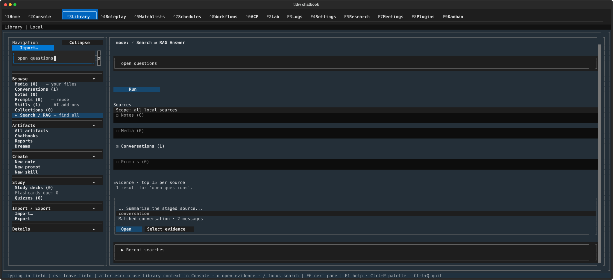

# Library Search/RAG — query your sources and stage the evidence in Console

## What this screen is for

One query across everything in your Library — notes, media, conversations,
and prompts — instead of filtering each list separately. Results come back
as evidence rows with snippets and citations; open a hit in its own editor
or viewer, or select it and send it to Console as grounding for a chat.
Two modes: **Search** (keyword matching, always available) and **RAG
Answer** (semantic retrieval, then a grounded, cited answer generated by
your configured LLM provider — or an honest "nothing supports an answer"
when it can't; needs embeddings support installed, plus a provider).

## Getting there

Two ways, both inside the Library screen (**Ctrl+3** — see
[Library](../library.md)):

- Click the **"Search / RAG"** row in the rail's **Browse** section.
- Type into the rail's **"Search Library…"** box and press Enter — you land
  on this canvas in **Search** mode and the query runs immediately.
  (Submitting the box empty just opens the canvas.)

## Layout tour

Top to bottom on the main canvas:

- **"Search / RAG"** — the canvas title (task-2859: dropped the redundant
  "Library " prefix and now matches the rail row's own "Search / RAG"
  spacing; it used to read "Library Search/RAG").
- **Query row** — the **"mode: ✓ Search ⇄ RAG Answer"** toggle (both modes
  are on the label with ✓ on the active one; one click flips to the other),
  the query box ("Ask or search Library sources"), and **Run** (reads
  "Searching…" while a search is in flight). A one-line status sits
  underneath.
- **"Sources"** — the scope block: a "Scope: …" summary line (reads "Scope:
  all local sources" when every available source is selected, otherwise the
  selected sources followed by what's off, e.g. "Scope: Notes, Conversations
  (Media, Prompts off)") and one toggle per source type — ☐/☑ **Notes**,
  **Media**, **Conversations**, **Prompts**, each with its count, e.g.
  "☑ Media (1)".
- **"Answer"** (RAG Answer mode only) — the generated answer, its
  citations, or an honest abstention; sits between "Sources" and the
  evidence rows. Nothing renders here in Search mode, or before a RAG
  Answer query has run (see [The generated answer](#the-generated-answer)
  below).
- **"Evidence · top 15 per source"** (Search mode) / **"Evidence · top 15"**
  (RAG Answer mode) — the result rows (anatomy below). RAG Answer mode
  drops "per source" because it runs one merged semantic query, not one
  query per source the way Search mode does. The number is your active RAG
  profile's result count, not a fixed 5 — see
  [How deep the search goes](#how-deep-the-search-goes) below.
- **"N results for 'query'."** (task-2859) — a headline right above the
  evidence cards once results land, naming the count actually on screen
  and the query that produced it. Absent while there are no results yet
  (empty state, in-flight search, or a recovery message covers that
  instead), and it tracks whichever rows a source-scope toggle currently
  shows — unlike "Evidence · top N" above it, which stays fixed across a
  toggle.
- **"Recent searches"** — a collapsible fold of your recent queries.

## Features & controls

### Running a query

Type into "Ask or search Library sources" and press Enter or **Run**. The
gates are gentle: with no query the status line reads "Enter a question or
search query."; with every source toggled off it reads "Select at least one
source." Those are quiet nudges, not errors. Real failures are louder — a
callout carrying the reason and its next step on one line. (The full
structured record — why, owner, the config-file remedy — goes to the log,
not the screen.)

The **mode** toggle carries both modes on its label — "mode: ✓ Search ⇄
RAG Answer" — with ✓ marking the active one; a single press flips to the
other mode and resets the current results. Its tooltip names which mode a
press switches *to* and, for RAG Answer, that it's the paid one: "Next:
RAG Answer — calls a paid provider." / "Next: Search — stays local." Once you're in RAG Answer
mode with a provider configured, the query row's status line (silent in
Search mode) names what Run will bill before you press it: "To openai ·
gpt-4.1-mini: question + evidence" — the provider and the model from your
saved defaults (Settings ▸ Providers & Models, the same `[chat_defaults]`
pair First Run wrote; a model saved under the provider's own section is
used when the defaults name none, and never another provider's model).
If no model is saved anywhere the line says "its default model" rather
than guessing. It is a statement, not a confirmation gate; nothing blocks
Run because of it.

Use Tab or Shift+Tab to reach the mode toggle, then Enter to switch. Focus
stays on the toggle so Enter can switch back. Changing mode clears the current
evidence and answer, including any late result from the previous mode, while
keeping your query and Recent searches. It does not start a new search.

- **Search** — keyword matching over your sources; works with nothing extra
  installed.
- **RAG Answer** — retrieval driven by your active RAG profile (see
  [Retrieval mode follows your RAG profile](#retrieval-mode-follows-your-rag-profile)
  below), then a generated answer. If embeddings support isn't
  installed and your profile needs vectors (Semantic or Hybrid), the run
  blocks as "RAG unavailable" with the next step
  `Install RAG support: pip install "tldw_chatbook[embeddings_rag]", then
  restart, or switch mode to Search.` and the recovery pointer
  "Settings > RAG". Installed but nothing indexed yet? The block is
  "Index empty" — "The semantic index has no content yet" — with the
  recovery "Ingest content to index it automatically, run a semantic index
  backfill, or switch mode to Search".

### Retrieval mode follows your RAG profile

RAG Answer's retrieval step is no longer fixed to "always semantic" — it
follows whichever **search mode** your active RAG profile
([Settings ▸ RAG](../settings/rag.md)) is set to:

- **Plain keyword** profiles (e.g. the built-in "BM25 Only") route the
  query through the same keyword search Search mode uses, honestly
  labeled — no vector index required, and no `match: strong`-style
  similarity band on the resulting rows (they read `| keyword match`
  instead — see [Evidence rows](#evidence-rows) below). They also need no
  embedding model: the first query starts at once instead of waiting for
  one to load, and it works without embeddings support installed.
- **Semantic** profiles run vector retrieval, same as before.
- **Hybrid** profiles blend keyword and vector retrieval whenever at least
  one **keyword-indexed source** is selected — which is now all four of
  Media, Notes, Conversations and Prompts. A query narrowed by a RAG scope
  stays on the hybrid path: the scope is pushed into *both* legs, so
  keyword matches from inside your scope reach the results and nothing from
  outside it can. (A scope can only name media and notes, so an active
  scope excludes conversations and prompts from retrieval entirely rather
  than searching them unrestricted.)
- **Prompts are keyword-only.** Nothing builds a vector index over your
  saved prompts, so a prompt reaches hybrid results through the keyword leg
  alone. In practice that means prompts answer *keyword-shaped* queries —
  the words you type have to appear in the prompt's name or body.
  **Two things soften that, and it is worth knowing which is which
  (2026-08-13).** The keyword leg first asks for **every** word you typed,
  function words included. When a source comes back with nothing, it asks a
  second time — dropping the common function words ("the", "a", "for",
  "about", "of", …) *and* treating each remaining word as the **start** of a
  word rather than the whole of it. So "saved prompt for chasing a supplier
  **about** a late order" finds a prompt whose text never contains "about",
  and "watchlist **brief**" now finds a page that only ever says
  "briefing". **The widening goes one way only:** typing `briefings` will
  not find "briefing", and every *content* word you type must still match
  something — as a whole word or as the beginning of one. A long
  natural-language question that would find a note by meaning can therefore
  still miss a prompt. If a prompt you know exists is not coming back, drop
  to the distinctive nouns from its name or body, and prefer the shorter
  form of a word to the longer one.

  (This is the whole keyword leg's behaviour, not a prompts-only rule — it
  is just that prompts have no vector leg to cover for it, so prompts are
  where you notice.)

A quiet one-line disclosure can appear above the evidence rows,
alongside the "No strong semantic matches" / "Semantic search found
nothing from…" lines described below, when the route taken is worth
naming: `Profile 'BM25 Only': keyword search (no vectors).`,
`No keyword leg for the selected sources — semantic only.`, or
`Semantic leg empty — keyword-only results.` (shown when a hybrid
profile's vector leg came back empty but its keyword leg still found
rows — the "Index empty" recovery state is withheld in that case, since
the index genuinely isn't empty).

RAG Answer mode still needs embeddings support installed regardless of
which mode the active profile resolves to, and generating the answer
itself still calls your configured LLM provider either way — only the
*retrieval* step's behavior depends on the profile.

### How deep the search goes

The Evidence heading names the depth — **"Evidence · top 15"** — and that
number is your active RAG profile's **result count**
([Settings ▸ RAG](../settings/rag.md), the **"Default results"** field),
the same setting the Console's Library RAG chip already followed. On the
shipped default profile ("Hybrid Basic") it is 15; "Fast Search" and "Long
Context" ship 5, "High Accuracy" and "BM25 Only" ship 20. Change the
profile — or that field — and the next search on this canvas runs at the
new depth; no restart. (Built-in profiles are read-only, so editing the
number means cloning one first, which Settings ▸ RAG says on the spot.)

Two details worth knowing:

- In **Search** (keyword) mode the count is *per selected source*, so four
  selected sources can produce up to four times as many rows; **RAG
  Answer** mode merges one query across sources and caps the total. That
  is the whole reason the heading says "per source" in one mode and not the
  other.
- Depths above 50 are trimmed to 50 on this canvas. Nothing stops you
  setting a profile to 100 for other surfaces; the evidence list just
  stops there.

A deep list is a scrolling list: the evidence region scrolls, and the
"N results for '…'" headline directly above the rows always names how many
are actually on screen right now.

### Sources scope

The four toggles decide where the query looks: ☑ is in scope, ☐ is
excluded; click to flip, or reach a toggle with Tab and press Enter. Focus
stays on that toggle. A source whose count is (0) is disabled. If your
Library is empty, the scope block takes over entirely: "No Library sources
yet — import media or create notes, then search." with an **"Open Import
media"** button ([Import & export](import-and-export.md)).

Toggling a source off takes effect immediately on the evidence rows
already on screen — it does not wait for the next run. That source's rows
disappear, any selection sitting on one of them is cleared, and staging
it (`u` or **Use in Console**) is refused with the disabled reason as a
toast. Toggling it back on restores those rows in place, with no re-run
and no "Searching…". One honest caveat: while source counts are still
loading (right after landing on this canvas, or after a count lookup
fails) filtering is suspended, so rows are never wrongly hidden before
real counts arrive — the toggle strip and the run gate read the same
either way.

Scope changes do not restart an in-flight search or regenerate its answer;
the answer remains based on the evidence retrieved for that run. Press Run
to retrieve and answer with the new scope. With every source off, Run stays
disabled until you select a source again.

### Older-engine chunks: the report line and Re-chunk

Under the source toggles, the panel reports how much of your Library was
chunked by the pre-parity engine: **"Chunked by an older engine: N items."**
The report and action appear when such items exist; a fully migrated Library
omits the report rather than showing zero. A completed run's summary remains
available for the app session. Beside the line sits **"Re-chunk older-engine items"**,
which re-chunks exactly those items through the current template-aware
path: each item is re-chunked honoring **its own stored template choice**
(the one picked at import, or the `[chunking] default_template` config
fallback, or plain options), the old chunk rows are replaced in one
transaction, and the item is force-reindexed into the semantic index —
the stale vector document is deleted by its deterministic id first, so
search serves the new chunk text, and the owning service's query cache is
cleared. When the run lands, a summary line states the outcome honestly:
**"N re-chunked, M skipped, K failed"** plus any notes (for example "…
re-index skipped (semantic index unavailable)" when no embeddings index is
configured) — never a bare "done". The reported count drops by exactly
the number re-chunked; skipped and failed items keep their older-engine
chunks.

Use Tab to focus **Re-chunk older-engine items**, then Enter to start. The
button stays disabled and **Re-chunking…** remains visible while the run is
active, including after mode/source changes or returning from another Library
view or app destination. Re-chunk continues while you are away. Returning shows
its progress or completed counts and notes, even if it finished elsewhere.
Starting another run replaces the summary; closing the app clears it. This is
session feedback, not a saved job history. A failed run shows an error notice
and releases the action for retry. In a compact terminal, scroll the panel to
read the wrapped summary.

Details worth knowing before you press:

- **Skips are honest, not silent.** An item whose source text is empty or
  whose stored template no longer resolves is *skipped* and counted —
  never silently re-chunked with different settings. Genuine errors (a
  chunker crash, a database failure) are per-item *failures* that never
  abort the rest of the batch.
- **Re-chunk and index backfill refuse to overlap.** While a RAG index
  backfill (Settings ▸ RAG) is running, the press is refused with a
  notice — and a backfill is likewise refused while a re-chunk runs.
  Neither cancels the other; wait for one to finish, then run the other.
- **An interrupted run loses nothing.** The re-index step marks the item
  as needing re-indexing *before* adding the new vector document, so a
  crash in between leaves the item re-indexable — the next backfill
  restores it to search rather than leaving it permanently absent.
- **Offset-basis caveat for re-chunked items.** When the governing
  template runs a preprocessing step (normalizing whitespace, cleaning
  markdown), the re-chunked rows' start/end offsets count into that
  *transformed* text, not necessarily the stored source — the same caveat
  as template imports (see [Import &
  export](import-and-export.md)). Each chunk's metadata names the basis
  it used (`offset_basis`: "source" when nothing rewrote the text,
  otherwise the preprocessing operation), so navigation and citation
  consumers can check that one key instead of guessing.

### The generated answer

RAG Answer mode doesn't stop at retrieval. Once results land, a second
step asks your configured LLM provider to answer the question from those
results, under a new **"Answer"** heading — a step Search mode never
triggers. While it works, the status line names the provider about to be
billed, e.g. "Asking anthropic…", rather than a generic "Generating
answer…".

The call is one shot, not streamed: the full answer lands in a single
update, not a token flow. It's grounded strictly in what was just
retrieved, and the model is instructed to cite the specific evidence row
it draws from with a bracketed label matching that row's number in the
list below it — e.g. `[S1]` is row 1 — not a label printed on the row
itself.

Four outcomes:

- **A cited answer** — the answer text, with its `[S1]`-style citations,
  plus a quiet "Citations resolve to staged evidence." note underneath
  when every label it used maps back to a retrieved row.
- **An uncited or unvalidated answer** — the answer text still shows, but
  a bordered caution callout appears ABOVE it (as prominent as the
  answer, not a footnote below it) naming what to check before relying
  on it.
- **Honest abstention** — "Nothing in your library supports an answer to
  that.", shown as a plain quiet line, not an error. Two paths land here:
  when nothing retrieved is even eligible to cite, this is shown without
  ever calling the provider — an off-topic query or an empty match costs
  nothing; when evidence *was* retrieved but doesn't actually address the
  question, the same sentence is what the model itself is asked to say
  back.
- **A failed call** — "Answer failed: \<reason>" plus "Run the query
  again to retry."; there's no separate retry button, since **Run**
  already re-triggers both retrieval and the answer step.

**What it cost.** Every outcome above gets a quiet footer line naming what
the call actually cost, except the abstention reached without ever calling
the provider (the "nothing retrieved is even eligible to cite" case above
— genuinely free). The footer reads `provider · model · $0.0031 (1,240
tok)` when pricing for that model is known, or `provider · model · 1,240
tok · pricing unknown` when it isn't — it never prints a dollar figure it
can't source. A call that spent money but then failed outright still shows
this line: a call that cost money says so even when it didn't produce a
usable answer. The model it names is the one the status line named before
Run — the footer reports what the provider says it ran, so a provider that
answers with a dated snapshot id (gpt-4.1-mini-2025-04-14 for
gpt-4.1-mini) shows that longer name here.

The same retrieval-coverage line shown above the evidence rows below
(e.g. "Semantic search found nothing from: Notes.", "No strong semantic
matches — results below are weak.") is also handed to the model as part
of its prompt, so it can tell "your notes say nothing about this" apart
from "your notes were never searched."

**Needs its own provider.** Separately from the embeddings support
retrieval itself needs, RAG Answer mode needs an LLM provider *with a
working credential* configured — an endpoint name alone is no longer
enough to unblock Run. If no provider is selected, or the selected provider
has no usable credential, the panel says **"No analysis provider is configured ·
Set one in Settings ▸ Providers & Models."** and offers **"Open Settings ▸
Providers"**. Tab to the button and press Enter to open that Settings category.
The credential-specific environment/config remedy remains in the log.

Return to Library with **Ctrl+3**, which opens the Library landing, and reopen
**Search / RAG**. Your query, mode and source choices are retained; both
query fields show the same draft. Run and the recovery action refresh to reflect
current provider readiness, without repeating a search or generating an answer.

An empty Library instead offers **"Open Import media"**. It opens the existing
Import form without starting a job. At compact width, use the **Nav** handle to
reopen Library navigation, then choose **Search / RAG** to return to your draft.
Deselecting every existing source does not offer Import as the remedy; select a
source again.

A key set either the modern way (`[api_settings.<provider>] api_key = …`)
or the legacy way (`[API] <provider>_api_key = …`) satisfies it — the same
credential check Console's own readiness display uses, so a provider that
works in Console now works here too. Search mode has no such requirement, so — like the
embeddings-support block above — it stays the zero-cost escape while you
configure one.

Only the retrieved evidence, not the generated answer text, currently
travels to Console — see [Sending evidence to
Console](#sending-evidence-to-console) below.

### Evidence rows

Each hit is one block:

- **Title** — numbered, e.g. "1. g2_demo_article", with a match band
  appended when the row carries a similarity score: `| match: strong`
  (≥ 0.5), `| match: moderate` (≥ 0.2), or `| match: weak (0.09)` — the
  weak band keeps the raw number so you can see how weak. Keyword
  ("Search") mode rows carry no score, so nothing is appended.

  The band is a statement about *semantic similarity*, so rows scored
  another way say what they are instead of borrowing a band they don't
  fit:

  - Hybrid profiles (Hybrid Basic / Hybrid Full) blend the keyword and
    vector rankings into a fused score that maxes out near 0.17 — still far
    below the weak boundary. Those rows are banded on the vector leg's own
    similarity, so a strong hybrid hit reads `| match: strong`, exactly as
    the same hit would in a semantic profile.
  - A hybrid row that only the keyword leg found has no similarity at all
    and reads `| keyword match`. You see these in two situations. The
    obvious one: the vector leg came back short or empty — for instance the
    selected sources have nothing in the vector index yet. The one that
    matters more: **a document the keyword leg matched exactly and the
    vector leg never returned can now take a slot in a full result list**,
    which is the point of running a hybrid profile at all. It normally
    lands at the bottom of the list, below the rows the vector leg ranked,
    so a hybrid result reads as "the semantically closest documents, plus
    anything that matched your words literally". A document both legs found
    is unaffected: it fuses into one row and is ranked on the strength of
    both.
  - A reranked row reads `| reranked`: reranker scores are on the
    reranking model's own scale, not a 0-1 similarity, so the band is
    withheld rather than guessed.

  The "No strong semantic matches — results below are weak." line above
  the list follows the same rule: only rows carrying a real similarity can
  trigger it, so keyword-match and reranked rows neither cause it nor
  suppress it.
- **Badge line** — the source type first (e.g. "Media"), then a workspace
  name when it isn't "all workspaces", a citation count ("2 citations")
  when the hit carries citations, and "excluded from context" when the row
  can't be used in the active workspace.
- **Snippet** — the matched text, or "No snippet available." On screen it is
  clamped to roughly 320 characters at a word boundary (with a trailing "…"
  when clamped) and Markdown structure is stripped — headings, emphasis
  markers, list bullets, and code fences — so a long, heavily-formatted
  match can't bury the results below it. Identifiers keep their punctuation:
  `top_k` and `my_notes_2026.md` render intact. The full, unclamped text is
  what travels to Console when you stage the evidence.
- **"Citations: …"** — the citation labels, when present.
- **Actions** — **Open** (jumps to the item in its own Library surface: the
  media viewer, notes editor, prompt editor, or that conversation) and
  **Select evidence**. On a selected row the button reads **"Selected
  evidence"** and an inline **"Use in Console"** button appears beside it.

**Row order in Search mode: sources take turns.** When a query matches more
than one source, the list interleaves by rank — each source's best hit, then
each source's second-best, and so on — rather than listing all notes, then all
media, then all conversations, then all prompts. Nothing is dropped and the
count is unchanged; only the order differs, and "Evidence · top N per source"
still means exactly what it says (each source is still capped at N on its own).
Notes break ties at equal rank, so a note still holds row 1 whenever notes
matched at all; what changed is that a media or conversation hit no longer
waits behind *every* note. Concretely, on a library where twelve notes mention
your words in passing and one media document is squarely about them, that
document is now row 2 instead of row 13. **Which modes this reaches:** the
reorder belongs to the plain (keyword) retrieval path, so it applies to Search
mode always, and to RAG Answer mode whenever your active profile's search mode
is plain — the shipped "BM25 Only" profile is exactly that case. Hybrid and
semantic profiles are untouched: their retrieval runs the engine's own leg,
which has ranked across sources since well before this change.

Before any search the region shows "No evidence yet. Run Search/RAG to
populate results." A search that runs cleanly but finds nothing is a quiet
two-line note, not an error: "No evidence matched '\<your query>'." then
"Try broader terms." (or "Try broader terms or turn on more sources." when
a real source is still toggled off). A genuine retrieval failure — missing
dependencies, an empty index, no provider, a policy block — is louder: the
one-line reason callout described above.

In RAG Answer mode, when results land but the semantic query didn't
actually touch one of your selected sources (or every hit's match is weak),
a quiet line appears above the rows, e.g. "Semantic search found nothing
from: Notes, Conversations." or "No strong semantic matches — results
below are weak." — telling you *why* a source is missing instead of leaving
you to guess whether it has nothing relevant or was never searched. Under a
**hybrid** profile a source can also be on screen purely from the keyword
leg; that reads "Keyword matches only from: Notes." rather than claiming
the search found nothing from a source whose rows you are looking at.
Prompts never appear in any of these lines, in either direction: the line
is a statement about the *semantic* leg, and prompts are outside it
entirely, so saying "semantic search found nothing from Prompts" would
blame a search that was never run. Search mode never shows this line; its
keyword leg always queries every selected source.

The same line also carries the one disclosure a reranking-enabled profile
owes you. Reranking never fails a search — if the reranker cannot run, or
runs and silently fails to score some rows, the unreranked results come
back anyway — so without a line saying so the screen looks identical to a
successful rerank. When it happens you get exactly one sentence, appended
last: "Reranking was skipped (\<reason>) — these results are in their
original retrieval order." if the attempt raised (a dead credential, a
provider outage), or "Reranking was degraded (3/5 scorings failed) — …" if
it returned having scored only some of them. Rows the reranker never
actually scored also keep their original score band rather than claiming
`| reranked`.

### Recent searches

The "Recent searches" fold keeps your last 10 submitted queries across
restarts, storing up to 200 characters per entry. Selecting an entry runs
its stored text immediately using the current mode and Sources selections;
previous mode/source settings are not saved with it. Re-running a query
moves it to the top of the list.

Tab to the heading and press Enter to expand it, then Tab to an entry and
press Enter to run it. **Clear history** empties the saved list while
keeping the current query, evidence and answer; keyboard focus returns to
the heading. The fold closes when results land and opens when a search
comes back empty.

### Sending evidence to Console

Press **Select evidence** on the best row (it relabels to **"Selected
evidence"**), then press the row's inline **Use in Console** button — or
the `u` key — and Console opens with the evidence staged as live work
labeled **"Review evidence in Console"**; the snippet, citations, and
source identity travel with it. See [Console: Context &
RAG](../console/context-and-rag.md) for the staged-sources side.

This is a **user-initiated Library search**. Staging its result is a one-shot
manual action and **does not change the current conversation's Library
controls**: Auto remains Never or Automatic, and Assistant remains Blocked or
Allowed exactly as saved on the Console Library chip.

Before Console's first send, if Console isn't set up yet (no provider/model
configured, or the default connection's last connection check could not reach
the server or had its key rejected, or a local server answered it with any
other error status, a redirect, or an unreadable model list, wherever it ran:
Settings, Chat settings, Switch model or setup; a 403 or 404 only means the
model list is unavailable and does not lock anything), a
toast warns that the evidence is staged and setup is what unlocks it before
you navigate, and Console's own locked "Get started" card shows the same
receipt so the selection is never silently lost — see [Console: First
run](../console.md#first-run-the-get-started-card). After the first send there
is no toast and no Get started card: a failed check shows as Console's
ordinary **Not ready** state, and the evidence is staged as usual.

### Not the same screen as "Search"

A separate, older **Search** screen also exists: open the command palette
(**Ctrl+P**) and pick **"Quick Actions: Search All Content"** (typing
"search" alone surfaces the *Library* command — that word is an alias for
Library, not this screen's entry).
It has **Search / Saved / History / Maintenance** tabs; the **Maintenance**
tab is where semantic *indexing* is managed ("Start Indexing", index
statistics). The Library canvas on this page searches; it does not manage
indexes — if RAG Answer mode reports an empty index, go there to backfill.

## Common tasks

1. **Search everything, fast** — type your words into the rail's "Search
   Library…" box and press Enter. You land here with results.
2. **Narrow the scope to media only** — under "Sources", click **Notes**,
   **Conversations**, and **Prompts** so they show ☐, leaving "☑ Media";
   run again.
3. **Open an evidence hit** — press **Open** on its row; you jump straight
   to that item's editor or viewer in Library.
4. **Send evidence to Console** — press **Select evidence** on the best
   row, then the inline **Use in Console** (or press `u`). Console opens
   with "Review evidence in Console" staged.
5. **Re-run a recent search** — Tab to **Recent searches** and press Enter
   to expand it, then Tab to an entry and press Enter (or click it).
   This runs immediately using the **current mode and Sources selections**;
   history remembers query text, not earlier settings. Both query boxes
   show the selected text. **Clear history** removes the saved entries and
   leaves the current query, evidence and answer in place.
6. **Ask a question and get an answer** — click **"mode: ✓ Search ⇄ RAG
   Answer"** so it reads "mode: Search ⇄ ✓ RAG Answer", then run; the panel shows a generated,
   cited answer above the evidence rows — or an honest "Nothing in your
   library supports an answer to that." if it can't. If the run blocks,
   follow the recovery copy.

## Keyboard & commands

| Key | Action |
|---|---|
| Enter (in the query box) | Run the search |
| Tab | Move focus through the panel, including each evidence card in turn |
| Shift+Tab | Move back through the panel controls to the query box |
| `/` (outside a text field) | Focus the Library rail search; Enter there runs keyword Search |
| Page Up / Page Down (with an evidence card focused) | Scroll the panel to read the generated answer, citation feedback and evidence |
| Enter (on a focused evidence card) | Select that evidence — the same as clicking its select action |
| `o` (on a focused evidence card) | Open that item in its own Library surface |
| `u` | Use Library context in Console — only while the "Search / RAG" rail row is selected; the footer hint appears here and nowhere else in Library. With an evidence card focused it selects that card first, so one key stages what you're looking at |
| Esc (in the query box) | Leave the query box for the panel, so the panel's own keys work on the next keystroke. Nothing you typed is cleared |

From the query box, Tab visits Run, each enabled source toggle, then the
evidence cards. The number of stops depends on which sources are available.
The card you are on draws a solid block down its left edge — a shape, not
just a colour — so it stays visible in a monochrome terminal and next to a
card that is merely selected.

The text-only Answer region is above the evidence cards. After tabbing to a
card, use **Page Up** to read the answer and its citation warning or note;
use **Page Down** to return through the answer to the evidence. Focus stays
on the card while the panel scrolls. Scrolling preserves your question and
source choices and does not run another search or provider call.

To edit the next RAG question, use **Shift+Tab** from the evidence card or
its actions, back through the enabled source controls and Run to the query
box. This keeps RAG Answer mode selected. The rail search shares the query
text, but submitting there chooses keyword Search mode. Resizing the
terminal, or results and answers arriving, keeps the control you have
focused in view.

The footer's **enter** hint names what Enter does on the control you are
actually on: "run search" in the query box and on **Run**, "toggle
Notes"/"toggle Media"/… on a source button, "switch mode" on the
Search ⇄ RAG Answer toggle, and "select evidence" on a card. It used to
read "select evidence" everywhere, including in the query box.

## Related settings & docs

- **Settings ▸ RAG** — search mode, citation style, chunking, top-k, and
  embedding-model defaults for RAG retrieval.
- `config.toml`:
  - `[library.search]` → `history` — the persisted "Recent searches" list.
  - `[rag]` (with `[rag.retriever]`, `[rag.chroma]`, …) — retrieval and
    processing settings; `[rag_search]` — legacy, kept for compatibility.
  - `[embedding_config]` — embedding models and cache. (There is no
    `[embeddings]` section — the table is named `embedding_config`.)
  - `[api_settings.<provider>]` / legacy `[API] <provider>_api_key` —
    the credential RAG Answer's provider gate checks; either satisfies
    it, and it's the exact same check Console's own readiness display
    uses — see [Console orientation](../console.md).
- [Library](../library.md) — the rail, the other Browse canvases, and
  getting around.
- [Import & export](import-and-export.md) — ingesting content so there is
  something to search.
- [Console: Context & RAG](../console/context-and-rag.md) — where
  handed-off evidence lands.
- [Guide index](../index.md) — global keys and navigation.

## Quirks & troubleshooting

- **The evidence window follows your active profile.** "Evidence · top N
  per source" reads the active RAG profile's **Default results** setting
  (Settings ▸ RAG), clamped at 50 — it falls back to a fixed top 5 only
  when no profile resolves. "Per source" only appears in Search mode — RAG
  Answer mode runs one merged query across sources (semantic, keyword, or
  hybrid depending on the active profile — see [Retrieval mode follows
  your RAG profile](#retrieval-mode-follows-your-rag-profile)), not one
  per source, so the heading doesn't claim it.
- **Which retrieval mode RAG Answer actually uses depends on your active
  profile**, not a fixed "always semantic" assumption — see [Retrieval
  mode follows your RAG profile](#retrieval-mode-follows-your-rag-profile)
  above.
- **The scope summary line tracks the toggles.** Deselecting a source (e.g.
  turning Media off) updates "Scope: …" to name what's still in scope and
  what's off — it's a live summary of the ☐/☑ toggles below it, not a fixed
  label.
- **A source toggle also filters the rows you're already looking at.** It
  is not just a setting for the next run — turning a source off hides its
  rows now, drops any selection on one of them, and refuses to stage it;
  turning it back on brings the rows back without re-running the query.
- **Workspaces and Collections can't be searched yet.** They exist as
  source types, but retrieval doesn't reach them, so no toggle appears for
  either.
- **RAG Answer mode needs embeddings support.** Without it, runs block with
  `Install RAG support: pip install "tldw_chatbook[embeddings_rag]", then
  restart, or switch mode to Search.` — Search mode always works, and is the
  zero-cost escape while you decide whether to install.
- **`u` works only on this row.** Elsewhere in Library the key does
  nothing, and the footer hint disappears.
- **The generated answer cites, but isn't itself saved.** RAG Answer
  mode's answer carries `[S1]`-style citations back to the evidence rows
  (see [The generated answer](#the-generated-answer) above) — but only
  the evidence rows, not the answer text, currently travel to Console via
  "Use in Console"; saving the generated answer itself as its own
  artifact is still downstream work.
- **A hit's conversation may vanish between searching and opening** — if it
  was deleted since the search, **Open** notifies "Conversation is
  unavailable."
