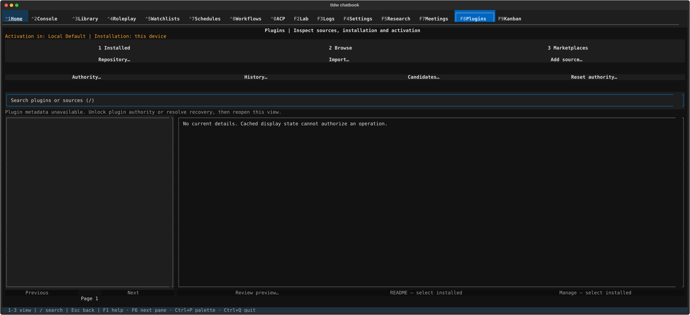

# Plugins — Installed plugins, source-qualified browsing, and marketplaces

## What this screen is for

Plugins is where you add plugins to Chatbook and decide where they may run.
You can preview a plugin from a Git repository or a folder on disk, add a
marketplace (a catalog of plugins) and browse it, then install what you
reviewed. Installing happens once per device; enabling is set per
workspace, with a global default. Nothing is installed, trusted or enabled without a review step
you confirm.

Plugins is protected by its own passphrase, called **plugin authority**. Set it
up once with **Authority…**, and unlock it with the same button when Plugins
asks.

## Getting there

- Press **F8**, click **F8 Plugins** in the nav bar, or press **Ctrl+P** →
  "Tab Navigation: Switch to Plugins". Typing "marketplaces" or "plugin
  repositories" in the palette finds it too.

## Layout tour

From top to bottom:

- **Header**: "Plugins | Inspect sources, installation and activation".
- **Scope line**: "Activation in: *workspace* | Installation: this device".
  Enabling and disabling apply to the workspace named here (your active
  workspace, shown by its ID, or "Global default" when none is active).
  Installation is for this device. Switching workspace elsewhere in the app
  reloads Plugins for the new one.
- **Views**: **1 Installed**, **2 Browse** and **3 Marketplaces**.
- **Entry actions**: **Repository…**, **Import…** and **Add source…** open
  the entry forms described below.
- **Management actions**: **Authority…**, **History…**, **Candidates…** and
  **Reset authority…**.
- **Search box**: "Search plugins or sources (/)" filters the current view.
- **Status line**: what Plugins is doing, or what to do next. The capture
  above shows the message you get before plugin authority is set up and
  unlocked: "Plugin metadata unavailable. Unlock plugin authority or resolve
  recovery, then reopen this view."
- **List** (left) with **Previous**, **Page *n*** and **Next** below it.
  Each page holds 25 rows.
- **Details** (right): the selected row's details, with the detail actions
  below them.

On a terminal narrower than 100 columns, the list and the details take turns:
selecting a row shows its details with a **Back to list** button.

## Features & controls

### The three views

| View | What it lists | Detail actions |
|---|---|---|
| **1 Installed** | Plugins installed on this device. The details show whether the plugin is enabled here and the global default, whether its revision is trusted ("Trust: reviewed" or "needs review"), how many selected components are eligible to run, where it came from, and each component's state ("eligible (recorded)", "excluded", "disabled", "needs trust", or "needs configuration / blocked"). | **Read README** shows the installed revision's README.md as plain text under the details. **Manage…** opens the Manage plugin dialog. |
| **2 Browse** | The plugins listed by your marketplaces, from their last refresh. The details show the entry's catalog support, package location and diagnostics. | **Preview entry** copies that plugin from its marketplace and inspects it, without installing it. An entry the catalog marks unsupported shows "Preview unavailable — unsupported". |
| **3 Marketplaces** | The marketplace sources you added. The details show the source's origin, ref and catalog file, its last successful refresh, and whether its cached catalog is current ("available"), stale ("last-good (stale)") or not loaded yet. | **Refresh source** reads the marketplace's catalog again. Refreshing updates the list in Browse; it never installs or enables anything. |

**Review preview…** sits with the detail actions in every view. It opens the
install review for the preview you made last (see below) and stays disabled
until there is one.

While no row is selected, the detail actions say what they need, for example
"Manage — select installed" or "Refresh — select source".

Empty views say what to do next: "No plugins installed. Choose Repository,
Import, or Add source above.", "No marketplace sources. Add a source or import
a selected Cursor/Codex root.", or "No cached entries. Select Marketplaces to
inspect status and refresh a source." When a marketplace's last refresh
failed, Browse shows its last good list and says "Showing stale cached
results. Select a marketplace and Refresh."

### The entry forms

Each entry action replaces the list with a short form. It starts with "Choose
an explicit location. No account or directory is connected automatically."
**Back** (or **Escape**) returns to the list.

| Form | Fields | What the main button does |
|---|---|---|
| **Repository…** ("Preview selected repository") | "Repository URL or absolute local directory", and "Git ref (HEAD)" | **Preview** copies the plugin from that Git repository (an HTTPS or SSH URL, or `github:owner/repo`) or from that folder, and inspects it. |
| **Import…** ("Preview Cursor/Codex import") | The folder, and **Cursor** or **Codex** | **Preview** lists what Chatbook found in that Cursor or Codex folder (its marketplace catalogs, and the folder itself if it is a plugin): "Import preview: *n* candidates. No sources or packages imported." It imports nothing. |
| **Add source…** ("Add marketplace source") | The repository URL or folder, the Git ref, and the catalog file: **Detect catalog**, **Agent Plugins** (`.agents/plugins/marketplace.json`), **Cursor** (`.cursor-plugin/marketplace.json`) or **Claude** (`.claude-plugin/marketplace.json`) | **Add source** saves the marketplace and opens **3 Marketplaces**. Select it and press **Refresh source** to load its plugins into Browse. |

A successful Repository preview reads "Preview captured: *n* components. Not
installed or enabled.", lists the components, and the status line says
"Preview retained for this session. Installation requires separate review."
Changing a field throws the preview away; preview again before reviewing.

### Install review

After a **Repository…** preview or a Browse **Preview entry**, **Review
install…** (in the form) and **Review preview…** (in the detail actions) open
the **Manage plugin** dialog for that preview, with the workspace it captured
("Captured workspace: …"). In it:

1. Leave the interpretation on **Automatic interpretation**, or pick
   **Portable**, **OpenAI** or **Cursor**.
2. Tick the components you want.
3. Choose **Install disabled** or **Install and enable in captured
   workspace**.
4. Press **Review action**. The dialog shows exactly what will happen, which
   components are selected or excluded, and the reminders "Commands and stdio
   servers run with your host user privileges." and "Trust, setup and normal
   per-call permissions remain separate gates."
5. Press **Confirm reviewed action**. The dialog reports "Submitted. Close
   leaves this operation running; Refresh reads its owner status."

Changing any input after **Review action** clears the review ("Inputs changed.
Review again before confirming."). **Close** (or **Escape**) keeps your draft
for the next time you open it; **Discard draft** throws the draft away. On an
install review it also releases the previewed copy, but **Review preview…**
stays enabled, so preview again before reviewing.

### Manage plugin (installed plugins)

**Manage…** on an installed plugin opens the same dialog with a longer action
list. Most actions work the same way: choose it, fill in what it asks for,
press **Review action**, read the review, then press **Confirm reviewed
action**.

| Action | What it is for |
|---|---|
| Review trust | Trust the installed revision. A component is eligible to run only when it is selected, the plugin is enabled where you are working, its revision is trusted, and its configuration is complete. |
| Save component selection | Change which components are selected. |
| Enable in captured workspace / Inherit global default / Disable here | Turn the plugin on or off for the captured workspace, or follow the global default there. |
| Enable global default (all inheriting workspaces) / Disable global default (all inheriting workspaces) | Change the default that every workspace without its own setting follows. |
| Disable everywhere | Turn the plugin off in every workspace. |
| Check for update / Rollback selected revision | Review a newer revision, or go back to a revision this device kept (enter its revision digest). |
| Save MCP configuration (does not connect) / Save reviewed mapping references / Save or revoke declared value | Configure the plugin's MCP servers, connections and declared values. **Review action** on Save or revoke declared value opens the "Declared plugin value" dialog, which stores the value as a protected reference. |
| Review explicit hook test / Review connection and discovery | Test a hook or an MCP server with event data you type. These need an existing, idle Console chat in the captured workspace. |
| Create saved-data root | Give the plugin a folder for its saved data. |
| Uninstall; keep saved data | Remove the plugin. Its saved data stays on disk. |
| Delete exact saved roots / Resume pending saved-data cleanup / Review qualified reboot reconciliation | Remove or recover the plugin's saved data (enter root IDs, or leave blank for the listed ones). |

The other buttons: **Refresh status** reads the current state again.
**Cancel operation** and **Cancel affected work** are available only while a
confirmed change is waiting: a component-selection change, update or rollback
waits for work still using the current revision to finish, and a saved-data
deletion or resumed cleanup waits for the data's users to finish. **Cancel
operation** withdraws the change; **Cancel affected work** stops the work it is
waiting for. **Console** takes you to Console
so you can pick a chat for a test, with the hint "Select an existing chat in
the captured workspace. Return with F8 and Manage; your exact draft is
retained."

Enabling a plugin does not grant its tools permission: they still go through
the normal per-call permissions, like any other tool. The full rules for
configuration, disabling, uninstalling and saved data are in
[Managed plugin operations](../Plugins/operations.md).

### Authority, history and candidates

| Button | What it does |
|---|---|
| **Authority…** | Opens "Set up plugin authority" the first time (choose a passphrase of at least 8 characters and type it twice), or "Unlock plugin authority" when it is locked. Plugin authority has its own passphrase, separate from config encryption and from skill trust. When it is already unlocked, pressing it runs authority recovery and reports "Authority recovered; saved-data recovery remains separately reviewed." |
| **History…** | Opens "Plugin operations", the list of install, change and removal operations with their outcome. **Manage saved data** opens the selected operation's plugin, including one you already uninstalled, so you can delete or recover its saved data. Old entries may have expired from the list. |
| **Candidates…** | Opens "Persisted candidates", the copies Plugins kept from earlier previews and downloads. **Review discard**, then **Confirm discard**, releases one of them; "Reference release does not delete bytes." |
| **Reset authority…** | Opens "Reset plugin authority". **Review reset** shows what it affects; **Confirm plugin reset** archives plugin trust authority. Installed plugins and their saved data stay, and setting authority up again with **Authority…** is refused while any plugin is installed or plugin saved data remains. A wrong passphrase is not a reason to reset: retry instead. |

## After restoring a backup

A backup of your profile holds your plugins (their files, settings and saved
data) and the plugin authority files, but not the protected marker kept in
your OS keyring. After a restore, the plugins come back but **stay off**: none
of them runs until plugin authority recovery completes.

To finish recovery, open Plugins (**F8**) and press **Authority…**. Unlock with
your plugin passphrase; a successful unlock recovers the plugins and they can
run again. If authority is already unlocked, **Authority…** runs the recovery
directly.

Today this works when you restore onto the same profile on the same computer
and the plugins have not changed since the backup. In two other cases Plugins
says it cannot recover them yet; the plugins stay off and their files and
saved data stay on disk:

- The plugins changed after the backup was made. Unlocking reports "Plugin
  authority does not match the plugin files here: …".
- You restored on another computer at the same paths, or the OS keyring was
  reset. **Authority…** reports "Plugin authority needs recovery: …".

**Reset authority…** does not help in either case. Restoring after plugin
folders were deleted has further limits; see
[After restoring a backup](../Plugins/operations.md#after-restoring-a-backup).

If plugins were downloaded from a repository after the backup was made (a
source refresh, an update check, an install or an update), the Backup screen's
**Review restore** lists their download folders and offers **Remove newer plugin
downloads**. It deletes each download's git copy and its copies of your git and
SSH settings, with no safety copy; installed plugins keep working. See
[Local backup and recovery](../Backup-and-Recovery.md).

## Common tasks

### Set up plugin authority
1. Press **F8**, then **Authority…**.
2. Enter a passphrase of at least 8 characters, enter it again, and submit.
3. The views load. Next time Plugins is locked, **Authority…** asks for the
   same passphrase.

### Install a plugin from a repository or a folder
1. Press **Repository…**.
2. Enter the repository URL, or the absolute path of the plugin's folder.
   Change "Git ref (HEAD)" if you need a branch or tag.
3. Press **Preview** and read the component list.
4. Press **Review install…**, tick the components, choose **Install
   disabled** or **Install and enable in captured workspace**, press
   **Review action**, then **Confirm reviewed action**.
5. Close the dialog and choose **1 Installed**. Select the plugin and use
   **Manage…** ▸ **Review trust** before its components can run.

### Add a marketplace and install from it
1. Press **Add source…**, enter the marketplace's repository URL or folder,
   and leave the catalog on **Detect catalog** unless you know which file it
   uses. Press **Add source**.
2. In **3 Marketplaces**, select the new source and press **Refresh source**.
3. Choose **2 Browse**, select a plugin, and press **Preview entry**.
4. Press **Review preview…** and continue from step 4 of
   [Install a plugin from a repository or a folder](#install-a-plugin-from-a-repository-or-a-folder).

### Turn a plugin off for one workspace
1. Make that workspace the active one; the scope line names it.
2. In **1 Installed**, select the plugin and press **Manage…**.
3. Choose **Disable here**, **Review action**, then **Confirm reviewed
   action**.

## Keyboard & commands

| Key | Action |
|-----|--------|
| 1 / 2 / 3 | Switch between the **1 Installed**, **2 Browse** and **3 Marketplaces** views inside Plugins (not destination keys; they type digits while a text field has focus) |
| / | Focus "Search plugins or sources (/)" |
| ↑ / ↓, Enter | Move through the list and select a row |
| Escape | Close a plugin's details or an open form and return to the list; in a dialog, close it |

## Related settings & docs

- [Managed plugin operations](../Plugins/operations.md): configuring,
  disabling, uninstalling, saved data, recovery, and restoring a backup.
- [Plugin compatibility](../Plugins/compatibility.md) and
  [plugin authoring](../Plugins/authoring.md).
- [Local backup and recovery](../Backup-and-Recovery.md).

## Quirks & troubleshooting

- **"Plugin metadata unavailable. Unlock plugin authority or resolve
  recovery, then reopen this view."** Plugin authority is not set up, is
  locked, or needs recovery. Press **Authority…**. Plugin authority keeps its marker in the OS
  keyring, so on a system without a secure keyring it cannot be set up and
  Plugins stays in this state.
- **"Operation unavailable or source changed. Check the selected location,
  unlock authority if needed, and preview again."** A preview or **Add
  source** failed: the location is wrong or unreadable, or plugin authority is
  locked.
- **After an Import… preview, Review install… and Review preview… read "No
  package to review" and stay disabled.** An Import… preview only lists what a
  Cursor or Codex folder holds; the status line says "Import previews only list
  what the folder holds. To install from it, use Repository… on the plugin's
  folder or Add source… on its marketplace."
- **"Review could not load (…). Nothing was changed. Close and open it
  again."** The **Manage plugin** dialog failed while loading. It stays open
  with **Review action** disabled, and Chatbook keeps running; close it and
  open it again.
- **The scope line shows the workspace's ID**, for example
  "workspace-default", not its display name.
