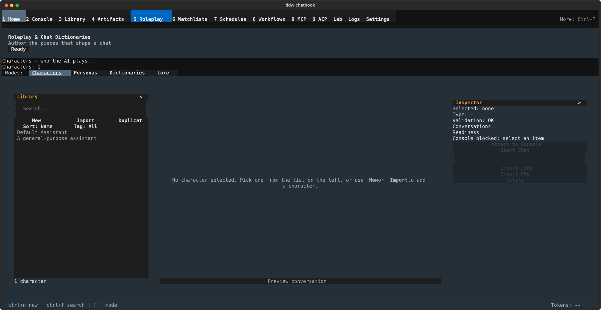

# Roleplay & Chat Dictionaries

## What this screen is for

This is the workshop for everything that shapes how a chat sounds and what
it knows: **characters** (who the AI plays), **personas** (assistant
profiles for roleplay and chat), **chat dictionaries** (text find/replace
rules applied to what gets sent), and **lore books** (world facts injected
when a keyword appears). One screen, four modes, one shared layout. Nothing
here talks to a model on its own — you author an item, then hand it to
Console. Reach for it before a roleplay session, or whenever a chat needs
background facts or wording rules it doesn't have yet.

The details live on three child pages:

- [Characters & personas](roleplay-chat-dictionaries/characters-and-personas.md) — character cards, persona profiles, their editors, avatars, and import/export.
- [Lore books](roleplay-chat-dictionaries/lore-books.md) — world books: entries, keywords, budgets, and attachments.
- [Chat dictionaries](roleplay-chat-dictionaries/chat-dictionaries.md) — find/replace rules, the substitution preview, versions, and what Console actually applies.

## Getting there

- Press **Ctrl+4** from anywhere, or click **⌃4 Roleplay** in the nav bar.
- **Ctrl+P** → "Tab Navigation: Switch to Roleplay & Chat Dictionaries".
  Four more palette
  entries land here too: "Character/Persona Management: Create New
  Character", "Character/Persona Management: Show All Characters",
  "Character/Persona Management: Open Character Tab", and "Quick Actions:
  New Character Chat".
- Old destination names still find it: typing **ccp**,
  **conversations_characters_prompts**, **characters**, or **roleplay**
  into the palette all route here.

## Layout tour

Top to bottom:

- **Header** — one row: the title **Roleplay**, the kind you are browsing
  (**Characters**, **Personas**, **Dictionaries** or **Lore**) and, for now,
  "› \<name\>" for the selected item, with " · editing" while an editor is
  open. A long name ends in "…" ("..." with ASCII glyphs on); the kind is
  never cut. On the right, in words: **Unsaved changes** (**Unsaved** below
  100 columns) while any Roleplay draft is unsaved or still saving — an
  edited form, a staged avatar, open visual authoring; **No chat provider ·
  Settings ›** while no chat provider is ready, whatever is selected (click
  it to open Settings › Providers & Models); and where your data lives:
  **Local**, or **Server: \<name\> · read-only**. The header never says
  "Ready".
- **Purpose line** — one line describing the active mode; it is the same
  text as that mode's chip tooltip, and it changes every time you switch
  modes.
- **Status row** — "Characters: N" in Characters mode, "Personas: N" in
  Personas mode, and "Mode: Dictionaries" / "Mode: Lore" in the other two.
- **Modes:** — the chip strip. All four modes are live; none is a
  placeholder.

| Chip | Its tooltip (and the purpose line) |
|---|---|
| **Characters** | "Characters — who the AI plays." |
| **Personas** | "Personas — assistant profiles for roleplay and chat" |
| **Dictionaries** | "Dictionaries — text find/replace rules." |
| **Lore** | "Lore — world facts injected on keywords." |

Below the chips sit three panes:

- **Library** (left rail) — the searchable list of items in the current
  mode, with its **New** / **Import** / **Duplicate** buttons. Its top
  border names the kind and counts it ("Characters 349"). The **<**
  button in its header collapses it to a slim **Library** handle; click the
  handle to bring it back.
- The **centre pane** — the detail view or editor for whatever you
  selected. Empty until you pick something. In Characters and Personas
  modes it starts with a **Try a test chat (nothing saved)** toggle for
  trying the selection out without saving anything; in Dictionaries and
  Lore modes the equivalent is a **Try it** preview.
- **Inspector** (right rail) — what's selected, whether it validates, its
  saved conversations, and the actions that send it to Console. Its
  header's **>** button collapses it to an **Inspector** handle.

Both rails start open. **F6** and **Shift+F6** cycle focus through the
panes (handle → Library → centre → Inspector → handle).

## Features & controls

### The Library rail

| Control | What it does | Shown in |
|---|---|---|
| **Search...** | Filters the list as you type. In Characters mode it searches the whole library. Enter moves into the list at once and puts the cursor on the first match as soon as the search's results appear, however long a slow server takes. Until they appear, Enter on the list opens no old row: it remembers one open and opens the first match when the current results arrive (a server search shows an empty list until the server answers). Repeated Enter while waiting still opens it only once. An arrow key, click, new search, sort, tag, source or mode change, or leaving Roleplay cancels that pending open. A search that fails or finds nothing cancels it too. | every mode |
| **New** | Creates a new item in the current mode. ("Create a new item in this mode.") | every mode |
| **Import** | Opens a file picker; the tooltip names the accepted formats per mode — "Import a character card (PNG or JSON).", "Import a dictionary (JSON or Markdown).", "Import a world book (JSON)." | Characters, Dictionaries, Lore — **hidden in Personas** |
| **Duplicate** | Copies the selected item. ("Duplicate the selected item.") | Characters, Dictionaries, Lore — **hidden in Personas** |
| **Sort: Name** | Cycles the list order — Name → Recent edit → Recent add (plus Relevance while a Characters search is running). ("Cycle the list sort order.") | Characters, Personas — **hidden in Dictionaries and Lore** |
| **Tag: All** | Opens the "Filter by tag" picker. ("Filter characters by tag.") | **Characters only** |

**Empty states** name the way out: "No characters yet - use New or
Import to add one.", "No personas yet - use New to add one." (Personas has
no Import), and the same "use New or Import" wording for "No dictionaries
yet - …" and "No lore books yet - …".

#### The list

Every item takes one line when the list is narrow (as at 120 columns) or a
kind holds more than 40 items. When the list is at least 40 cells wide and
the kind holds 40 or fewer, each item takes two lines, the second one dim:
a character's age, first tag and the start of its description ("3d ·
fantasy · Commands the…"), the first words of a persona's system prompt,
"250 entries" for a lore book, "150 rules" for a dictionary. Lore books and
dictionaries end their first line with **on** or **off**, and a book that
is off has a muted name. A name too long for the list is cut in the middle
("Highspire Gazette…om card) 2"); hover over it to read it whole.

The first columns are a gutter: **▸** marks the item open in the centre
pane and **✓** a marked item (">" and "[x]" with ASCII glyphs on).

There are no pages. The list scrolls through the whole library and loads
200 more rows as you near the end; **End** jumps to the last item and loads
the rest on the way, also when pressed while a search, sort or tag is still
loading its list. Moving the cursor or opening another item while those
rows load keeps the cursor where you put it. Personas lists every persona,
not only the newest 100.

Highlighting a row doesn't open it: press **Enter** or click. With the list
focused, **Space** turns the highlighted lore book or dictionary on or off
(turning one off says "{name} turned off · space to undo"; press **Space**
again to undo), and **s** cycles the sort in Characters and Personas. These
keys act on the list only, never on a focused button.

#### Counts in the border

The list's top border names the kind and its count: "Characters 349",
"Personas 114", "Lore books 3 · 2 on" and "Chat dictionaries 3 · 2 on"
(books add how many are on). While a search or a tag narrows the list it
reads "Characters 48 of 349", adding "· tag fantasy" for a tag. Personas
reads "Personas (…)" while it loads. On a server, Characters reads
"Characters 0" with the empty-list line until the server first answers,
then "100+" until the total is known. "(?)" means the list could not load.

The bottom border gives the open item's place in the list, "#4 of 28". It
is blank while nothing is open, or while a search hides the open item.

#### Marks and the marks bar

To act on several items at once, mark them: press **m** on the highlighted
row, or click its ✓ column (the tooltip reads "Click to mark"). Do the same
again to unmark. A click anywhere else on a row opens the item and never
marks it.

While marks exist, the list's bottom row is the **marks bar**:
"✓ 3 marked · Export… · Delete… · Clear esc". Lore books and dictionaries
have no **Export…**. On a narrow list the bar drops words first, then whole
buttons, **Clear** before **Export**; at its narrowest it shows only
**Delete**, with the count in its tooltip.

Marks are kept per kind. They survive searching, sorting, tags and
switching to another kind and back. When a search or tag hides some of
them, the bar says so: "✓ 3 marked (2 hidden)". **Clear**, or **Escape**
while the list or the marks bar has focus, clears the current kind's marks.
Leaving Roleplay clears them all: marks are never saved.

- **Export…** asks for a folder ("Export 3 items as JSON") and writes one
  JSON file per marked item.
- **Delete…** opens the delete dialog below, naming the marked items.

The Inspector's **Export JSON** and **Delete** act on the open item only,
whatever is marked.

#### Deleting

Every delete asks once, in the same dialog:

- The Inspector's **Delete** asks "Delete {name}? This cannot be undone
  here." (**Delete** / **Cancel**).
- The marks bar's **Delete…** is titled "Delete 3 marked" and asks "Delete
  these 3 characters? This cannot be undone here.", then lists up to five
  names and "and N more". Its confirm button reads **Delete 3 marked**.

**Cancel** has the focus, and **Escape** cancels. Focus then returns to the
button you pressed.

### The Inspector

| Row | Shows |
|---|---|
| **Selected:** | The selected item's name, or "Selected: none". |
| **Type:** | "character", "persona", "dictionary", or "lore" — or "Type: -" with nothing selected. |
| **Validation:** | "Validation: OK", a list under "Validation errors:", or "Validation: editing..." while an editor is open. |
| **Conversations** | Saved chats for this item — "Loading conversations..." then the list, or "No saved conversations." |
| **Readiness** | Whether the Console actions will work right now (see below). |

Which action buttons appear depends on what you selected:

| Selection | Attach to Console | Start Chat | Include assigned voice profile | Export JSON | Export PNG | Delete |
|---|---|---|---|---|---|---|
| Character | shown | shown | shown | shown | shown | shown |
| Persona | shown | shown | hidden | shown | hidden | shown |
| Dictionary | hidden | hidden | hidden | hidden | hidden | shown |
| Lore book | hidden | hidden | hidden | hidden | hidden | shown |
| Nothing selected | shown, disabled | shown, disabled | shown, disabled | shown, disabled | shown, disabled | shown, disabled |

**Include assigned voice profile** is a checkbox rather than a button: tick
it to carry a character's voice along with **Export JSON**. It only takes
effect once that character has a voice assigned — see
[Characters & personas](roleplay-chat-dictionaries/characters-and-personas.md).

The **Readiness** line is the single source of truth for why a Console
action won't fire:

- "Console ready" — both actions will work.
- "Console blocked: select an item" — nothing is selected yet.
- "Console blocked: select a character or persona" — a lore book is
  selected; only characters and personas go to Console.
- "Console blocked: attach arrives in a later update" — a dictionary is
  selected.
- "Console blocked: unsaved edits" — save (or discard) first.
- "Start Chat blocked: \<reason\>" — the selection is fine, but the chat
  provider the handoff would use isn't ready. Attach still works; Start
  Chat doesn't. The header shows **No chat provider · Settings ›** whenever
  that provider isn't ready, whatever is selected.

### Sending to Console

Both actions stage a card built from the item's full record (its name,
description, personality, scenario, and system prompt) — they don't send
anything by themselves.

- **Attach to Console** stages it as context for your next message, with
  the suggested prompt "Use \<name\> to guide the next response." Console
  confirms with "Staged in Console." This stays available even when the
  provider isn't ready — you're only staging.
- **Start Chat** opens Console on a fresh chat with the suggested prompt
  "Respond as \<name\>." and confirms with "Chat staged in Console." It
  refuses to run while the provider is unready.

A third route sits outside the Inspector: the centre pane's **Preview
conversation** has its own **Open in Console** button, which carries the
test exchange you just ran into a real session. See
[Characters & personas](roleplay-chat-dictionaries/characters-and-personas.md).

### Leaving with unsaved edits

Switching modes, changing selection, or pressing Escape in an editor with
unsaved work first raises the **Unsaved Changes** dialog, naming the item
and asking whether to close it. **Keep Open** returns you to the editor;
**Close Without Saving** discards the edits and continues (Escape is the
same as Keep Open). Deleting an item with unsaved edits shows two dialogs
in a row — discard first, then the delete confirmation.

Leaving Roleplay for another screen with unsaved work (a character or
Persona form, a staged avatar, or unsaved visuals) asks **Finish Roleplay
drafts before leaving**, naming what is unsaved: **Save and continue**,
**Discard and continue**, or **Stay** (Escape is Stay). **Ctrl+Q** asks
the same question before quitting. If a Roleplay save or reaction
generation is still running, Ctrl+Q first says "Waiting for Roleplay work
to finish before quitting" and carries on once that work is done. If a
save fails, **Some Roleplay drafts could not be saved** names what failed
and offers **Retry** or **Stay**, so neither leaving nor quitting drops a
draft that did not save. If a question Ctrl+Q raised closes before you
answer it, Chatbook stays open and says "Quit cancelled."

## Common tasks

1. **Switch modes.** Click a chip in the **Modes:** strip, or press
   **Ctrl+1** (Characters), **Ctrl+2** (Personas), **Ctrl+3**
   (Dictionaries), or **Ctrl+4** (Lore). With focus outside any text box,
   **[** and **]** step to the previous/next mode.
2. **Create something in the current mode.** Press **Ctrl+N** (or click
   **New** in the Library rail). The new item appears in the list and its
   editor opens in the centre pane; **Ctrl+S** saves characters and
   personas, while dictionaries and lore books have their own Save button.
3. **Find an item.** Press **Ctrl+F** to jump into the **Search...** box
   and type. Press Enter to drop into the results list, then Enter again
   (or click) on a row to open it.
4. **Send a character to Console.** Select the character, check the
   Inspector reads "Console ready", then press **Attach to Console** (or
   **Ctrl+Enter**) to stage it as context, or **Start Chat** to open
   Console on a new chat as that character.
5. **Give the centre pane more room.** Click **<** in the Library header
   and **>** in the Inspector header. Click the **Library** or
   **Inspector** handle to bring either rail back.

## Keyboard & commands

> **Mode keys are the single letters c / p / d / l, not Ctrl+digits.**
> Ctrl+1 … Ctrl+0 always change *screens* now (they belong to the global
> nav layer), so on this screen the four modes use plain letters — which a
> focused text box will type instead, so press **Escape** first if a field
> has focus. The nav bar and **Ctrl+P** work here as everywhere.

Screen-level keys only — global keys live in the [guide index](index.md).

| Key | Action |
|---|---|
| c / p / d / l | Switch to Characters / Personas / Dictionaries / Lore — **only when focus is not in a text box** (in a text box they type the letter) |
| [ / ] | Previous / next mode — **only when focus is not in a text box** (in a text box they type the bracket) |
| Ctrl+N | New item in the current mode |
| Ctrl+F | Focus the **Search...** box; Enter there moves into the list and puts the cursor on the first match once the results appear |
| Ctrl+Enter | Attach to Console — only with a saved character or persona selected |
| Ctrl+S | Save — character and persona editors only |
| Escape | Back: cancels the open editor, returns from a conversation transcript to the card, or moves focus from the search box to the list. On the list or its marks bar it clears the current kind's marks. It never leaves the screen. |
| Enter | Open the highlighted item (Library list) |
| m | Mark or unmark the highlighted item (Library list) |
| Space | Turn the highlighted lore book or dictionary on or off (Library list) |
| s | Cycle the sort (Library list; Characters and Personas) |
| End | Jump to the last item, loading the rest of the list (Library list) |
| F6 / Shift+F6 | Next / previous pane |

## Related settings & docs

- Child pages: [Characters & personas](roleplay-chat-dictionaries/characters-and-personas.md) · [Lore books](roleplay-chat-dictionaries/lore-books.md) · [Chat dictionaries](roleplay-chat-dictionaries/chat-dictionaries.md)
- Concept and format deep dives: [World & Lore Books](../Features/World-Lore-Books-Documented.md) · [Chat Dictionaries](../Features/ChatDictionaries-Documented.md) — the data
  model, matching rules, and file formats. Their UI walkthroughs describe
  a retired tab and no longer match this screen.
- Where the work lands: [Console ▸ Context & RAG](console/context-and-rag.md)
  shows which dictionaries and world books are in play on a live chat, and
  [Console ▸ Chat basics](console/chat-basics.md) covers sending itself.
- `config.toml`: this screen reads no section of its own. The only setting
  it reflects is your chat provider default — what the Readiness line and
  the header's **No chat provider** chip report on.

## Quirks & troubleshooting

- **Pressing c / p / d / l (or [ / ]) typed a character instead of changing
  mode.** Those are plain characters, so any focused text box takes them
  first — including the name field of an item you just created. Press
  **Escape** to move focus out of the field, or click a mode chip.
- **Ctrl+2 takes me to Console now, not Personas mode.** Intended — the
  Ctrl+digit row is the global screen navigator everywhere (Roleplay's
  modes moved to **c / p / d / l**).
- **New / Import / Duplicate / Tag are greyed out in Characters mode.**
  You're on a server runtime, where characters are read-only — the buttons
  give no explanation, and the sort button quietly reads "Sort: Server
  order". Export, Edit, and Delete are disabled for the same reason.
  Switch to a local runtime to author characters.
- **The Inspector only offers Delete.** A dictionary or a lore book is
  selected; the Console and export actions apply to characters and
  personas only.
- **My collapsed rail came back.** Rail collapse lasts for the current
  visit — leaving the screen and returning gives you both rails open
  again.
- **My marks are gone.** Leaving Roleplay clears every mark, by design
  (marks are never saved, so a bulk delete never acts on rows you marked
  on an earlier visit). Switching kinds keeps them.
- **The Inspector's Delete ignored my marks.** It acts on the open item
  only. Use **Delete…** in the marks bar to delete the marked items.
- **Ctrl+S did nothing.** It only presses Save in the character and
  persona editors. Dictionaries and lore books save from their own Save
  buttons.
- **A mode chip looks "coming soon".** None are any more — all four modes
  are live. Prompts moved out to Library and is no longer a mode here.

—
*Verified against dev @ acaae68e9 + task-2725 deferred center views — 2026-08-07 (modes, selection, editor open/cancel exercised live)*
