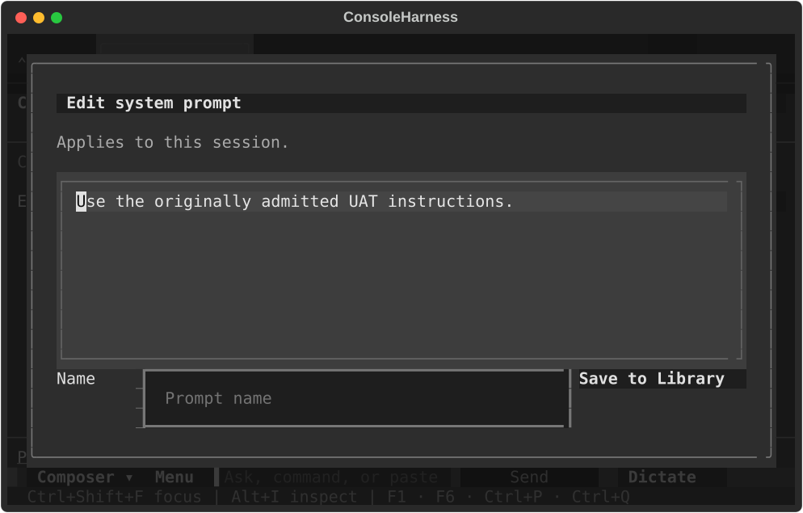
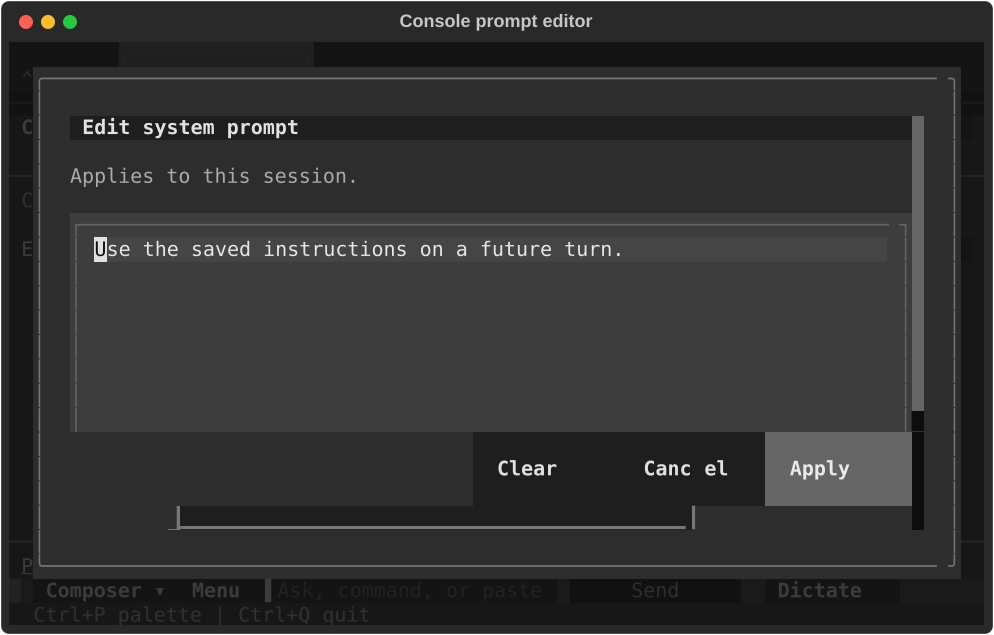
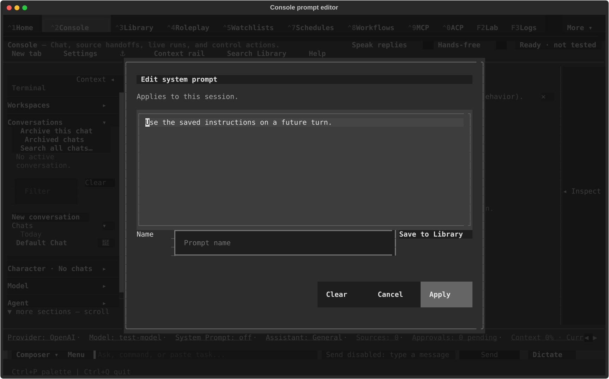

# TASK-39147 end-to-end verification and UAT — 2026-11-07

The complete native workflow passed functional end-to-end verification, including
backup, isolated restore and rebackup. Five mounted acceptance cases passed.
The prompt-editor clipping found at 80×24 is corrected by the follow-up below.
Original timing, mounted-test and broader CSS qualifications remain recorded;
these results are not a certification that all bugs are absent.

## Initial UAT scope and environment

- Current staged TASK-39147 production source, HEAD
  `e08627ac38392fb890984169376b1c242c3a2f3e`; initial verification made no production edits.
  The subsequent prompt-editor correction is recorded separately below.
- Private profiles, real SQLite, native AgentService/ExecutionOwner lifecycle,
  real filesystem/shell tools and complete-profile backup/restore. Only provider
  responses and deliberate delivery failures are scripted. Network and real-user
  profile guards remain installed.
- Mounted real ChatScreen and workflow/prompt/confirmation widgets with production
  CSS, driven by Textual Pilot. This is mounted automated UAT, not a human-driven
  terminal or external-provider certification.
- Observed host load was approximately 49–56 on 18 logical CPUs. This contextualizes
  timing; it does not establish the cause of every failed deadline.

## Passing evidence

| Scenario | Result and evidence |
| --- | --- |
| Native correction, independent review, final acceptance, Stop, backup, isolated restore and rebackup | **1 passed in 217.49s**, `/tmp/pr39147-uat-native-functional.txt` |
| Same/future prompt saves through Apply during running planning | Passed, `/tmp/pr39147-uat-mounted-final/test_mounted_acceptance_prompt0/uat.json` |
| Same/future prompt saves through Apply during Stop | Passed, `/tmp/pr39147-uat-mounted-final/test_mounted_acceptance_prompt1/uat.json` |
| Lost closing-review response, known accounting, fresh visible retry and result removal | Passed, `/tmp/pr39147-uat-mounted-final/test_mounted_acceptance_closin0/uat.json` |
| Lost closing-review response, unknown accounting, fresh visible retry and result removal at 80×24 | Passed, `/tmp/pr39147-uat-mounted-final/test_mounted_acceptance_closin1/uat.json` |
| The four mounted acceptance cases together | **4 passed in 163.59s**, `/tmp/pr39147-uat-mounted-final.txt` |
| Mounted two-phase plan approval, next-phase approval, each saved checkpoint and final acceptance | **1 passed in 56.37s**, `/tmp/pr39147-uat-phase-controls.txt` |
| Original workflow-command/setup UAT | Passed in the original three-test batch, `/tmp/pr39147-uat-existing-controls.txt` |

The native journey retained the actual failed verifier (exit 7), then recorded a
fresh passing verifier (exit 0, complete output `verified`, different input
manifest). Five native children produced preserved handoffs; accounting recorded
15 model calls and five child launches. User edits, Git HEAD and index survived.
The restored profile reproduced the original durable checkpoints/results/windows,
started no native executions, and produced a second coherent backup. See
`/tmp/pr39147-uat-native-functional/test_native_correction_keeps_f0/original/native-journey.json`
and the sibling `wave-rebackup.log` marker
`WAVE_RESTORED_INERT_REQUIRED_EVIDENCE_REBACKED_UP`.

The prompt cases checked the actual admitted provider payload, persisted future
settings, returned lifeline/thread, released owner/intake/capacity and normal
shutdown. Closing cases used real confirmation clicks, lost a response only after
the real closing transaction committed, retried at the displayed fresh revision,
and preserved charges, plans and the immutable marker after removal. No recovery
fence or native execution remained at successful shutdown.

## Timing qualification

The unmodified complete test failed its **130s overall process watchdog** after
workflow completion and Stop, as backup began (`/tmp/pr39147-uat-native.txt`,
1 failed in 130.95s). A diagnostic run allowing 240s overall but retaining the
original five-second planning and 35-second phase waits failed the correction wait,
then reached its expected state about five seconds later
(`/tmp/pr39147-uat-native-budget.txt`, 1 failed in 83.05s).

The functional pass used `/tmp/pr39147-uat-native-functional.py`: 240s overall and
60s test-driver status waits. All original functional/resource/storage assertions
and production budgets remained intact; backup/restore watchdogs were unchanged.
This certifies functional completion under those bounds. It **does not turn the
original timing tests green or certify latency**. The test suite and production
deadlines were not edited.

## Initial UAT finding — corrected below

**P2: system-prompt editor action row is clipped at 80×24.** Open the Console's
system-prompt editor at that terminal size. The title, editor and Library-name row
render, but Apply/Clear/Cancel are outside the visible dialog and cannot be clicked.
The fixed textarea minimum plus the other rows exceeds the dialog's capped height.
The source widget and stylesheet are unchanged from HEAD, so this is outside the
TASK-39147 changes at that point. The authorized correction below now resolves it.

Relevant source: `tldw_chatbook/css/features/_console_panels.tcss:430–466` and
`tldw_chatbook/Widgets/Console/console_system_prompt_modal.py`.
The same editor's Apply controls passed at 140×42. Workflow recovery/removal
controls passed at 80×24; that does not qualify the separate prompt editor.



## Failed and corrected probe setup

The original existing mounted approval tests stopped before workflow actions: one
failed a chat-tab physical-click assertion; the two-phase case timed out waiting
for setup after Send. The batch was stopped at two failures: **1 passed, 2 failed
in 105.77s**. These tests are not reported green.

The extra acceptance probe initially used a wrapper named differently from the
supported `resolve_recovery` operation, so service admission refused before the
intended injection. A second run also waited for the active tab to remain the
captured chat, although the captured prompt had saved and the host's late startup
selected a blank chat. The unknown-accounting probe initially released its provider
before the actual Stop cancellation was delivered. Final probes preserve the public
operation name, wait for the captured chat's payload revision, select its real tab
before each edit, and wait for actual cancellation before releasing the provider.
Earlier failed packets remain separate; they are not workflow regression evidence.
Probe source: `/tmp/pr39147-uat-probe.py`; final command/output:

```sh
.venv/bin/python -m pytest /tmp/pr39147-uat-probe.py \
  -o 'markers=bootstrap_profile: private acceptance profile' \
  -q --timeout=240 --basetemp=/tmp/pr39147-uat-mounted-final
```

The final four-case run predates the additional phase-controls parameter; its
collection and all four results are retained in the log. The additional case ran
separately with `-k phase-controls --basetemp=/tmp/pr39147-uat-phase-controls` and
passed in 56.37s. It started a real planner, then used physical Approve/Accept
clicks for both phases, selected each actual saved checkpoint, verified exactly
two native children/three provider calls and the four durable decision records,
and closed normally. It does not relabel the original pre-workflow test failures.

## Limits and preservation

No full-suite run, remote provider, other operating system or unrelated archive
lineage was certified. The earlier 71 targeted regressions remain separate evidence
on the same unchanged production source. Passing tested scenarios does not prove
the absence of all bugs.

The initial verification-only follow-up staged five TASK-39147 documents/evidence
paths. The starting snapshot is `/tmp/pr39147-uat-start.json`; final exact-path staging,
unrelated file/index preservation and unchanged HEAD are audited in
`/tmp/pr39147-uat-final-preservation.json`. No commit, push, reset, stash or merge.


## Prompt-editor correction and rerun

The dialog now uses the existing native scrolling/docked-action pattern. The
frame scrolls within its existing size cap, the action row reserves its own space,
and Library feedback scrolls into view after its wrapped height is laid out.
Widget ids, action results and the existing
visual tokens are retained. The generated app bundle contains the matching dock
rule, rebuilt from its source module.

- The new painted-bounds regression failed before correction: **1 failed in
  11.41s**, `/tmp/pr39147-prompt-layout-red.txt` (Apply was absent from the
  compositor's visible widgets at 80×24).
- Initial corrected-layout regressions: **7 passed in 111.83s**,
  `/tmp/pr39147-prompt-layout-green-isolated.txt`. These check actual painted labels
  and physical Apply/Clear/Cancel clicks at 80×24 and 140×42, resize round trips,
  retained long prompt text, wrapped Library feedback, and Tab/Enter focus.
- Existing Apply/Clear/Cancel persistence and Library save/duplicate/missing-name
  controls: **6 passed, 20 deselected in 83.43s**,
  `/tmp/pr39147-prompt-layout-existing-modal.txt`. The same six controls passed
  again against the final scroll-timing code: **6 passed, 20 deselected in
  213.53s**, `/tmp/pr39147-prompt-layout-existing-final.txt`.
- Mounted Console UAT rerun: **4 passed in 379.34s**,
  `/tmp/pr39147-prompt-layout-uat-final.txt`. Both terminal sizes exercised same/
  future prompt saves during running planning and Stop, actual admitted provider
  input, recovery review, physical Cancel/Clear, persisted state and normal native
  shutdown. No UI or process deadlines were relaxed for this rerun.
- Final-code narrow UAT rerun after the feedback scroll-timing correction:
  **2 passed, 2 deselected in 254.35s**,
  `/tmp/pr39147-prompt-layout-uat-source-final.txt`. Both running and Stop/recovery
  cases physically applied prompts, canceled drafts, cleared persisted prompts,
  retained admitted provider input and completed actual native cleanup/shutdown.
  This overlaps the initial four-case UAT rather than adding new scenarios. Wide
  geometry is unchanged by the final timing-only adjustment and remains covered
  by the final seven-case regression file. No deadlines were changed.
- New test lint and both touched Python files' formatting pass. The modal retains
  four inherited lint findings and introduces none. The design detector returned
  no findings. The prompt-specific bundle reproduces exactly from its modular
  sources (`/tmp/pr39147-prompt-layout-own-bundle-check.txt`). Final static
  evidence is `/tmp/pr39147-prompt-layout-static-final.json` and
  `/tmp/pr39147-prompt-layout-lint-format-final.txt`.

Fresh before/after evidence retains the original clipped image above and the
corrected views below. The two-size capture passed in **80.12s**
(`/tmp/pr39147-prompt-layout-capture-cells.txt`); it predates only the final
Library-feedback scroll-timing correction, which does not change these initial
editor views. Capture uses the mounted Console's painted compositor strips
at each size. The raw SVG exporter sometimes produced title-only frames in this
two-App harness; those empty captures are not visual evidence of the fix.





A stricter follow-up asserted the entire wrapped feedback text in painted cells.
It exposed the last line beneath the docked footer (**1 failed in 40.92s**,
`/tmp/pr39147-prompt-layout-feedback-paint.txt`): the original scroll request used
Static's stale one-line geometry immediately after `update`. The private diagnostic
recorded scroll offset 7 versus maximum 9, and the three-line feedback intersecting
the action row (`/tmp/pr39147-prompt-layout-feedback-geometry.txt`). Deferring
`scroll_visible` until after layout refresh corrects the measurement. The complete
new regression file, now requiring all wrapped feedback text to be painted,
passed **7 tests in 204.41s** against the final code
(`/tmp/pr39147-prompt-layout-green-final.txt`). An initial
external diagnostic could not collect before private-profile admission and ran
no tests; the repository's private-profile diagnostic reproduced the painting
failure. No real-profile recovery action was taken.

### Broader checks and probe qualifications

The wider CSS batch had **16 passed, 3 failed, 20 deselected in 502.71s**
(`/tmp/pr39147-prompt-layout-controls.txt`), stopping at three failures:

1. Full generated-sheet sync reports unrelated staged portrait declarations.
   A full build also produced portrait rules using unavailable tokens, causing
   **7 parsing failures in 93.16s** before layout could be exercised
   (`/tmp/pr39147-prompt-layout-green.txt`). Those two unrelated generated widget
   sheets were restored to their exact starting index bytes and are not staged by
   this fix. The prompt-specific app bundle is independently reproducible.
2. The canonical-class scan exceeded its 90s test deadline; it remains unqualified.
3. The dimension floor reports existing numeric values in `_agentic_terminal`,
   `_settings_splash_theme`, `_wizards` and `_workflows`. All four files match their
   starting index bytes; this correction adds no numeric style values.

The first expanded UAT batch had one process-watchdog failure and one successful
80×24 Stop case before interruption. A diagnostic run showed the host's startup
blank tab had changed the active target before initial Apply. Final UAT waits for
that tab to finish mounting, then selects the actual fixture chat. The failed
packets remain `/tmp/pr39147-prompt-layout-uat.txt` and
`/tmp/pr39147-prompt-layout-uat-debug.txt`; they are not relabeled as passes.

Final narrow command (same private runner and deadlines):

```sh
.venv/bin/python -m pytest /tmp/pr39147-prompt-layout-uat.py \
  -o 'markers=bootstrap_profile: private acceptance profile' \
  -k 'prompt-running-80 or prompt-stopping-80' \
  -q --timeout=240 --maxfail=1 \
  --basetemp=/tmp/pr39147-prompt-layout-uat-source-final
```

The preceding full native backup/restore journey was not repeated for this scoped
layout correction. No full suite, external provider or other-platform run. Exact
fix staging and preservation are audited in
`/tmp/pr39147-prompt-layout-final-preservation.json`, against
`/tmp/pr39147-prompt-layout-start.json`. Unrelated staging and files remain intact.


## CI follow-up — 2026-11-08 (in progress)

Published task commit: `3285573d77da4e646faa9ed8f974d4b42f99fea5` on
`codex/task-39147-native-phase-rebuild`, parent `e08627a`.
The [initial Derived Artifacts run](https://github.com/rmusser01/tldw_chatbook/actions/runs/42426760674)
has 12 failed and 3 successful test jobs. Its final aggregate job was still queued
when these failures were diagnosed. No success or bug-free claim follows from the
earlier local UAT. Integration onto newer remote dev remains outside this work.

Repairs are built as Git blobs through `/tmp/pr39147-ci-repair-state.json` and a
private index. Local verification loads the candidate's Python and relevant
package resources from Git objects in memory, including private pytest children;
it does not replace checkout files or create a worktree. Local handles, adapters
and assertions remain real except the tests' existing provider doubles. This
harness does not replace actual Linux CI, filesystem-membership checks or isolated
`python -I` execution; those remain qualified by the pushed run.

Observed verification before publication of the repair batch:

- Initial representatives: four migration variants and one standalone-controller
  send failed. Two saved-hook controls also failed. Full baseline controls
  reproduced the migration/hook defects, so they are inherited native-foundation
  compatibility failures rather than claimed new task regressions.
- Core repair candidate `853640e`: **21 passed in 60.25s**, covering the four
  migration variants, controller send, saved hooks and publication, strict custody
  fields, workflow atomic-save/invalid-value controls and app/Settings size pins.
  Packet: `/tmp/pr39147-ci-core-targeted-green.txt`.
- Broader targeted Console controls: **61 passed, 2 failed in 235.98s**.
  Packet: `/tmp/pr39147-ci-secondary-targeted.txt`. Both failures were retained:
  real completed-tool response-rule repair and the external Stop follow-up.
- Binding the actual replacement bridges through runtime APIs makes the completed
  tool case, real-agent boundary and unchanged-target native acceptance pass:
  **3 passed, 1 failed in 100.27s**. The remaining prepared-start/manual-send case
  hits the mounted configuration refusal, not a discarded assertion.
  Packet: `/tmp/pr39147-ci-bound-fixtures-targeted.txt`.
- Supplying the lifetime stub's actual store: **1 passed in 23.21s**;
  `/tmp/pr39147-ci-custody-store-targeted.txt`.
- The new ordinary-chat Stop case fails before the maximum fix:
  **1 failed in 15.17s**; `/tmp/pr39147-ci-host-hook-red.txt`. A trace of the
  external Stop control reports `ordinary maximum does not cover this effect` at
  event prehold. The repair includes the installed engine's enabled definitions
  before admission; it retains the existing opaque claim and physical-drain check.

Final scoped checks of the repair batch:

- Expanded original Stop physical-drain controls (agent runtime on/off,
  onboarded/fresh) plus the actual external-Stop/native-rule follow-up:
  **5 passed in 48.02s**; `/tmp/pr39147-ci-host-hook-green.txt`, source tree
  `37e9ae83e420ef9e7c06208c4de96d3dc948ca24`.
- The originally failing mounted Settings streaming-save case:
  **1 passed in 62.54s**; `/tmp/pr39147-ci-settings-render-green.txt`, source tree
  `52ccdd59bd3298cc9bb5e18bbecb9d37ff986adb` (same product sources plus evidence).

Exact narrow commands use the Git-source harness environment described above:

```sh
.venv/bin/python -m pytest \
  Tests/Chat/test_console_ordinary_tree.py::test_original_stop_hook_holds_same_ordinary_tree \
  Tests/Chat/test_response_rules_external_hook.py::test_real_external_stop_and_native_violation_commit_one_followup -q
.venv/bin/python -m pytest \
  'Tests/UI/test_settings_console_fallback_rows.py::test_choosing_streaming_on_saves_true_over_a_saved_legacy_or_unset_value[saved-off]' -q
```

Remaining diagnosis: the mounted preparation refusal also reproduces with full
Git sources from `e08627a` (**1 failed in 19.78s**;
`/tmp/pr39147-ci-mounted-baseline.txt`). The synthetic app factory selects MCP
files outside the configured profile, leaving the actual source unbound; the
stock capture correctly refuses it. Memory-backed fixture sources also do not
qualify for that stock route. Production refusal and actual source/recovery
checks have not been weakened to accommodate these fixtures. Remaining fixtures
and any task-related compatibility defects still need resolution and remote CI.

Ruff comparison over every changed Python file introduces **zero new findings**;
inherited lint debt remains explicit. The app shrinks to 5708 lines (ratchet
reduced from 5710), and Settings fits the unchanged 35818-line budget. No assertion,
timeout or budget is relaxed. Preservation auditing compares the complete real
index, dev HEAD/status and hashes/links/missing states of all 374 starting dirty
and untracked paths; `/tmp/pr39147-ci-repair-preservation.json` is the current
packet. No full-suite local sweep, external provider or other-platform UAT was run.


## Second CI repair batch — 2026-11-08 (CI still required)

The [run on ab472e8](https://github.com/rmusser01/tldw_chatbook/actions/runs/42441233109)
completed all 15 test jobs: **11 failed, 4 passed**. The failures are retained in
`/tmp/pr39147-ci-job-<job-id>.log`. Its aggregate stayed queued after the tests
finished; normal then force cancellation applied only to that failed task run.
No unrelated workflow was cancelled. The initial run is also cancelled, not green.

Actual job logs identify the remaining mounted fixture failures: Console P0
blocked-send and Retry (`128610694933`), prepared-start/manual Send
(`128610695192`), hidden-field Settings (`128610695208`), Stop controls at all four
sizes and key/palette/slash routes, visible-turn attention, Resend and Send
acknowledgement, and pending-interrupt/no-controller cases. Baseline reproduction
of the source refusal remains inherited-failure evidence; it does not justify
bypassing native preparation.

The fixture correction selects the configured private profile, gives ordinary
sends actual file-backed storage and explicitly selects their existing gateway-only
mode. Factory ownership tracks the exact file database, closes its real connection
and leaves replacement fields caller-owned. Native-start setup drains its original
scratch manager before borrowing the runtime's and captures configuration through
the mounted asynchronous producer. Direct-admission fixtures perform native
precapture; the pending-interrupt seed uses the controller's capture API. The
blocked-send helper awaits actual turn retirement instead of watching only the
legacy acceptance entry. The button observer watches the common visible request,
which precedes both the new native receiver and legacy dispatch. The no-controller
case explicitly removes/restores its passive store through the real runtime API.
Assertions and deadlines are retained.

With those real sources, ordinary agent-runtime-off Send exposed a product defect:
legitimate cold permission publication changed the captured MCP source, but its
receipt was retained only when an agent source existed. The native publisher now
hands the same exact service/store/candidate/binding/path receipt to the ordinary
owner under its live opaque claim. Consumption retains actual resource, configured
path/binding and unchanged-other-source checks, then clears the receipt. It no
longer attests permission-store function/code identity. Replaced sources/paths and
missing original task context still refuse before effects. A separate sequential
fixture failure was traced to a stale imported config-module alias; the snapshot
fixture now rebases that alias to the actual newly installed module along with its
existing callable aliases. The config-installation guard is unchanged.

Retained RED and scoped GREEN packets (cohorts overlap):

- Profile/database ownership regression: **1 failed in 7.22s**, tree
  `3d9810b78178e9be6ecdb235a8b48cc807658f3d`,
  `/tmp/pr39147-ci-round2-profile-fixture-red.txt`; corrected ownership plus the
  existing exact-original/replacement cleanup control: **2 passed in 11.79s**,
  tree `7dff96d8bb6151947a07f2a9a6129e24b5444760`,
  `/tmp/pr39147-ci-round2-profile-fixture-green.txt`.
- Agent-runtime-off/on cold permission receipt: **2 failed in 9.85s**, tree
  `eed4069574ca3c96b7520a56e982aa14f753dc7a`,
  `/tmp/pr39147-ci-round2-cold-mcp-red.txt`. A first corrected packet had **7 passed,
  1 failed in 27.05s**; sequential stale config-module setup caused the remaining
  failure, while the agent-on case alone passed. Those packets remain qualified.
- Final MCP/publication controls: **15 passed in 39.01s**, tree
  `a4dc048c5f3e06871594e63e04f748871b76d77d`,
  `/tmp/pr39147-ci-round2-mcp-full-controls.txt`. Both runtime modes pass together;
  controls retain missing-context, replaced receiver/path/factory/manifest,
  unqualified cold-source, replaced-controller, fresh switch and native dependency
  retarget refusals. No diagnostic plugin or bypass environment is active.
- Final mounted first-send/Retry, native-start/manual Send and Anthropic hidden
  Settings submission: **4 passed in 79.74s**,
  `/tmp/pr39147-ci-round2-final-native-controls.txt`.
- Send acknowledgement ordering at 80×24 and visible attention from Home:
  **2 passed in 32.71s**, `/tmp/pr39147-ci-round2-send-attention-controls.txt`.
- The old button observer missed native Send and failed its positive assertion:
  **1 failed in 33.15s**, `/tmp/pr39147-ci-round2-final-ui-controls.txt`.
  The corrected observer and complete pending-interrupt projection journey pass
  **2 cases in 125.55s**, `/tmp/pr39147-ci-round2-final-fixtures-green.txt`.
- Focused Dictate and focused Stop retain their no-unintended-Send assertions:
  **2 passed in 58.31s**, `/tmp/pr39147-ci-round2-final-send-observers.txt`,
  tree `2678e5cff2298af0ade850f72214c016799188cb`.
- Representative held Stop at 80×24, three sequential visible replies, keyboard
  Resend and no-controller Stop: **4 passed in 77.19s**,
  `/tmp/pr39147-ci-round2-ordinary-ui-green.txt`, preceding only final fixture
  alias/observer refinements. The earlier two ordinary failures in
  `/tmp/pr39147-ci-round2-ui-other-controls.txt` are not called passing.
- Late first-batch cleanup/recovery packet: **29 passed, 1 failed in 910.71s**,
  `/tmp/pr39147-ci-native-and-settings-targeted.txt`. Its 28 native cleanup/recovery
  controls and Settings case passed; its remaining manual-send fixture refusal is
  corrected and passes in the final four-case mounted packet above.

The final mounted native and projection packets use product/test tree
`2678e5cff2298af0ade850f72214c016799188cb`; subsequent task, architecture and QA
edits plus line-formatting adjustments do not change executable behavior. Commands run with
`PYTHONPATH=/tmp/pr39147-ci-harness`, `PYTEST_PLUGINS=pr39147_ci_overlay`, and
`PR39147_CI_TREE=<recorded tree>`; the in-memory loader covers private pytest
children. This remains local targeted evidence, not actual Linux CI or a full
suite. All changed Python files add **zero Ruff findings** compared with the
published task source; inherited debt is retained. `git diff --check` passes.
No size budget, timeout, assertion or test selection is relaxed in the branch.

Preservation: `/tmp/pr39147-ci-fix-start.json` still covers the original 374
states. Another writer added unrelated untracked `300` between heartbeats; the
extended `/tmp/pr39147-ci-fix-round2-start.json` and current audit cover 375 states,
plus exact real index entries/status and original dev HEAD. No real checkout file
was edited, and no new worktree or source export was created. AC #8 and task status
remain open pending a successful exact-head workflow. No full local suite,
external-provider call, other-platform UAT or newer-dev integration is certified.


## Third CI repair batch — concurrent read and streaming Stop

The [run on 3a2f2a4](https://github.com/rmusser01/tldw_chatbook/actions/runs/42450072567)
passes the admission-sensitive gate and previously failing Settings/attention/Stop
lanes, but UI lane 4 reports **170 passed, 1 failed in 851.12s**. Its remaining
failure is the focused Space-on-Stop case at 160×45: the button receives the key
and the provider submit reports stopped, but the test never observes the required
`Response stopped by user.` system row. Actual job log:
`/tmp/pr39147-ci-job-128637182697.log`. Other lanes were still running during this
repair; the workflow is not green and no active test job was cancelled.

That exact case passes on unchanged pushed code in isolation: **1 passed in
69.09s**, `/tmp/pr39147-ci-round3-space-stop-red.txt` (the exploratory filename is
not a claim that the test failed). A separate instrumented diagnosis passes
**1 case in 29.25s**, `/tmp/pr39147-ci-round3-space-stop-diagnostic.txt`; its real
controller snapshot has no concurrent preparation read and records the user Stop
normally. `/tmp/pr39147-ci-round3-stop-diagnostic.jsonl` retains the diagnosis.
Those isolated passes do not explain away or relabel the actual CI failure.

Source analysis finds an early return after cancelling current preparation reads.
It can consume Stop while an already streaming response still needs terminal
settlement. The new test parks an actual finite native-read worker concurrently
with a real persisted streaming response. App-scoped and same-session variants
fail before correction; the unrelated-session control passes: **2 failed, 1 passed
in 22.63s**, `/tmp/pr39147-ci-round3-concurrent-read-stop-red.txt`, tree
`f177d837fcb32c0cd871d99d7f7b1272699e7693` (unchanged product source).

The repair replaces that early success return with a retained cancellation result
and continues through existing native commit/stream Stop logic. It retains original
read attribution/cancellation, exact native settlement and all existing source,
permission, revision and recovery checks. It does not restore implementation
attestation. Repeated Stop records one explicit marker. The original finite-read
record remains unretired while its worker is blocked and retires only after
physical return; an unrelated-session read is not cancelled.

Verification on tree `10f668eeb6ace9a255955d118197c08b7126f94f`:

- New three-way concurrent-read regression, existing six direct/agent/sync
  dispatch-CAS settlement cases and the two repeated-cancellation read ownership
  controls: **11 passed in 65.84s**,
  `/tmp/pr39147-ci-round3-stop-read-controls.txt`.
- Original focused Stop Enter at 80×24 and Space at 160×45:
  **2 passed in 53.50s**, `/tmp/pr39147-ci-round3-mounted-stop-controls.txt`.
  The original assertions and five-second Stop wait remain unchanged.
- Ruff comparison across all branch-changed Python files adds **zero findings**;
  `/tmp/pr39147-ci-round3-lint.txt`. The new test formats cleanly and subsequent
  formatting preserves its AST. Existing formatter/lint debt is retained.

Commands use the existing Git-source harness with `PYTEST_PLUGINS=pr39147_ci_overlay`
and the recorded tree, without diagnostic plugins in verification. New regression
node: `Tests/Chat/test_console_durable_commit_offload.py::test_stop_with_concurrent_preparation_read_still_finalizes_live_stream`.
No assertion, required CI check, deadline or size budget is relaxed. The original
CI failure remains unqualified until the new pushed head is tested. No full local
suite, external-provider or other-platform run; newer-dev integration and merging
remain outside scope. The complete real index, dev HEAD and 375 preserved path
states remain unchanged. Existing ADR356 covers this direct Stop/lifetime fix.


## Fourth CI follow-up — native fixture custody and poll evidence

All 15 test jobs on [3a2f2a4](https://github.com/rmusser01/tldw_chatbook/actions/runs/42450072567)
finished: **12 passed, 3 failed**. The only queued job afterward was the redundant
aggregate. Normal then force cancellation stopped only that old failed task run;
its completed test evidence is retained. The Stop repair is published separately
as `591fcd64b1ec073dcacfc70fcb73e3cc54572ea4` and has not yet received a CI verdict.

Besides the Space case already documented, the actual remaining logs show:

- UI lane 1: **239 passed, 1 failed in 826.31s**,
  `/tmp/pr39147-ci-job-128637182834.log`. Resend's incremental content is already
  in the store, but the UI assertion after the existing 0.65-second observation
  still sees Preparing. No timeout or content assertion is changed to hide this.
- UI lane 10: **157 passed, 1 failed in 778.01s**,
  `/tmp/pr39147-ci-job-128637182863.log`. The interrupt fixture's direct controller
  seed reaches cold skill capture without a matching runtime request record and
  correctly refuses with `Original skill preparation custody changed; send again.`

The interrupt fixture now follows the existing mounted producer: native
precapture, `_admit_console_turn_to_runtime` and `runtime.wait_for_turn`. It retains
the actual request/task custody required by cold skill preparation. The production
custody and selected-source checks are unchanged. Warm-catalog local passes of the
old direct seed did not certify the cold route.

The Resend test is strengthened to assert that the exact existing timer survives
its held admission callback. It adds actual run state, timer presence, sync flags
and in-flight/custody counts to failure output. It retains its original content
assertion and 0.65-second observation. No production Resend change or latency fix
is claimed. An unchanged-head local control passes that Resend case in 19.31s;
its companion interrupt test fails with a **different** Textual message-pump
`WaitForScreenTimeout`: **1 passed, 1 failed in 118.69s**,
`/tmp/pr39147-ci-round4-mounted-controls.txt`. That is retained as a failure rather
than relabeled as reproduction of the CI custody error.

Final candidate tree `9d0f7ba3ce6912d656707ede2657da35239414be`:

- Strengthened Resend and the complete six-journey interrupt projection fixture:
  **2 passed in 193.17s**, `/tmp/pr39147-ci-round4-fixture-controls.txt`.
  Individual calls: Resend 26.39s, interrupt journeys 159.73s. Original waits,
  process/UI limits, assertions and real cleanup remain in place.
- Supported native skill capture, prepared-skills-without-selected-source refusal
  and unknown cold-source refusal: **3 passed in 5.03s**,
  `/tmp/pr39147-ci-round4-skill-source-controls.txt`.
- Ruff comparison over all branch-changed Python files has **zero new findings**,
  `/tmp/pr39147-ci-round4-lint.txt`. Changed lines format cleanly; the pre-existing
  unrelated assertion formatting in the interrupt file is retained. Diff checks
  and exact preservation auditing pass.

The controller's broad size pin already exceeds its ceiling on the baseline
(29648 lines versus the 29184-line pin). The Stop repair measures 29598 lines and
changes no pin; this inherited whole-module debt is outside the selected CI size
checks. It is not called a passing full-suite result or repaired by raising a
budget. No full local suite, external-provider or other-platform UAT was run.

This batch changes fixture tests, task notes and QA evidence only. Existing ADR356
applies; no new architecture decision or production authority change. Dev HEAD,
full real index/status and all 375 recorded dirty/untracked states remain intact.
The next workflow must verify the actual new pushed head; old-head successes do
not close AC #8 or certify the absence of intermittent bugs.


## Fifth CI follow-up — aggregate attribution and task-only repair

[Run 42456510388](https://github.com/rmusser01/tldw_chatbook/actions/runs/42456510388)
on `d5d10f866bff7c85d409953dc48ea99149d5de7f` passed **all 15 test jobs**, including
UI lanes 1, 4 and 10. The workflow is nevertheless **not green**: aggregate job
`128681770614` failed its diagnostic inventory, index-plan census, Textual worker
and markup checks. Its actual log is `/tmp/pr39147-ci-job-128681770614.log`.
The unrelated merge-queue tick was not cancelled.

Immutable baseline `e08627ac38392fb890984169376b1c242c3a2f3e` reproduces all four
aggregate failure classes with the unmodified checkers. Git-source baseline
packet: `/tmp/pr39147-ci-round5-baseline-controls.txt`; per-source attribution:
`/tmp/pr39147-ci-round5-static-attribution.txt`. Both use in-memory Git blobs,
not the dirty checkout as the reference. This is local static evidence, not a
second baseline Linux workflow run.

- All three missing workflow indexes already exist in baseline schema/migrations.
  No index definition was added by TASK-39147.
- All seven flagged workflow UI functions are already absent from the baseline
  DOM census. Setup's button handler grows from six flagged lookups to seven in
  this task; the other counts are unchanged.
- Console Undo's three markup notifications and its entire `chat_screen.py` are
  byte-identical to baseline.
- All nine stale diagnostic owner rows are already stale on baseline.
  TASK-39147 adds one constant-only warning, `could not persist native child
  failure`, in AgentService, with no interpolated user input or new disk sink.

The task-owned correction makes worker-refusal presentation query surviving
notice widgets rather than requiring a removed widget. Existing retry state,
submitted objective and callable worker admission remain checked. The native-child
owner inventory row is updated after statement review; the other inherited rows
are deliberately retained. No census allowance, assertion, wait, resource fence,
revision check or recovery protection is weakened.

Targeted regression on tree `6cc6cdc64cdc010e777d9d29dceb7dd8e866f4d1`:
**1 failed, 1 passed in 3.73s**. The removed-notice case raises `NoMatches` from
the original error handler. Corrected executable tree
`3d1611e6b22d40744e438d75e2fec406c6324d6f`: **2 passed in 3.74s**,
`/tmp/pr39147-ci-round5-worker-green.txt`. RED packet:
`/tmp/pr39147-ci-round5-worker-red-verified-source.txt`. Two preliminary harness
runs accidentally reused a cached single-case test module; their one-case passes
are not candidate evidence. The rebuilt harness disables cached pytest bytecode
reads and confirms both parameterized nodes execute from the Git source.

`/tmp/pr39147-ci-round5-verification.txt` records zero new Ruff findings in both
changed Python files, clean formatting, `git diff --check`, and restoration of
Setup's flagged lookup count to the baseline six. This resolves the task delta,
not the inherited worker census failure. No full local sweep, external provider,
other-platform UAT, newer-dev integration or merge is certified.

Earlier temporary snapshots/harness files disappeared between wakes. Per the
preservation requirement, scope was reconstructed from the current branch's 96-path
diff against baseline, and fresh evidence was captured **before editing**:
`/tmp/pr39147-ci-round5-preservation-start.json`. It covers dev HEAD e08627a,
the complete real index/status and all 375 current dirty/untracked path states.
The new audit proves those states unchanged since that capture; it cannot recreate
missing earlier snapshot bytes. Only private Git objects/index were edited.

The user was asked whether the minimal inherited baseline repairs may be included,
because the standing authorization excludes unrelated file changes. That scope
answer remains pending. AC #8 stays open. A new full selected CI dispatch is held
until those known aggregate blockers can be addressed, avoiding a knowingly
redundant run; no active run or unrelated automation is changed.

## Sixth CI follow-up: approved minimal inherited gates (2026-11-08)

The user explicitly answered **“Include the minimal baseline CI repairs.”** The
private index advanced from published `6aaaeb33ab`, preserving the real checkout.
The task plan and AC #20 were recorded before implementation. No new ADR is needed
for existing view contracts, literal rendering or evidence for unchanged indexes;
ADR356 and the UI conventions remain applicable.

The previous summary omitted four **only-in-rebuild** diagnostic owners already
listed in aggregate log 128681770614: `Chat/console_workflow_preparation.py` (1),
`Chat/console_workflow_runs.py` (8), `UI/Console_Modules/workflows.py` (1), and
`Workspaces/worktree_activity.py` (1). All eleven statements and their context are
now reviewed: fixed native-return/observer diagnostics and allowlisted view error
metadata. The eight stale owner rows were compared with source `c5ceca1247`, whose
per-file counts/digests were verified to match the pin. Review separates formatting
and reindentation from fixed-string changes, hook attribution/type-only additions
and existing exception-capture forms. No logging source, sink topology or privacy
metadata changes here. Packets: `/tmp/pr39147-ci-round6-diagnostic-statements.txt`
and `/tmp/pr39147-ci-round6-diagnostic-review.json`.

Mounted partial-DOM regressions hold actual finite reads, remove controls and then
release them. Both history/checkpoint success and refusal paths, review refusal,
planning completion and three queued-button paths reproduce `NoMatches`; three
Undo cases prove bracketed external text was interpreted as markup. Isolated RED
on tree `faf92ff9c741f2b87c1d02ba1aaf07272609d6ec`: **12 failed in 8.35s**
(`/tmp/pr39147-ci-round6-dom-undo-red-isolated.txt`). Earlier fixture attempts had
automatic mount/resume workers and are discarded as clean regression evidence.
NoMatches handling now contains presentation teardown, retains existing finally
cleanup and clears stale checkpoint review. Worker/markup census counts and the
checkers themselves are unchanged. The success-count notification is literal too.

The real current AgentRuns schema is initialized in SQLite `:memory:` and populated
through native workflow/phase/task APIs. With `sqlite_stat1` explicitly absent,
`EXPLAIN QUERY PLAN` selects `idx_workflow_conversation` for the production history
page (no temp sort), `idx_workflow_open_interval` for the open-interval lookup, and
covering `idx_workflow_task_phase` for phase claims. Each dropped-index control
becomes a scan; history also needs a temp sort. No schema/index/DDL change and no
pre-convention exemption. Three plan cases pass in **0.74s**; see
`/tmp/pr39147-ci-round6-index-plans.txt` and `Tests/DB/test_workflow_runs.py`.

Final executable tree `7867d352de1d7937b0ad32892ed6a47232cc0925`:

- **39 passed in 10.48s**: complete workflow setup-worker/DOM-loss and workflow
  storage files, including all three plan pins (`round6-bootstrap-green.txt`).
- **12 passed, 3 deselected in 9.37s**: nonmounted Undo logic and literal text
  (`round6-undo-unit-green.txt`). This is an explicit targeted cohort.
- All **four unchanged static checkers return zero**: 691 diagnostic owners/16
  sinks; 327 declared indexes and census rows/111 plan pins; no new worker contract
  violations; no new markup violations (`round6-static-final.txt`).
- All six changed Python files add zero Ruff findings. Five complete modules format
  cleanly; all four changed Undo notification ranges format cleanly while inherited
  whole-chat-screen format debt remains. Diff check passes (`round6-verification.txt`).

The broader local attempt had **51 passed, 3 failed in 14.87s**. The three mounted
Undo fixtures refuse `raw_source_selection_changed` during app construction, before
Undo behavior. Separate pre-repair `6aaaeb33ab` controls reproduce all three
(**3 failed in 7.52s**); separate candidate Undo-only execution gives **12 passed,
3 failed in 8.98s**. Packets: `/tmp/pr39147-ci-round6-targeted.txt`,
`/tmp/pr39147-ci-round6-undo-baseline.txt`, and
`/tmp/pr39147-ci-round6-undo-isolated.txt`. These files are outside the selected CI
census; no extra baseline fixture repair or passing mounted-Undo claim is made.
The focused cohorts do not erase those failures.

Self-review traced the workflow callers and existing generation/revision checks,
kept read joining and worker admission callable, reviewed the substantive diff
independently of indentation, and confirmed no changed assertion budget, scanner,
worker/markup allowance, migration or native authority/resource fence. Subsequent
candidate changes are evidence Markdown only. The complete real index/status,
HEAD `e08627a` and all 375 preserved states audit unchanged. This source-overlay
harness is partial local evidence, not full-filesystem/isolated-Python or Linux CI.
No full local suite, external provider, other-platform UAT, merge or newer-dev
integration is certified. Overall CI on the next published head is still pending;
TASK-39147 remains In Progress with AC #8 open.

## Seventh CI follow-up: supported runner for the immutable build (2026-11-08)

[Run42493042973](https://github.com/rmusser01/tldw_chatbook/actions/runs/42493042973)
tests exact `1a921835b6c26be0512482696538734577c5846f`. All15 test jobs succeed;
aggregate128785469019 confirms diagnostic inventory, index plans, worker and
markup gates now pass in Linux CI. The aggregate fails earlier during
`actions/setup-python@v5`: **3.12.11 x64 was not found for Ubuntu26.04**. The
subsequent Mermaid check says to use its pinned Python because setup failed.
Actual packet: `/tmp/pr39147-ci-job-128785469019.log`. The separate merge tick
128791336060 remains queued and is not cancelled. Overall run success is absent.

The [official action manifest](https://api.github.com/repos/actions/python-versions/git/blobs/25851576302b86c37ffa01ee654d024d6d06b6de)
(blob identity, not a commit URL) provides Python3.12.11 for Linux x64 Ubuntu22.04
and24.04, with no26.04 build. Recorded source and exact download entries:
`/tmp/pr39147-ci-round7-python-support.json`. This time the stable version pin
outlived the moving runner label. Pin only `derived-artifacts.runs-on` to
`ubuntu-24.04`; keep the existing `3.12.11` build pin, artifact bytes/manifests,
checker assertions, all test selections and budgets unchanged. ADR124 applies;
no new architectural contract or ADR is introduced.

The existing Python-pin workflow regression adds the supported runner constraint.
RED tree `4d4f92eb4fa820c961ad0c4a80150b9f79db30c0`: **1 failed in0.81s**, solely
`ubuntu-latest != ubuntu-24.04` (`/tmp/pr39147-ci-round7-runner-red.txt`). GREEN
executable tree `9f6394c7085310d3acb49bc27011a9a9d5a71d2e`: **43 passed in5.17s**,
complete derived-artifacts and dispatch-safe workflow test modules, including
existing negative gate/membership controls (`/tmp/pr39147-ci-round7-workflow-green.txt`).
Parsed YAML comparison proves the only semantic change is that one runner label.
All steps, other jobs, Python pin and budgets compare equal. Zero new Ruff findings
and diff checks pass (`/tmp/pr39147-ci-round7-verification.txt`); existing full
CI-test-module formatting debt is retained. Self-review confirms no runtime,
asset, checker, production source or authority changes. Subsequent changes are
Markdown only. These are local configuration/manifest checks; actual supported
Ubuntu runner execution remains pending on the next pushed head. No full local
suite or new live UAT. Prior three mounted Undo profile-setup refusals and other
qualification limits remain recorded above. Real dev HEAD, full index/status and
all375 preserved states remain unchanged. Hold the next dispatch until the old
run including its merge tick completes; never cancel that tick or another run.


## Eighth CI follow-up: passive recovery under a configuration rebuild (2026-11-08)

[Run42501214598](https://github.com/rmusser01/tldw_chatbook/actions/runs/42501214598)
on exact6350ea97c109c074bd1d179f85803aff74236ecc finishes fourteen test jobs green
and UI10 red. Actual job128794172577 has157 passes and one failure in726.33s:
`test_rule_phase_events_project_only_the_mounted_current_session[rebuild]`.
The watchdog captures transcript sync calling passive trace recovery, then
`_ensure_console_chat_controller`, provider selection, `load_settings` and the held
configuration lock. Log: `/tmp/pr39147-ci-job-128794172577.log`. The passive method's
body is identical on e08627a and6350 (attribution packet
`/tmp/pr39147-ci-round8-attribution.json`); the user-approved minimal inherited
scope covers this repair. Its unmodified isolated case passes locally in20.01s,
which is retained as an intermittent reproduction, not evidence of a fix.

The existing response-rule test now explicitly refreshes the real mounted recovery
region while the configuration lock is held. It retains the1s Stop wait,2s watchdog,
current-session/other-session assertions and physical cleanup/draft checks. Existing
live callback tests publish the installed controller and test both provider display
readers and no-controller projection. The corrected test-only tree
`1b8e8cd4dd771ab98cdc97cf7ca3e3eddb239c29` gives **7 failed in24.62s**, solely
expected UI blocking/initializer calls (`/tmp/pr39147-ci-round8-region-red.txt`).
An earlier read-only-property fixture assignment error is not clean regression
evidence. Passive trace projection now uses its already injected live getter;
both provider display builders read the installed screen controller once. None
produces inert recovery display. Recovery action initialization/dispatch, actual
preparation/hold/message reads and permission/revision/resource fences are unchanged.
ADR220 applies without a new ADR or abstraction.

Executable tree `a53cc1078a23f12f043b42ca636550aca25e5fb9`:

- **9 passed in27.60s**: full four-variant held/no-controller response-rule function
  and five live recovery callback tests (`round8-recovery-green.txt`).
- Separate trace/provider UI recovery controls: **29 passed,1 failed in19.21s**
  (`round8-recovery-controls.txt`). The mounted real-screen provider fixture refuses
  `raw_source_selection_changed` during app construction. Exact unchanged6350
  reproduces that refusal (**1 failed in9.00s**, `round8-provider-baseline.txt`).
  No mounted-provider pass or additional baseline fixture repair is claimed.
- Formatting-only test lines yield tree `051adf8e2b7e363a1521d979fd8b8aae5b580621`,
  with equal test AST and byte-identical production sources. Every changed Python
  range formats cleanly with zero new Ruff findings; inherited whole-module format
  debt remains. Logger AST, recovery action callbacks, initializer and full workflow
  compare equal (`/tmp/pr39147-ci-round8-verification.txt`); diff check passes.

Self-review traces the full recovery refresh and all three passive readers; no
assertion, check, inventory allowance, Python pin or timeout was relaxed. The real
e08627a checkout, full index/status and375 preserved path states audit unchanged.
Prior mounted Undo failures remain qualified separately. Partial source overlays
are not actual Linux or full-filesystem/isolated-Python qualification. No full local
sweep, new external-provider/other-platform UAT, newer-dev integration, PR or merge.
Subsequent candidate changes are Markdown only. AC22 is checked; task In Progress
and AC8 open. The existing aggregate and separate queue tick must finish before
another dispatch; they are not cancelled. Actual overall success on the next
published head remains required.
